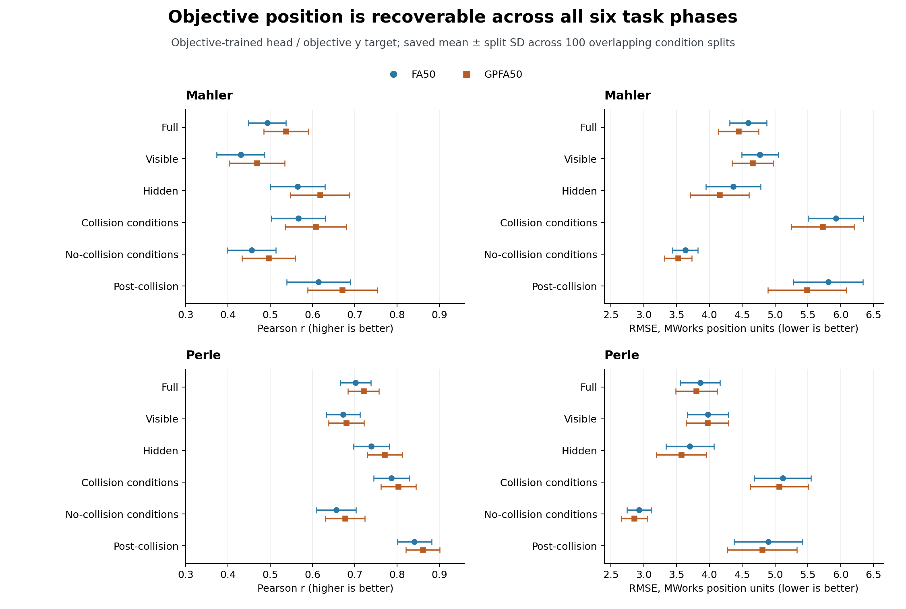
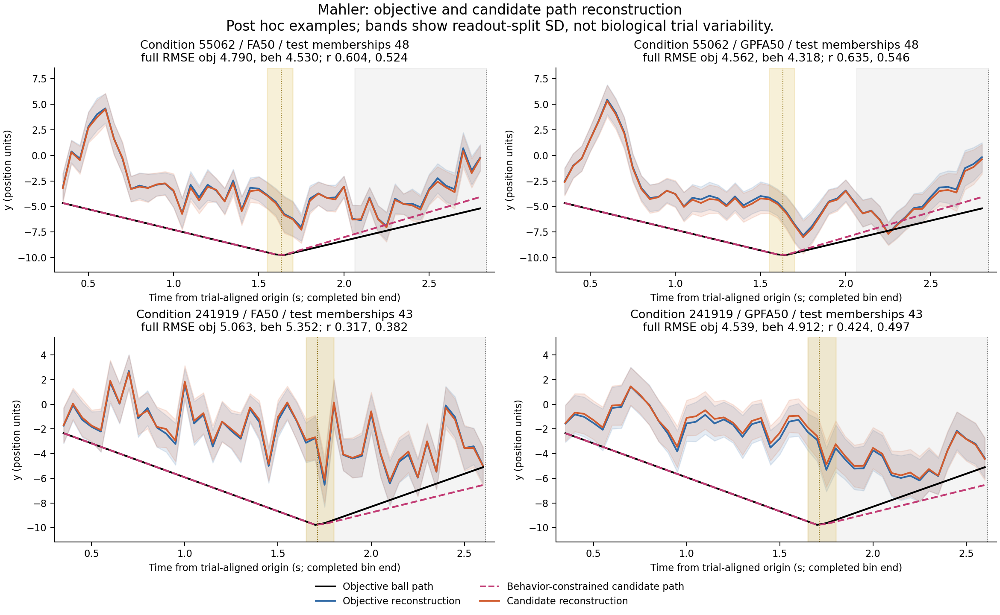
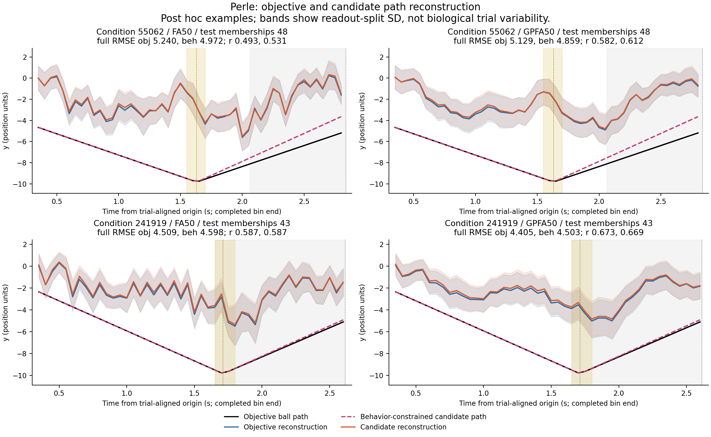
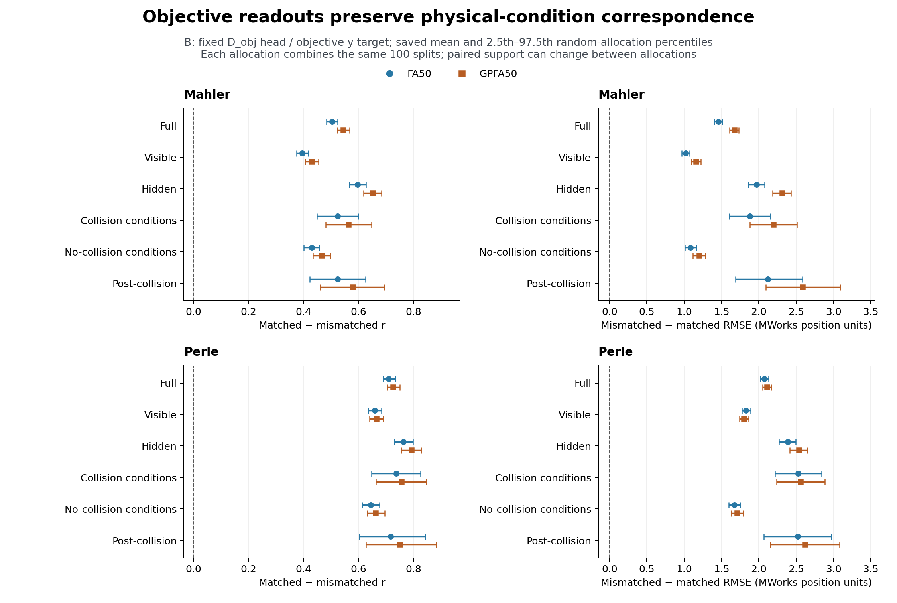

# Recovering Task-Motion Information: Results

**Condition-mean DMFC activity supports held-out-condition reconstruction of objective ball position, including during occlusion. Correct condition correspondence improves the scores, and the physical-geometry baseline gives lower full-interval squared error than every neural readout.** These findings establish task-position decodability within the recorded conditions and provide the reference for the behavioral-target comparison.

The retained `condition_endpoint_fa_gpfa_v1` and `closeout_v1` analyses have status `CLOSED_EXPLORATORY_WITH_LIMITATIONS`. Mahler and Perle are evaluated separately using **half1**, per-split training-side FA50/GPFA50 and 100 overlapping nominal 39/40 condition splits. The document reports the completed representation, readout and control analyses. Released-input filtering and fit provenance pass; the upstream preprocessing issue is recorded as `raw_preprocessing=fail`. [Setup](SETUP.md) defines the targets, support, scores and controls.

## 1. Objective-position reconstruction

### Vertical position across all six task phases

The same objective-trained OLS head is used in every phase. GPFA50 has higher correlation and lower RMSE than FA50 in every recorded animal/phase point estimate. This is a descriptive comparison of the fitted representations; paired uncertainty for the method difference remains unestimated. Temporal smoothing and derived coordinates differ between the representations.

*The objective path remains decodable in the hidden period. Points and bars show means ± population SD across 100 overlapping condition splits within each animal. Correlation measures covariation; RMSE retains amplitude and offset error in centered MWorks position units. High post-collision correlation therefore coexists with substantial error.*

Full-interval `y` correlation spans **0.4928–0.7204**, and hidden-period correlation **0.5644–0.7705**. The hidden-period result uses the same fitted mapping as the full interval. Shared time, condition identity and physical geometry remain possible contributors. Phase-specific RMSE measures absolute error on each phase's support and depends on the target variation in that phase.

| Phase | Unique conditions / bins | Mean test bins per split |
|---|---:|---:|
| Full | 78 / 3,369 | 1,701.15 |
| Visible | 78 / 1,931 | 976.32 |
| Hidden | 78 / 1,360 | 685.26 |
| Collision conditions | 26 / 1,207 | 600.99 |
| No-collision conditions | 52 / 2,162 | 1,100.16 |
| Post-collision | 26 / 631 | 318.60 |

The combined support counts each condition/bin once. Each split contains an average of **39.57 scored test conditions**, with all eligible bins from a condition held out together. The full interval also retains 78 mixed/boundary bins outside the separate visible and hidden masks. The [saved table](../evidence/closeout_v1/A/self_reconstruction_main_table.csv) retains all 24 objective-`y` means, SDs and supports.

Time-resolved examples: the same two post hoc conditions in both animals

*Each animal's sheet contains condition 55062 above and 241919 below, with FA50 and GPFA50 columns. The black objective target and blue prediction illustrate the present position-reconstruction question; the candidate curves are assessed in Goal 2. Both examples were selected post hoc. Bands show readout-split SD for these selected examples; aggregate scores describe performance across the full condition set.*

### Horizontal position is a shared task reference

Both targets share physical `x`, and their heads have equivalent horizontal predictions. These full-interval scores provide a shared task-position reference; vertical motion carries the objective-versus-candidate comparison.

| Animal | Representation | Full x r ± split SD | Full x RMSE ± split SD |
|---|---|---:|---:|
| Mahler | FA50 | 0.9274 ± 0.0054 | 1.3746 ± 0.0678 |
| Mahler | GPFA50 | 0.9338 ± 0.0067 | 1.3164 ± 0.0782 |
| Perle | FA50 | 0.9549 ± 0.0051 | 1.1012 ± 0.0808 |
| Perle | GPFA50 | 0.9564 ± 0.0051 | 1.0838 ± 0.0822 |

High `x` correlation partly reflects structured task progression. Phase-specific horizontal scores remain in the complete self-reconstruction table.

## 2. Does the readout preserve condition correspondence?

The **B fixed-head mismatch control** keeps the objective readout and predictions fixed while assigning another test condition's objective position at matching original timestamps. Each matched/mismatched pair uses the same valid rows. Positive effects favor the original correspondence.

*The correct physical-condition references give better objective-position scores. Points are saved means; bars are the saved 2.5th–97.5th percentiles across 1,000 allocation summaries, each combining the original 100 splits. These intervals summarize variation under the sampled condition-label allocations. Paired support can change between allocations.*

Both effects favor correct correspondence in all 1,000 allocation summaries for the reported full, hidden and post-collision comparisons in every animal/representation pair. This supports **condition-related objective-position correspondence**. The mismatch jointly changes physical initial conditions, branch geometry and time-position relationships. Isolating behavioral correspondence requires a comparison that holds task physics fixed.

Phase-time intersections shrink under remapping and can be empty for collision phases. Post-collision effect sizes describe the rows retained in each shared-support comparison. The [common-support record](../evidence/closeout_v1/B/B_coverage_summary.csv) retains this variation and zero-support cases. Changing support and possible fixed-point assignments prevent interpreting the empirical nonpositive fractions as exact fixed-support permutation p-values.

## 3. Does the neural readout improve on physical task geometry?

The geometry baseline uses each test condition's known physical anchor, horizontal position and time, plus the mean objective endpoint from training conditions. Its additional task information makes it a strong benchmark with unmatched inputs and capacity relative to neural-only OLS. Its full-interval objective `r` is **0.8434** and RMSE **2.7915** in all four cases.

| Animal | Representation | Neural skill ± split SD |
|---|---|---:|
| Mahler | FA50 | **−1.7543 ± 0.5302** |
| Mahler | GPFA50 | **−1.5883 ± 0.5400** |
| Perle | FA50 | **−0.9487 ± 0.4150** |
| Perle | GPFA50 | **−0.8923 ± 0.4176** |

Skill is `1 − SSE_neural / SSE_geometry`, scored per split and then averaged. **All four full-interval means are negative:** the geometry reference has lower squared error than the neural readout. The readout recovers condition-related position information, while the task-informed benchmark achieves lower error. This comparison measures the saved features and linear readout against the specified target and information set; recovering other neural information would require a separate analysis. Phase-specific baselines, skill and split SDs remain in the [C summary](../evidence/closeout_v1/C/random_endpoint_summary.csv).

## 4. Historical reproduction using the authors' factors

An earlier calculation reproduced OLS decoding from the authors' released FA50 factors, fitted across all conditions **before** readout cross-validation. That preprocessing and held-out definition differ from the current split-specific fits.

Historical decoding scores and numerical reproduction

| Historical author FA50 input | Interval | x r | y r | x RMSE | y RMSE |
|---|---|---:|---:|---:|---:|
| Mahler | Full | 0.9413 | 0.7002 | 1.2773 | 3.7422 |
| Mahler | Visible | 0.8163 | 0.6638 | 1.4694 | 3.9080 |
| Mahler | Occluded | 0.8393 | 0.7559 | 0.9348 | 3.4645 |
| Perle | Full | 0.9598 | 0.7872 | 1.0627 | 3.2452 |
| Perle | Visible | 0.8788 | 0.7606 | 1.2220 | 3.4050 |
| Perle | Occluded | 0.8885 | 0.8259 | 0.7769 | 2.9856 |
| Pooled author reference (`all`) | Full | 0.9664 | 0.8210 | 0.9726 | 3.0022 |
| Pooled author reference (`all`) | Visible | 0.8967 | 0.8033 | 1.1277 | 3.1168 |
| Pooled author reference (`all`) | Occluded | 0.9089 | 0.8491 | 0.6930 | 2.8024 |

This used released full means, 79 conditions and 3,502 eligible rows with 100 condition splits (seed 0). Current half1 results use split-specific representations and 3,369 conservative rows, so the historical/current comparison includes changes in preprocessing, representation and scoring support.

Maximum absolute saved-author prediction discrepancies were **1.9451 × 10⁻¹³** (Mahler), **1.6476 × 10⁻¹³** (Perle) and **7.2831 × 10⁻¹⁴** (pooled), with identical eligible-row and missingness handling. This verifies the decoding calculation using the authors' saved factors.

## 5. Interpretation and evidence

The results support **objective position reconstruction over time** from condition-mean activity, with the geometry baseline giving lower full-interval squared error. Physical geometry, elapsed time, condition identity and action preparation remain possible contributors. Local trajectory direction, prospective prediction and state updating require tests that distinguish those contributors.

The observations are processed condition means from two animals. Original neural–behavior trial matches, neuron-by-trial/half membership and unfilled responses remain unavailable. The prefix-only GPFA operates on globally imputed condition/time arrays, whose source audit retains `raw_preprocessing=fail`. Event-window neural-half reliability remains unmeasured for the final FA50/GPFA50 fits. The 100 overlapping partitions and 1,000 mismatches resample the existing animal datasets.

| Retained evidence | Content and filter |
|---|---|
| [Self-reconstruction table](../evidence/closeout_v1/A/self_reconstruction_main_table.csv) | `coordinate=y`: all six phases and 24 animal/representation rows; `coordinate=x, epoch=full`: horizontal check; all split SDs and supports |
| [B mismatch summary](../evidence/closeout_v1/B/B_summary.csv) | `head=D_obj, target=objective, coordinate=y`; `paired_r` and `paired_RMSE`, saved quantiles and nonpositive fractions |
| [B common-support record](../evidence/closeout_v1/B/B_coverage_summary.csv) | Changing support and zero-support cases |
| [Geometry and C-control summary](../evidence/closeout_v1/C/random_endpoint_summary.csv) | Objective `baseline_r`, `baseline_RMSE`, `skill`, split SD and phase support |
| [Historical Mahler](../evidence/historical/official_mahler_official_summary.json), [Perle](../evidence/historical/official_perle_official_summary.json) and [pooled](../evidence/historical/official_all_official_summary.json) | Source-faithful decoding and `author_result_check` |
| [Figure renderer](../../../code/mental_pong/make_result_figures.py) and [source hashes](../figures/documentation/results_source_manifest.json) | Saved-table plotting with objective-head filters and six-phase coverage checks |

The [behavior-relation results](../02_behavior_relation/RESULTS.md) assess the endpoint-constrained candidate with cross-scoring and randomized-endpoint refits. The scientific source is Rajalingham, Sohn and Jazayeri (2025), *Dynamic tracking of objects in the macaque dorsomedial frontal cortex* ([DOI](https://doi.org/10.1038/s41467-024-54688-y)); the [official protocol audit](../../../code/mental_pong/integration/official_protocol_audit.json) records implementation distinctions. The [code README](../../../code/mental_pong/README.md) describes the supported numerical reruns and their required inputs. The figures render summaries from the completed analysis.