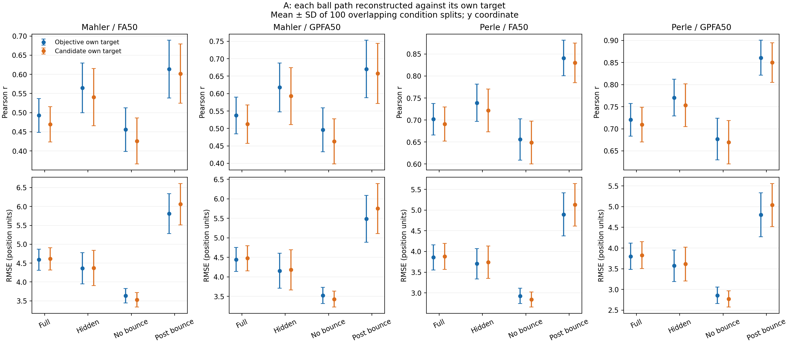
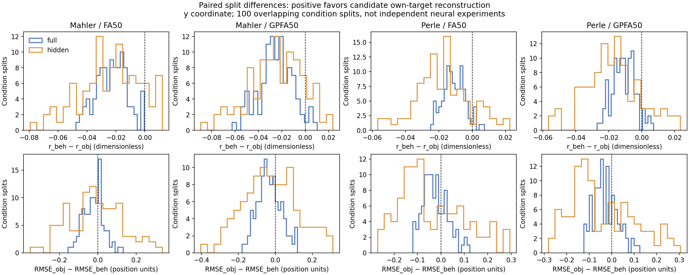
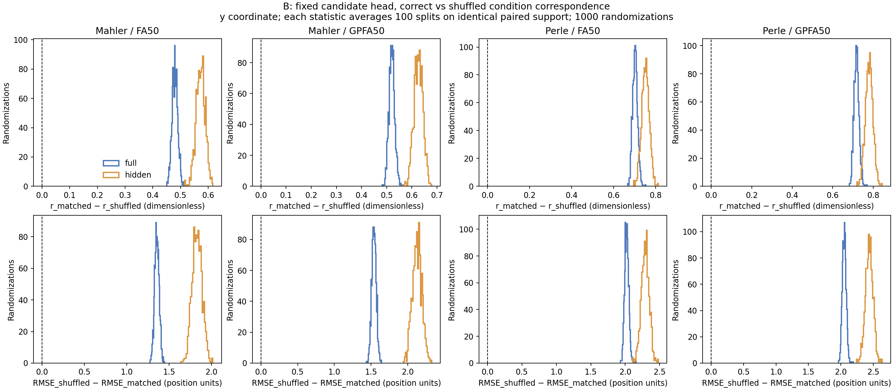
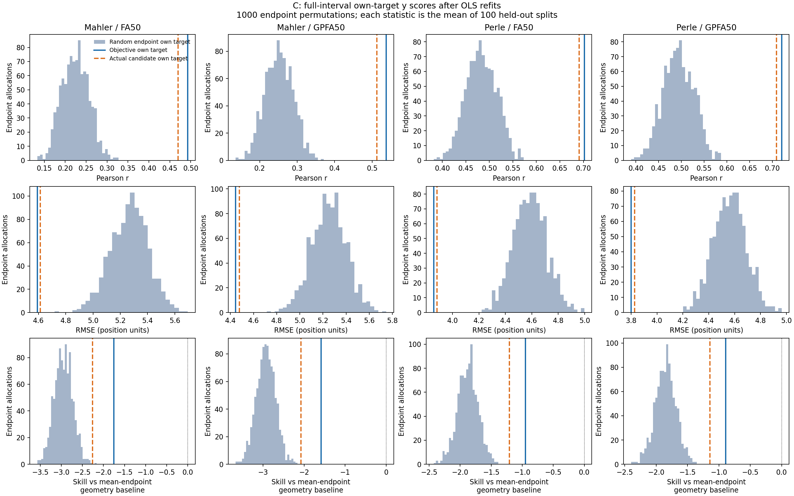
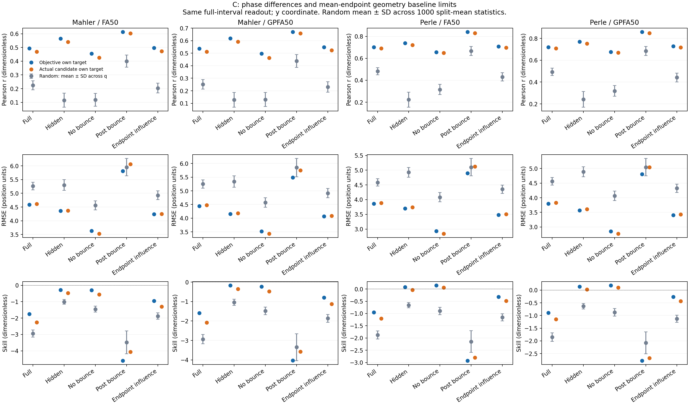
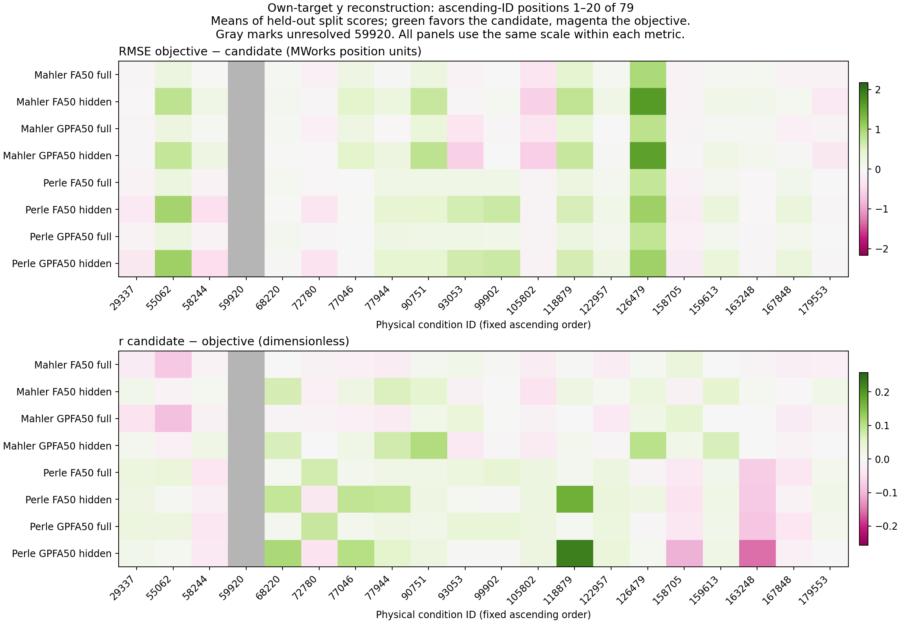
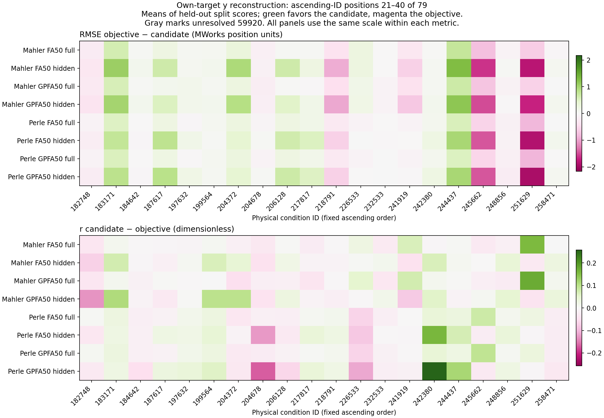
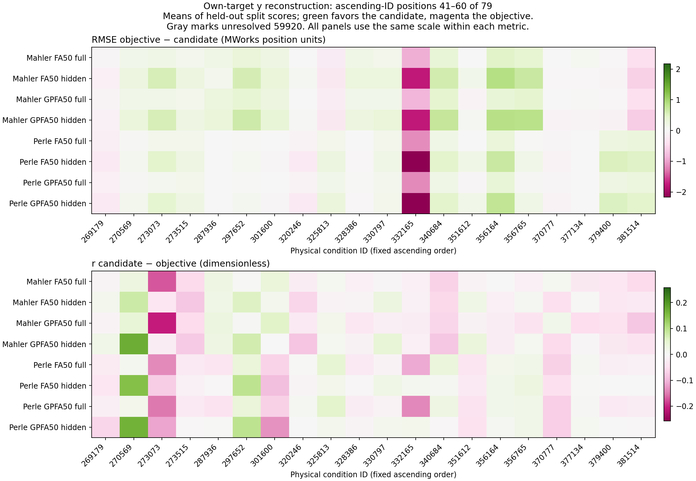
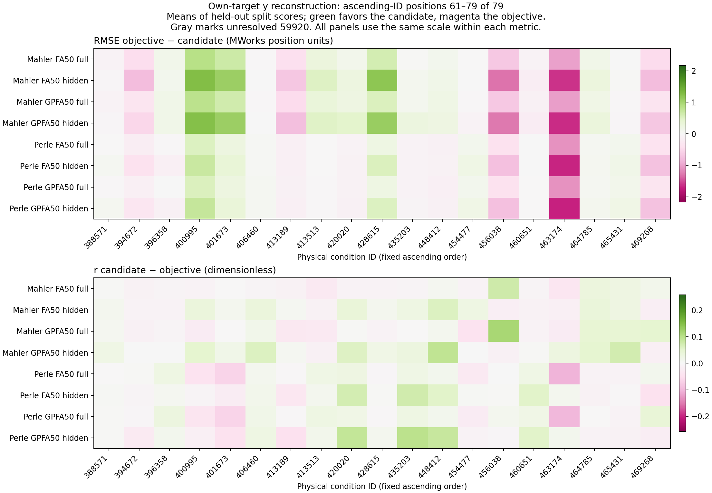

# Relating Neural Reconstructions to Behavior-Constrained Paths: Results

## 1. Main finding and evidence scope

**Objective ball trajectories have higher mean full-interval correlation and lower mean RMSE than the observed behavior-constrained candidates. Observed endpoint assignments support better reconstruction than the specified randomized assignments across several task periods.** The task-informed geometry baseline has lower full-interval squared error than the neural readouts of either target. These comparisons assess target reconstruction, condition-to-endpoint structure and accuracy relative to task geometry.

The completed analysis consists of **`condition_endpoint_fa_gpfa_v1` and `closeout_v1`**, with status `CLOSED_EXPLORATORY_WITH_LIMITATIONS`. It evaluates released **half1 condition-mean** dorsomedial frontal cortex (DMFC) activity from **Mahler** and **Perle**, separately fitted **FA50 / GPFA50** representations, and unregularized OLS task-position heads. All comparisons reuse **100 fixed, overlapping whole-condition splits** (nominally 39 training and 40 test identities) and the same physical-condition masks. Of 79 condition identities, **78 are scored** on **3,369 unique condition × time rows per animal**. Tests B and C each completed **1,000 random allocations** over these same splits. The unresolved upstream preprocessing issue is recorded as `raw_preprocessing=fail`.

The comparisons yield the following findings:

| Evidence | Recorded outcome | Interpretation |
|---|---|---|
| **A: objective vs. observed candidate** | In every animal/representation combination, full and hidden own-target comparisons favor the objective path in correlation and RMSE | The objective path is reconstructed more accurately under this whole-path readout protocol |
| **A: shared-target cross-scoring** | In all four full-interval combinations, the objective-trained head also scores better on the candidate reference than the candidate-trained head | The objective-trained head performs better even against the fixed candidate reference |
| **B: fixed-head condition mismatch** | Correctly matched candidate labels yield higher correlations and lower errors than condition-mismatched labels on paired support | The readout contains condition-linked task structure; this shuffle also breaks physical correspondence |
| **C: refitted random endpoints** | The observed endpoint assignment beats randomized assignments across full, hidden and endpoint-influence ranges in both r and RMSE | The observed condition-to-endpoint assignment supports stronger reconstruction under the preserved task geometry |
| **Geometry baseline** | All four full-interval neural skill means are negative | The task-informed comparator has lower full-path squared error than the neural readout |

The primary comparison concerns the **vertical y-coordinate** in centered MWorks display coordinates. Both targets share objective x and arrival time. Correlation r is dimensionless and RMSE is in display-position units. See the [analysis setup](SETUP.md) for the fixed target definition, masks and control protocols.

## 2. A — Reconstruction of the objective and behavior-constrained paths

### 2.1 Own-target comparisons across task phases

In A, **OO** denotes the objective-trained head scored against the objective trajectory, and **BB** the endpoint-candidate-trained head against its own constructed trajectory. The paired effects are `Delta r = r_BB − r_OO` and `Delta RMSE = RMSE_OO − RMSE_BB`; **positive** values favor the behavioral candidate. These differences were calculated from the saved full-precision split-level pairs. Each `± SD` summarizes the population SD across the **100 overlapping splits** within an animal/representation case.

*The same full-interval heads are scored in each phase. Bars show mean ± population SD across 100 overlapping splits. The candidate has lower correlation throughout these panels and lower RMSE in no-collision conditions, giving a metric-dependent ordering in that phase.*

Additional own-target scores: visible and collision conditions

| Animal | Representation | Task phase | r objective | r candidate | RMSE objective | RMSE candidate | Delta r ± split SD | Delta RMSE ± split SD |
| --- | --- | --- | --- | --- | --- | --- | --- | --- |
| mahler | FA50 | visible | 0.4299 | 0.4097 | 4.7691 | 4.7965 | -0.0203 ± 0.0092 | -0.0273 ± 0.0281 |
| mahler | FA50 | bounce | 0.5660 | 0.5528 | 5.9282 | 6.0919 | -0.0132 ± 0.0144 | -0.1637 ± 0.1156 |
| mahler | GPFA50 | visible | 0.4685 | 0.4466 | 4.6603 | 4.6940 | -0.0219 ± 0.0136 | -0.0337 ± 0.0466 |
| mahler | GPFA50 | bounce | 0.6076 | 0.5933 | 5.7253 | 5.8997 | -0.0143 ± 0.0196 | -0.1744 ± 0.1200 |
| perle | FA50 | visible | 0.6717 | 0.6664 | 3.9777 | 3.9918 | -0.0053 ± 0.0061 | -0.0141 ± 0.0217 |
| perle | FA50 | bounce | 0.7868 | 0.7776 | 5.1159 | 5.2585 | -0.0092 ± 0.0106 | -0.1426 ± 0.1061 |
| perle | GPFA50 | visible | 0.6796 | 0.6742 | 3.9696 | 3.9851 | -0.0055 ± 0.0064 | -0.0155 ± 0.0238 |
| perle | GPFA50 | bounce | 0.8030 | 0.7939 | 5.0658 | 5.2108 | -0.0091 ± 0.0110 | -0.1450 ± 0.1057 |

**Full and hidden own-target means favor the objective path on both scores in all four animal/representation combinations.** The no-collision phase combines lower candidate RMSE with lower correlation; after collision, candidate RMSE is higher in all four cases. The reconstruction ordering therefore depends on the task phase and metric.

*Positive differences favor the candidate. The distributions show paired effect sizes and their variation across the same 100 overlapping train/test splits. The mean summarizes the overall direction; the distribution shows the individual split outcomes.*

The unique phase supports are **full 78/3,369**, **visible 78/1,931**, **hidden 78/1,360**, **bounce 26/1,207**, **no_bounce 52/2,162** and **post_bounce 26/631** (conditions/rows). The full interval averages **39.57 scored test conditions and 1,701.15 bins per split**. The `full` support includes 78 mixed occlusion-boundary rows outside the `visible` and `hidden` masks.

### 2.2 The same predictions scored against both targets

Own-target OO versus BB combines a target change with a fitted-head change. Cross-scoring separates their contributions by comparing the trained heads against a fixed reference:

- **OO**: objective-trained head / objective target; **BO**: candidate-trained head / objective target.
- **OB**: objective-trained head / candidate target; **BB**: candidate-trained head / candidate target.

Each cell reports the mean **r / RMSE** over separately scored held-out splits.

| Animal | Representation | Task phase | OO r / RMSE | OB r / RMSE | BO r / RMSE | BB r / RMSE |
| --- | --- | --- | --- | --- | --- | --- |
| mahler | FA50 | full | 0.4928 / 4.5909 | 0.4807 / 4.5803 | 0.4817 / 4.6249 | 0.4696 / 4.6129 |
| mahler | FA50 | hidden | 0.5644 / 4.3630 | 0.5511 / 4.3401 | 0.5546 / 4.3965 | 0.5406 / 4.3735 |
| mahler | GPFA50 | full | 0.5374 / 4.4458 | 0.5250 / 4.4412 | 0.5248 / 4.4861 | 0.5126 / 4.4781 |
| mahler | GPFA50 | hidden | 0.6177 / 4.1563 | 0.6047 / 4.1406 | 0.6060 / 4.2003 | 0.5928 / 4.1806 |
| perle | FA50 | full | 0.7019 / 3.8586 | 0.6952 / 3.8612 | 0.6972 / 3.8829 | 0.6910 / 3.8829 |
| perle | FA50 | hidden | 0.7391 / 3.7038 | 0.7248 / 3.7222 | 0.7356 / 3.7287 | 0.7216 / 3.7421 |
| perle | GPFA50 | full | 0.7204 / 3.8005 | 0.7133 / 3.8047 | 0.7160 / 3.8249 | 0.7094 / 3.8265 |
| perle | GPFA50 | hidden | 0.7705 / 3.5718 | 0.7556 / 3.5955 | 0.7678 / 3.5946 | 0.7534 / 3.6130 |

For all four full-interval combinations, **OO improves on BO** on the same objective target and **OB improves on BB** on the same candidate target, on both measures. The objective-trained head therefore also performs better when both heads are judged against the candidate.

Cross-scoring shows that changing the target for a **fixed prediction** can increase r while worsening RMSE, or vice versa. Interpreting target preference therefore requires comparisons that hold the reference or trained head fixed. The heads share identical x labels, and agreement between their horizontal predictions confirms this part of the implementation.

## 3. B — Are readouts aligned to the correct physical condition?

Test B keeps the trained head and its predictions fixed while reassigning **candidate labels across test conditions** at the original timestamps. Matched and mismatched scores are recomputed on the **same common finite support for each mapping**. The effect orientation is matched-minus-mismatched r and mismatched-minus-matched RMSE; positive values favor the true condition correspondence.

For each animal, **1,000 random-control allocations** are summarized. Each q statistic averages the original **100 readout splits**; the bracketed 2.5th–97.5th percentiles summarize variation across these random allocations. `0.000` records 0/1,000 sampled q statistics with a nonpositive effect, at the resolution of the completed randomization.

*These distributions use the candidate-trained head and candidate reference. Full and hidden effects favor the original condition correspondence. Each allocation combines 100 overlapping splits; paired support is identical within each matched/mismatched comparison but can vary across allocations.*

Post-collision B effects and random-allocation quantiles

| Animal | Representation | Task phase | Paired r [q2.5%,q97.5%] | Paired RMSE [q2.5%,q97.5%] | Nonpositive fractions r / RMSE |
| --- | --- | --- | --- | --- | --- |
| mahler | FA50 | post_bounce | 0.5109 [0.4096, 0.6147] | 2.0348 [1.5982, 2.4783] | 0.000 / 0.000 |
| mahler | GPFA50 | post_bounce | 0.5641 [0.4476, 0.6825] | 2.4582 [1.9654, 2.9655] | 0.000 / 0.000 |
| perle | FA50 | post_bounce | 0.7177 [0.6017, 0.8420] | 2.5036 [2.0418, 2.9938] | 0.000 / 0.000 |
| perle | GPFA50 | post_bounce | 0.7516 [0.6300, 0.8795] | 2.5972 [2.1203, 3.0959] | 0.000 / 0.000 |

The true condition-to-candidate correspondence outperforms the prescribed mismatch across the listed phases and both readout representations. This supports **recoverable condition-associated task-position structure**. The permutation tests the combined physical-path, timing and behavioral-label correspondence; their separate contributions require targeted controls.

### Phase-dependent shared support

Valid phase-time masks vary across candidate conditions. Within each allocation, matched and mismatched scores use the *same intersection*; that intersection varies across allocations. The values below average the saved B allocation/split combinations, with zero-support cases retained in the coverage record.

| Animal | Task phase | Mean support fraction | Mean common bins | Zero-support q/splits |
| --- | --- | --- | --- | --- |
| mahler | full | 0.8668 | 1474.3057 | 0 |
| mahler | visible | 0.8463 | 826.3540 | 0 |
| mahler | hidden | 0.4733 | 324.2036 | 0 |
| mahler | bounce | 0.2914 | 179.7997 | 1249 |
| mahler | no_bounce | 0.5826 | 645.0828 | 0 |
| mahler | post_bounce | 0.1759 | 57.5533 | 1955 |
| perle | full | 0.8667 | 1474.1978 | 0 |
| perle | visible | 0.8462 | 826.2854 | 0 |
| perle | hidden | 0.4731 | 324.0607 | 0 |
| perle | bounce | 0.2911 | 179.5260 | 1229 |
| perle | no_bounce | 0.5822 | 644.6971 | 0 |
| perle | post_bounce | 0.1759 | 57.5711 | 1894 |

Post-collision mismatch retains **about 17.6%** of candidate support on average. There are **1,955 Mahler** and **1,894 Perle** zero-support q/split combinations in that phase (out of 100,000 per animal), and collision-condition support can also vanish. The post-collision B effects describe **the surviving matched support**, whose coverage varies across allocations and physical conditions. With changing support and possible fixed-point assignments, the empirical fractions are not exact fixed-support permutation p-values.

## 4. C — Does the observed endpoint assignment support better reconstruction?

Test C keeps each destination condition's physical anchor, objective x, arrival time and valid masks fixed. It changes only **which observed mean endpoint is assigned to which condition**, constructs a new affine candidate and **refits OLS to that new candidate**. The 1,000 global endpoint allocations per animal are applied consistently across the 100 splits and both FA/GPFA representations. This reference tests endpoint assignment while retaining the destination condition's physical geometry and timing.

For each phase, `Actual` is the original candidate's own-target reconstruction (BB); the random mean and 2.5th–97.5th percentiles summarize 1,000 **split-averaged scores from refitted endpoint assignments**. A random assignment is at least as good when its r is **at least the actual r** or its RMSE is **at most the actual RMSE**. Tail fractions report the frequency of matching or exceeding the observed quality among the 1,000 sampled assignments.

*The actual candidate (orange) outperforms these randomized endpoints in full-interval correlation and RMSE, while both trained targets retain negative skill against physical geometry. Histograms show 1,000 endpoint-allocation statistics, each averaging 100 held-out split scores from the same datasets.*

Visible and collision-condition C results, including the weaker RMSE tails

| Animal | Representation | Task phase | Actual r | Random r [q2.5%,q97.5%] | Actual RMSE | Random RMSE [q2.5%,q97.5%] | Fraction of random assignments at least as good: r / RMSE |
| --- | --- | --- | --- | --- | --- | --- | --- |
| mahler | FA50 | visible | 0.4097 | 0.2931 [0.2430, 0.3421] | 4.7965 | 5.2521 [5.0346, 5.4543] | 0.000 / 0.000 |
| mahler | FA50 | bounce | 0.5528 | 0.3577 [0.2855, 0.4257] | 6.0919 | 6.3029 [5.9777, 6.6684] | 0.000 / 0.116 |
| mahler | GPFA50 | visible | 0.4466 | 0.3284 [0.2718, 0.3852] | 4.6940 | 5.1983 [4.9618, 5.4331] | 0.000 / 0.000 |
| mahler | GPFA50 | bounce | 0.5933 | 0.3884 [0.3096, 0.4656] | 5.8997 | 6.2386 [5.8743, 6.6386] | 0.000 / 0.036 |
| perle | FA50 | visible | 0.6664 | 0.6076 [0.5622, 0.6467] | 3.9918 | 4.3313 [4.1109, 4.5550] | 0.001 / 0.000 |
| perle | FA50 | bounce | 0.7776 | 0.6632 [0.6043, 0.7150] | 5.2585 | 5.3351 [4.9994, 5.6841] | 0.000 / 0.330 |
| perle | GPFA50 | visible | 0.6742 | 0.6130 [0.5669, 0.6530] | 3.9851 | 4.3241 [4.0969, 4.5465] | 0.000 / 0.000 |
| perle | GPFA50 | bounce | 0.7939 | 0.6768 [0.6172, 0.7291] | 5.2108 | 5.3040 [4.9696, 5.6551] | 0.000 / 0.300 |

The candidate beats the randomized endpoint assignments on **both r and RMSE in full, hidden and endpoint-influence ranges** for all four animal/representation pairs. The recorded condition-to-endpoint relation thus carries structure relative to the randomization reference, alongside A's stronger objective-path reconstruction.

Post-collision comparisons show different outcomes for correlation and RMSE. The empirical fractions of randomized allocations with error at least as good as the actual candidate are **0.643, 0.406, 0.534 and 0.489**, respectively for Mahler FA50, Mahler GPFA50, Perle FA50 and Perle GPFA50. In that phase, observed r exceeds the sampled randomized values, while randomized RMSE is frequently as good as or better than the observed candidate's RMSE. The `bounce` RMSE tails (**0.116, 0.036, 0.330 and 0.300**) also show less decisive evidence than the corresponding r tails. Randomized endpoints retain physical-trajectory and elapsed-time structure, allowing positive reconstruction correlations.

*Gray points and bars show the random-allocation mean ± SD across 1,000 split-mean statistics; the tables report the separate 2.5th–97.5th percentile ranges. Blue and orange points are objective and actual-candidate means. Randomized candidates often match or improve on post-collision RMSE, while full-path neural skill remains negative. Visible and collision-condition results are retained in the table above.*

The saved C geometry audit checked **6,084 possible endpoint/condition pairings per animal** before applying the neural score. All geometrically valid candidates were retained independently of neural scores, with the same physical/time masks used for their controls. Three saved allocations provide bounded replay examples from the completed 1,000-allocation control.

## 5. Does the neural readout exceed a physical-geometry baseline?

The baseline derives position solely from the test condition's physical anchors, x/arrival timing and a **training-condition mean endpoint**. Its additional task information makes it an *unmatched-input* reference for the neural OLS head. The corresponding **neural skill** is `1 − SSE_neural / SSE_geometry`, evaluated **per split** and then averaged. Skill uses paired split-level squared-error totals; negative values indicate greater neural-readout error on the same target and support.

| Animal | Representation | Task phase | Candidate baseline r | Candidate baseline RMSE | Objective neural skill | Candidate neural skill ± split SD |
| --- | --- | --- | --- | --- | --- | --- |
| mahler | FA50 | full | 0.8653 | 2.5739 | -1.7543 | -2.2594 ± 0.5866 |
| mahler | GPFA50 | full | 0.8653 | 2.5739 | -1.5883 | -2.0766 ± 0.6001 |
| perle | FA50 | full | 0.8602 | 2.6391 | -0.9487 | -1.2057 ± 0.4717 |
| perle | GPFA50 | full | 0.8602 | 2.6391 | -0.8923 | -1.1445 ± 0.4763 |

Additional geometry-baseline results: visible and collision conditions

| Animal | Representation | Task phase | Candidate baseline r | Candidate baseline RMSE | Objective neural skill | Candidate neural skill ± split SD |
| --- | --- | --- | --- | --- | --- | --- |
| mahler | FA50 | visible | 0.9613 | 1.4233 | -8.0782 | -10.6916 ± 2.7368 |
| mahler | FA50 | bounce | 0.9627 | 1.9779 | -9.9410 | -8.6035 ± 1.5262 |
| mahler | GPFA50 | visible | 0.9613 | 1.4233 | -7.6793 | -10.2110 ± 2.7296 |
| mahler | GPFA50 | bounce | 0.9627 | 1.9779 | -9.2290 | -8.0157 ± 1.5728 |
| perle | FA50 | visible | 0.9581 | 1.4857 | -5.3408 | -6.4726 ± 2.0106 |
| perle | FA50 | bounce | 0.9647 | 1.9233 | -7.0926 | -6.5557 ± 1.2007 |
| perle | GPFA50 | visible | 0.9581 | 1.4857 | -5.3182 | -6.4526 ± 2.0396 |
| perle | GPFA50 | bounce | 0.9647 | 1.9233 | -6.9354 | -6.4209 ± 1.2103 |

**Every full-interval candidate and objective neural skill mean is negative.** The geometry-rich reference gives lower whole-path squared error, alongside the condition-to-endpoint structure detected by randomization. The phase figure shows where this ordering varies within the task.

This comparison concerns the *saved features, linear readout, target and baseline information set*. The result concerns this readout; a physically informed neural model could be examined as a separate extension. Three small **positive candidate** phase means remain in Perle: **FA50 `no_bounce` +0.0623**, **GPFA50 `hidden` +0.0288**, and **GPFA50 `no_bounce` +0.1065**. Their split SDs are **0.1720, 0.2481 and 0.1777**, respectively; these phase-level means coexist with negative full-path skill.

## 6. Why the metrics differ, and what averaging changes

### Output amplitude and bias

Pearson correlation measures co-variation and is insensitive to a positive linear rescaling of a prediction. RMSE responds to amplitude and offset errors. The saved full-interval diagnostics compare the observed objective/candidate target SD, prediction SD, mean bias (`prediction − target`) and prediction/target amplitude ratio.

*Both animal sheets contain condition 55062 on the top row and 241919 below, with FA50 and GPFA50 columns. The targets and predictions are displayed on actual task time. These examples were selected **post hoc**, and their bands show readout-split SD. They illustrate shape and amplitude differences in the selected conditions; aggregate scores summarize performance across conditions.*

The full-interval prediction/target amplitude ratios are **0.52–0.61** in the [saved C diagnostics](../evidence/closeout_v1/C/random_endpoint_summary.csv). Correlation can remain appreciable despite that compressed output range. Near-zero pooled bias can coexist with errors that cancel across conditions or time. Correlation, RMSE and amplitude diagnostics therefore describe complementary aspects of reconstruction.

### How the earlier trial-label version changed targets and weighting

An earlier readout version repeated each condition's **same neural mean** against different behavioral trial labels. That procedure changed both the target variation and the effective weighting of condition/time rows by the number of behavioral records. The current version uses the **fixed condition-mean endpoint candidate** with one neural row per condition/time, weighted equally across retained rows. The underlying saved neural representation is unchanged.

| Animal | Representation | Old trial-label r objective / candidate | Current mean r objective / candidate | Old RMSE objective / candidate | Current RMSE objective / candidate |
| --- | --- | --- | --- | --- | --- |
| mahler | FA50 | 0.4834 / 0.4544 | 0.4928 / 0.4696 | 4.6536 / 4.7663 | 4.5909 / 4.6129 |
| mahler | GPFA50 | 0.5276 / 0.4964 | 0.5374 / 0.5126 | 4.5077 / 4.6327 | 4.4458 / 4.4781 |
| perle | FA50 | 0.7000 / 0.6831 | 0.7019 / 0.6910 | 3.9135 / 4.0008 | 3.8586 / 3.8829 |
| perle | GPFA50 | 0.7190 / 0.7015 | 0.7204 / 0.7094 | 3.8544 / 3.9449 | 3.8005 / 3.8265 |

The current point scores can improve under changed scoring targets and condition weights, even as the detailed behavioral question becomes **less identifiable**. The score difference combines changes in labels and condition weighting while using the same neural representation, so neural information loss remains unmeasured. Each behavioral record in the earlier version was paired with the same neural condition mean; the original trial-level neural responses remain unavailable.

*Points below the identity line show how opposite signed behavioral errors partly cancel in a condition average. Both error signs occur in 77/78 valid Mahler conditions and 78/78 Perle conditions. This is a description of behavioral records; original neural trial membership is unavailable.*

The condition-equal mean absolute individual error versus absolute condition-mean error is **1.7272 versus 0.9784** for Mahler and **1.3388 versus 0.7908** for Perle. Full-path candidate/objective RMS separations are **0.6760** and **0.5612**. Path separation pools bins, whereas readout RMSE averages split scores. Their magnitudes describe target separation and reconstruction error; statistical power and neural information loss require separate assessments.

## 7. Figures and reproducible evidence

All 79 conditions: outcome heterogeneity and unresolved condition 59920

*Each metric has a common scale across pages. Green favors the candidate; magenta favors the objective. Gray preserves unresolved condition 59920. These descriptive means summarize held-out split scores; per-condition significance remains untested. The complete four-curve atlases are stored as external artifacts.*

The saved evidence files retain full metric fields, split dispersions and all conditions:

- **A:** [own-target table](../evidence/closeout_v1/A/self_reconstruction_main_table.csv) (`coordinate=y`), [2×2 head/reference table](../evidence/closeout_v1/A/cross_2x2_summary.csv) (`epoch=full|hidden`), [shared-target contrasts](../evidence/closeout_v1/A/contrast_summary.csv), and [condition](../evidence/closeout_v1/A/condition_self_comparison.csv)/[binwise](../evidence/closeout_v1/A/binwise_reconstruction.csv) scores.
- **B:** [paired mismatch summary](../evidence/closeout_v1/B/B_summary.csv) (`head=D_beh,target=behavior,coordinate=y`), and [coverage](../evidence/closeout_v1/B/B_coverage_summary.csv) with zero-support counts.
- **C and baseline:** [random-endpoint summary](../evidence/closeout_v1/C/random_endpoint_summary.csv), [geometry audit](../evidence/closeout_v1/C/geometry_feasibility.json), and saved [completion record](../evidence/closeout_v1/C/completed.json).
- **Averaging and checks:** [prior-version comparison](../evidence/closeout_v1/A/previous_trial_version_comparison.csv), [cancellation summary](../evidence/closeout_v1/descriptive/mean_cancellation_summary.json), and [numerical replay audit](../evidence/closeout_v1/A/replay_audit.json). The audit records reapplication of the saved OLS heads to existing features, with numerical differences of approximately `1.1e-14`.

[Goal 1](../01_task_motion/RESULTS.md) retains the objective-only reference and original-author FA decoding check. The [execution README](../../../code/mental_pong/README.md) describes saved-head and mini replays using project-local artifacts, which remain outside the public repository.

## 8. Interpretation and next evidence

The completed analysis supports **condition-level recoverability of task position and structured correspondence to the real condition-mean endpoint assignment**. Objective paths have better full-interval reconstruction, and the geometry baseline has lower squared error than the neural readouts. **Candidate reconstruction relative to randomized assignments, the objective path and task geometry answers three separate questions.** Across broad phases the candidate outperforms randomized assignments; over the full interval, objective reconstruction is better and neural skill relative to geometry is negative.

The most important alternative explanations are common physical geometry, target difficulty and variance, elapsed time, possible endpoint-goal or motor-related activity, and shared neural preprocessing structure. The affine candidate inherits much of the objective trajectory. Identifying behavior-specific internal simulation requires evidence beyond this shared structure. The pre-feedback status of the terminal paddle label is unresolved. Training-side fitting and GPFA prefix inference use the released arrays, which retain the unresolved global-condition/time imputation issue (`raw_preprocessing=fail`).

The decisive missing observation is the original **neural–behavior trial match**: comparing trials from the *same animal and physical condition* with different endpoint errors requires their corresponding neural states. Cancellation of signed **behavioral** errors is documented; whether averaging also reduced **neural** effects remains unmeasured. The negative result weakens this *particular mean-endpoint path plus linear-readout hypothesis*. Internal object simulation and other behavior-sensitive states remain broader possibilities. [Next Steps](../NEXT_STEPS.md) specifies the required paired observations and a proposed comparison designed to distinguish these explanations.

The scientific status remains `CLOSED_EXPLORATORY_WITH_LIMITATIONS` for these completed results. The study includes two animals and 100 highly overlapping partitions of the same physical conditions; animal-population uncertainty remains unestimated. Numerical values and figures report the completed analyses from the retained result records.
