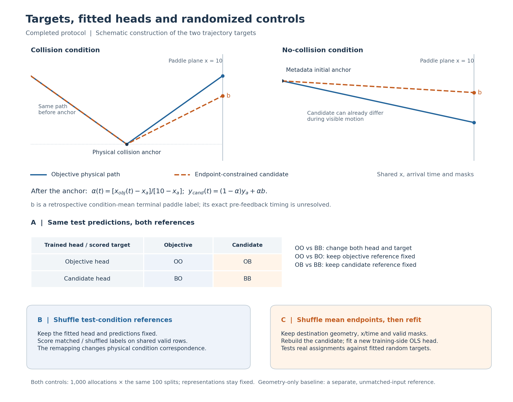

# Relating Neural Reconstructions to Behavior-Constrained Paths: Setup

## 1. Question and study design

**Do linear readouts of condition-averaged DMFC activity reconstruct the mean-endpoint behavior-constrained path more accurately than the objective ball path?** The controls assess condition correspondence, sensitivity to endpoint reassignment, and accuracy relative to known task geometry.

The analysis uses the same neural features to train two linear readouts: **`D_obj`**, whose target is the physical ball trajectory, and **`D_beh`**, whose target is a trajectory constructed from the *mean terminal paddle position* of the corresponding physical condition. The second path makes the behavioral hypothesis explicit as a reconstruction target. The path is constructed retrospectively from the recorded endpoint, and the analysis evaluates reconstruction of its time course. An internal-estimate or future-endpoint interpretation would require additional observations of the relevant neural state and timing.

The tests answer distinct questions:

| Test | Comparison | Question addressed |
|---|---|---|
| **A — Own-target and cross-scoring** | Objective and candidate heads fitted from identical neural features, then evaluated against both targets | How reconstruction varies with the target and trained head, including comparisons against a fixed reference |
| **B — Fixed-head condition mismatch** | Keep fitted predictions fixed and reassign test-condition labels | Whether neural predictions retain the correct condition-to-position correspondence on paired valid support |
| **C — Random endpoints with refitting** | Reassign recorded condition-mean endpoints, rebuild physically constrained candidates, and fit a new readout for each assignment | Whether the observed endpoint assignment supports better reconstruction than the specified randomized assignments |
| **Geometry baseline** | Predict position from physical anchors, timing and a training-condition mean endpoint alone | Whether this neural readout improves on a strong, explicitly task-informed reference |

The comparisons assess candidate reconstruction, condition correspondence, endpoint-assignment structure and added accuracy over geometry. Convergent evidence beyond shared physical structure would support a candidate-specific neural interpretation. The results characterize this candidate and readout. Internal computation and other behavioral representations would require targeted follow-up tests. [Goal 1](../01_task_motion/RESULTS.md) establishes objective-position decodability; [Goal 2 results](RESULTS.md) present the target and control comparisons.

## 2. Observations and the two trajectory targets

### Available neural and behavioral data

Both animals are analyzed separately: **Mahler** (518 aligned neurons) and **Perle** (2,058). The neural data are published *condition-mean DMFC pseudopopulations*: **79 physical conditions × 100 bins of 50 ms**, assembled across recording sessions. For every one of the 100 fixed splits, FA50 or prefix-inferred GPFA50 provides 50 neural features per condition and time. The final OLS comparison uses **released half1**. Half2 latents are retained as separate representation records.

Terminal-paddle records are selected using the saved occlusion-category, completion, finite-endpoint, geometry-support and `ignore=0` criteria. These yield **7,407 Mahler records from six source sessions** and **84,873 Perle records from 58 source sessions**. Records are pooled by physical condition, with each retained record weighted equally. Each mean uses the same retained records at every time point; trial correctness and endpoint sign are not selection criteria. These behavioral means are linked to neural condition means; individual neural–behavior trial pairing is unavailable.

Both targets share the same valid support: **78 conditions, 3,369 condition × time rows per animal**. Physical condition `59920` remains in the nominal 79-condition split file, with its labels unscored because collision/terminal geometry is unresolved.

| Evaluation range | Conditions | Unique condition × time rows | Meaning |
|---|---:|---:|---|
| `full` | 78 | 3,369 | Conservative active interval, including 78 mixed occlusion-boundary bins |
| `visible` | 78 | 1,931 | Eligible visible periods |
| `hidden` | 78 | 1,360 | Eligible occluded periods |
| `bounce` | 26 | 1,207 | Conditions containing a physical collision |
| `no_bounce` | 52 | 2,162 | Conditions without a physical collision |
| `post_bounce` | 26 | 631 | Post-collision periods |
| `endpoint_influence` | As retained by the saved mask | 2,793 | Additional C-control period in which the endpoint assignment can affect the candidate |

The `full` mask includes the visible and hidden rows plus 78 mixed boundary bins. Collision/no-collision labels classify physical conditions, while visible/hidden masks classify time periods. The same finite, feedback-conservative masks are applied to both targets. See [Models and Data](../MODELS_AND_DATA.md) for source array definitions, released neural preprocessing and physical-event provenance.

### How the candidate path is constructed



*The sketches show how the affine candidate is constructed from task geometry and endpoints. B keeps the fitted head fixed; C refits it after changing endpoint assignments. The geometry baseline supplies a separate task-informed accuracy reference.*

Let \(b_c\) denote the retained **mean terminal paddle y-coordinate** for condition \(c\). The objective trajectory \((x_{\mathrm{obj},c}(t),y_{\mathrm{obj},c}(t))\) is determined from the released physical motion and conservative event geometry. The candidate retains **objective x, arrival time, and valid masks**, with y defined by the endpoint-constrained linear path.

The collision anchor starts the candidate's deviation from the objective path; no-collision conditions use the metadata initial anchor. The candidate can therefore differ during **visible motion**, which distinguishes this construction from the historical hidden-only and successive-update proxies.

At or after the relevant anchor, with \((x_{a,c},y_{a,c})\) fixed by the task geometry,

\[
\alpha_c(t)=\frac{x_{\mathrm{obj},c}(t)-x_{a,c}}{10-x_{a,c}},
\qquad
 y_{\mathrm{beh},c}(t)=[1-\alpha_c(t)]y_{a,c}+\alpha_c(t)b_c,
 \qquad x_{\mathrm{beh},c}(t)=x_{\mathrm{obj},c}(t).
\]

The path follows the fixed physical geometry and endpoint interpolation. Its definition is independent of neural scores and keeps the original collision branch, timing and speed, with a fixed endpoint throughout. It is affine in the endpoint: averaging the valid per-record constructed paths yields the same path as applying the construction to their mean endpoint, up to floating-point precision. **All 78 × 78 = 6,084 physical-condition/endpoint combinations per animal** were checked for finite geometry. Exact single-trial collision times and strictly pre-feedback timestamps for terminal paddle position are unavailable. The terminal label therefore serves as a retrospective reconstruction target; prospective belief remains an interpretation for a separate test.

## 3. Fixed representations, readouts and data separation

The final analysis is **`condition_endpoint_fa_gpfa_v1`**, followed by **`closeout_v1`**; the completion status is `CLOSED_EXPLORATORY_WITH_LIMITATIONS`. FA50 and GPFA50 were fitted separately for each animal and each fixed condition split, using only **half1 training-condition neural responses**. GPFA50 infers each saved posterior state from the prefix of completed *released* neural bins available at that time. The same source latents and preprocessing were reused in the earlier trial-label version, which differs downstream in targets and row weighting.

The 100 saved whole-condition partitions use:

```python
GroupShuffleSplit(n_splits=100, train_size=0.5, random_state=0)
# 39 nominal training and 40 nominal test physical identities
```

The original split identities are retained, giving 38/40 or 39/39 *contributing* conditions when the missing-geometry condition is left unscored. The same partition identities are used for both animals, both representations and both readout targets. Each training-side transform fixes neuron eligibility, mean, scale and 50 latent dimensions before test scoring. The representation is fixed before test scoring, and OLS uses fixed settings without a separate validation search. Individual neural–behavior trial pairing remains unavailable.

Within a split, construct an identical design matrix \(X\) of valid training condition × time rows, shape \([n_{\mathrm{train\ rows}},50]\), and fit two separate unregularized ordinary least-squares maps, each with an intercept:

\[
\widehat{\mathbf y}_{\mathrm{obj}}=D_{\mathrm{obj}}(\mathbf z),\qquad
\widehat{\mathbf y}_{\mathrm{beh}}=D_{\mathrm{beh}}(\mathbf z).
\]

Each coordinate has **50 slopes + one intercept** (102 fitted coefficients for a complete xy head). The float64 implementation is `sklearn.linear_model.LinearRegression(fit_intercept=True, positive=False)`. It uses the saved latent vector directly in an unregularized, unweighted OLS fit, without extra feature normalization, behavior or time covariates, or additional temporal history. All valid training times share the same linear head; longer conditions contribute more rows. Store predictions **only for held-out conditions** and reuse those predictions for every phase analysis. The targets have identical x coordinates, so agreement between their x labels and predicted x values provides an implementation check.

Each GPFA state uses the available prefix of the **provided, already processed array**. Those inputs retain the earlier filling of missing whole-condition responses using global condition/time information. Consequently `provided_input_filtering=pass` and `fit_provenance=pass` coexist with the retained **`raw_preprocessing=fail`**. Model choices and data provenance are recorded in [Models and Data](../MODELS_AND_DATA.md).

## 4. Evaluation procedure: A, B and C

### A. Own-target reconstruction and two-by-two comparison

The illustrated 2×2 matrix scores each frozen prediction against both references on the **same valid test rows**. **OO versus BB** changes both the fitted head and target, so target variance, time structure and difficulty can affect the result. **OO versus BO** and **OB versus BB** hold the respective reference fixed. These comparisons evaluate condition-mean position reconstruction.

The primary outcome is the **vertical coordinate y**, because both targets have identical x. All six phase scores use the same fixed full-interval heads. The full-interval `bias`, target/prediction SD and amplitude ratio add calibration information that correlation alone omits.

### B. Fixed-head condition mismatch

At the original timestamps, **permute candidate labels across eligible test conditions** while preserving the fitted predictions. Matched and mismatched scores use the **same intersection** of valid masks within an allocation; intersection sizes can differ across allocations, especially after collisions.

The control uses **1,000 allocations** per animal across the same **100 saved splits**, generated with `numpy.random.Generator(PCG64)` and seeds **314159 (Mahler)** and **314160 (Perle)**. Allocation `q` is the outer loop, and each allocation is used without retries. Fixed points in a permutation are allowed. The readout weights, neural inputs and predictions remain unchanged. The resulting effect is **matched minus mismatched correlation** or **mismatched minus matched RMSE**: positive means correct correspondence is better. This tests *condition-related correspondence* by changing physical and behavioral label relationships together.

### C. Randomized endpoints with a newly fitted readout

**Permute the 78 observed mean endpoints among physical conditions**, preserving each destination's anchors, x, arrival time and masks. Rebuild its affine candidate, **refit OLS on the 39 nominal training identities**, and score the 40 nominal held-out identities. Refitting evaluates how well the same readout procedure learns each changed target.

Use **1,000 global allocations** with Mahler seed **271828** and Perle seed **271829** (`PCG64`). A given animal's allocation is reused for all 100 splits and both FA/GPFA representations. The original candidate is compared with **random-target alternatives learned by the same readout procedure**. The batched unweighted float64 OLS implementation was checked against the original scikit-learn fits. Saved allocations `q=0,1,2` support limited replay, while the completed statistical control includes all 1,000. Random targets can still have positive correlation because they preserve physical geometry and time.

### Task-geometry baseline

For each test condition, construct a trajectory from **its known physical anchors, x/time and the mean endpoint among valid training conditions**. This geometry-only prediction provides the denominator for skill against the corresponding neural head's target; it is recalculated under randomized endpoint assignments when required. The baseline receives additional physical variables, making it a strong descriptive reference with **unmatched architecture and inputs**.

## 5. Metrics and meaning of uncertainty

For each animal, representation, held-out split and phase, pool the eligible **condition × time** rows, then compute Pearson correlation and root mean square error (RMSE) for y:

\[
 r=\operatorname{corr}(\widehat y,y),\qquad
 \operatorname{RMSE}=\sqrt{\operatorname{mean}[(\widehat y-y)^2]}.
\]

For A, report the paired differences using saved full-precision split scores:

\[
 \Delta r=r_{\mathrm{BB}}-r_{\mathrm{OO}},\qquad
 \Delta\operatorname{RMSE}=\operatorname{RMSE}_{\mathrm{OO}}-\operatorname{RMSE}_{\mathrm{BB}}.
\]

**Positive A differences favor the candidate.** The mean and population SD (`ddof=0`) summarize **100 overlapping condition splits**: 100 resamplings of the same animal datasets. For A, average the full-precision paired differences before rounding; the displayed four-decimal means may give a different final digit when subtracted.

For B, each of 1,000 allocations produces an effect statistic **already averaged across the 100 fixed splits**. Report its 2.5th–97.5th percentile range, the mean effect, coverage and the empirical fraction of nonpositive effects. The reported ranges are *randomization-reference quantiles* under allocation-specific support, rather than animal-level confidence intervals or exact fixed-support permutation p-values.

For C, each of 1,000 assignments similarly gives a split-averaged score. The correlation tail is the fraction with random `r` **greater than or equal to** the actual candidate's `r`; the error tail is the fraction with random RMSE **less than or equal to** the actual candidate's RMSE. A saved `0/1000` outcome means that no sampled assignment met the comparison criterion at this finite Monte Carlo resolution.

The geometry comparator uses

\[
 \operatorname{skill}=1-\frac{\operatorname{SSE}_{\mathrm{neural}}}{\operatorname{SSE}_{\mathrm{geometry}}},
\]

computed **within each split** before averaging; a zero baseline denominator remains undefined (`NA`). A negative value means the neural readout has larger squared error on the matched target. The diagnostic **bias** is `mean(prediction − target)`, and **amplitude ratio** is `SD(prediction) / SD(target)`; they measure offset and compression that r can miss. Correlations with constant values or fewer than three points remain undefined.

These metrics quantify contemporaneous task-position reconstruction from condition means, with phase masks locating performance within the task. Local neural dynamics and internal simulation remain questions for tests of state transitions and competing computations.

## 6. Source code and evidence

The analysis depends on the recorded source functions and immutable split/control configurations:

- [Condition averaging](../../../code/mental_pong/trajectory_project/condition_endpoint_fa_gpfa_v1/condition_data.py) (`mean_payload`) and [physical/endpoint geometry](../../../code/mental_pong/trajectory_project/trial_endpoint_fa_gpfa_v1/trial_data.py) (`fit_condition_geometry`, `endpoint_candidates`): fixed mean labels and task branch construction.
- [Condition OLS](../../../code/mental_pong/trajectory_project/condition_endpoint_fa_gpfa_v1/decoding_condition.py) (`fit_condition_ols`, `score_rows`) and [analysis protocol](../../../code/mental_pong/trajectory_project/condition_endpoint_fa_gpfa_v1/configs/analysis_protocol.json): design rows, readout and holdout definition.
- [Closeout protocol](../../../code/mental_pong/trajectory_project/closeout_v1/configs/closeout_protocol.json), [B protocol](../../../code/mental_pong/trajectory_project/closeout_v1/configs/b_fixed_head_protocol.json), [C protocol](../../../code/mental_pong/trajectory_project/closeout_v1/configs/c_endpoint_protocol.json), [fixed-head null code](../../../code/mental_pong/trajectory_project/closeout_v1/null_condition.py) and [random-refit code](../../../code/mental_pong/trajectory_project/closeout_v1/null_endpoint.py): seeds, mapping and scoring implementation.
- [Model/data provenance](../MODELS_AND_DATA.md), [software and actual replay scope](../../../code/mental_pong/README.md), [Goal 1 physical reference](../01_task_motion/RESULTS.md), [Goal 2 numerical evidence](RESULTS.md) and [next observations](../NEXT_STEPS.md).

The endpoint candidate and B/C controls are **project-specific analyses** developed from the data and task framework of Rajalingham, Sohn and Jazayeri (2025, [DOI](https://doi.org/10.1038/s41467-024-54688-y)). The behavioral endpoint's exact pre-feedback timing, the original neural–behavior trial memberships, neural means before upstream global-condition/time filling, and single-trial collision/feedback records are unavailable. `raw_preprocessing=fail` is retained. The current conclusions concern condition-mean readouts. Within-condition behavioral-choice tests and raw-data temporal validation require the missing paired observations and preprocessing records.
