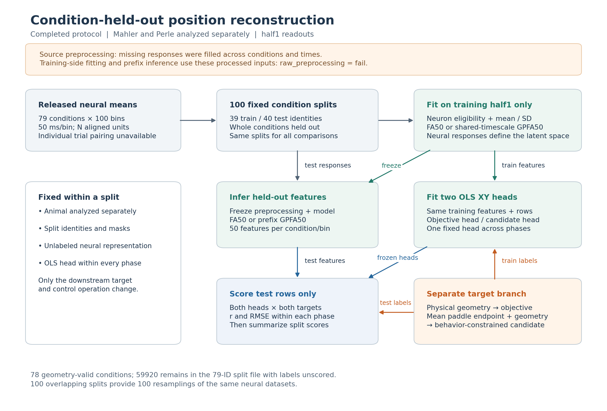

# Mental-Pong: Models and Data

This document describes the data, fitted representations, behavioral targets and saved artifacts used in the completed Mental-Pong analysis. The study asks whether linear readouts of dorsomedial frontal cortex (DMFC) activity recover ball position, and whether reconstruction is more accurate for the objective path or the behavior-constrained candidate. The procedures and findings are documented under [task motion](01_task_motion/SETUP.md) ([results](01_task_motion/RESULTS.md)) and [behavior relation](02_behavior_relation/SETUP.md) ([results](02_behavior_relation/RESULTS.md)).

The current analysis is `condition_endpoint_fa_gpfa_v1`, followed by `closeout_v1`. It uses condition-averaged macaque neural recordings, separately fitted 50-dimensional factor analysis (FA50) and Gaussian-process factor analysis (GPFA50), and linear position readouts evaluated on held-out conditions. Earlier GPFA64 experiments are documented separately as historical analyses.

## 1. Data source and observation level

The neural study is Rajalingham, Sohn and Jazayeri (2025), *Dynamic tracking of objects in the macaque dorsomedial frontal cortex*, *Nature Communications* 16, 346 ([DOI](https://doi.org/10.1038/s41467-024-54688-y)); its Fig. 3 and decoding methods provide the main experimental context. The separately published [Mental-Pong Zenodo v1 dataset](https://doi.org/10.5281/zenodo.13952210) is attributed to Rajalingham, Sohn and Jazayeri (2024). The recorded archive is `MentalPong.zip`, MD5 `382e420c6f053d8ac2bdd4acd2fb02b2`. The earlier behavioral/computational task paper by Rajalingham, Piccato and Jazayeri (2022) is a [different study](https://doi.org/10.1038/s41467-022-33581-6).

The analysis reads `mahler_hand_dmfc_dataset_50ms.pkl` and `perle_hand_dmfc_dataset_50ms.pkl`. The supplied neural responses are **processed means for each physical task condition**. Units from different recording sessions form a condition-aligned *pseudopopulation*; the release provides no individual neural–behavior trial matches. Mahler and Perle are analyzed as separate populations.

The analysis selects the `occ` (occlusion) task category. *Visible* and *hidden* identify periods within that task. The neural arrays contain **79 physical conditions and 100 time bins of 50 ms each**. The original values are mean spike counts per 1 ms sample averaged into the released 50 ms bins; multiplying the released count scale by 1,000 converts it numerically to spikes/s. FA/GPFA fitting uses values standardized within each training split.

## 2. Neural, behavioral and task data

| Recorded field or processed object | Dimensions or contents | Role in this study |
|---|---|---|
| `neural_responses_sh1.occ`, `neural_responses_sh2.occ` | Neuron × 79 conditions × 100 bins | Two released condition-mean neural halves; reordered by global neuron identity and transposed for analysis |
| `neural_idx_global.occ` | Stable neuron mapping | Aligns each half to the same population order: **518 units in Mahler, 2,058 in Perle** |
| `meta.py_meta_index` | 79 physical condition identifiers | Defines whole-condition train/test groups; used for grouping, not as a neural feature |
| `masks.occ.start_end_pad0`, `f_pad0` | Condition × time | Define usable task intervals and remove terminal support overlapping feedback |
| `trial_meta` | Behavioral session, synchronization, condition, paddle endpoint and quality fields | Supplies condition-specific endpoint records for the behavioral candidate |
| `valid_meta_sample_full.pkl` and retained physical-event audit | Initial ball state, timing and collision geometry | Defines physically constrained trajectories and collision anchors |
| Condition-label arrays | Objective XY and candidate XY: `[79,100,2]`; masks: `[79,100]` | Provides the two time-aligned position targets and the common scoring support |
| Saved FA50/GPFA50 latents | Each `[2,79,100,50]` per animal and split | Contains representations for both released halves; the **final OLS comparison uses half1** |

All 518 Mahler and 2,058 Perle aligned neurons satisfy the recorded per-split eligibility checks and are retained in the current fitted representations. The retained second-half latent documents representation provenance; behavioral readout results use the first half alone.

### Behavioral records and usable support

The behavioral pool is selected using `occ_alpha=1`, a finite completed terminal `paddle_y` and `ignore=0`. Duplicate records are removed only when animal, session and synchronization identifiers identify the same observation.

| Source-record count | Mahler | Perle |
|---|---:|---:|
| Source sessions contributing selected behavioral records | 6 | 58 |
| Occlusion records across the 79 conditions | 8,078 | 89,601 |
| Finite completed terminal endpoints | 7,502 | 85,960 |
| Unknown terminal status | 576 | 3,641 |
| Records retained for current condition means | **7,407** | **84,873** |
| Recoverable behavioral records paired to the released neural trials | **Unavailable** | **Unavailable** |

Endpoints are averaged **within each physical condition**, using the same equally weighted behavioral records at every time point. Records are pooled across source sessions. These counts describe behavioral evidence; the decoder uses **one equally weighted neural observation per condition and time bin**.

There are **78 geometry-valid conditions and 3,369 common condition-time rows per animal**. Condition `59920` stays in the 79-condition split identities and is marked as having no valid label rows. The saved common and phase masks determine exactly which observations enter a score. Missing position labels remain unscored.

### Two different position targets

The **objective trajectory** follows the task's physical ball path, including its recorded collision branch, evaluated on the same 50 ms time grid as the neural responses. The **behavior-constrained candidate** is generated from the recorded *condition-mean terminal paddle position* and the fixed physical geometry. It retains objective horizontal motion and arrival time, while the vertical coordinate is an affine function of the mean endpoint:

```text
candidate_x(c,t) = objective_x(c,t)
candidate_y(c,t) = offset(c,t) + alpha(c,t) * mean_paddle_endpoint(c)
```

Task geometry alone defines the `offset` and `alpha` arrays. Affine averaging makes the mean of individual endpoint-generated candidates agree with the candidate generated from the mean endpoint, up to numerical precision. The recorded construction checks cover 6,084 endpoint/condition assignments per animal.

The candidate is a **comparison target** combining task geometry with a retrospectively observed endpoint. Its reconstruction measures correspondence to that constructed path. A prospective individual-movement test would require paired trials and verified pre-feedback timing; the exact endpoint time remains unavailable. Because objective and candidate paths share their horizontal coordinate, the comparison centers on vertical differences. It serves as a proxy whose relationship to an internal trajectory requires empirical testing. Target construction and the [condition-averaging audit](evidence/condition_endpoint_fa_gpfa_v1/condition_averaging_audit.json) are separate from neural-representation fitting.

## 3. Training and test conditions

The current protocol uses the **same 100 fixed whole-condition splits** for both animals, both representations and both OLS targets:

```python
GroupShuffleSplit(n_splits=100, train_size=0.5, random_state=0)
# Per split: 39 training conditions; 40 test conditions
```



*The same condition identities govern preprocessing, representation fitting and OLS evaluation. Behavioral endpoints define the downstream readout target. Nominal test membership is 40 conditions, with valid scoring support determined by the saved masks.*

The protocol uses fixed readout settings and train/test partitions, with no separate validation search. The **100 overlapping splits measure partition sensitivity** within the recorded task and populations.

Evaluation tests transfer to held-out **condition-mean patterns from the same task**.

### Split-specific preprocessing

For every split, the half1 **training-condition active rows only** determine which neurons are eligible and their standardization parameters:

1. Require a finite-value fraction of at least `0.99` and training standard deviation above `1e-5`. The recorded fitted cases retain all aligned neurons.
2. Estimate each neuron's training mean and standard deviation and apply `(response - mean_train) / std_train` to both train and test observations. Remaining nonfinite inputs are replaced with zero **after standardization**.
3. Require at least `0.95` eligible observed-neuron coverage at a measurement bin in each released half. Use the preserved task and common masks for scoring.
4. Freeze that split's preprocessing, representation parameters, target definition and test membership before evaluating its held-out rows.

The published arrays contain **missing whole-condition neural responses filled with neuron-specific means computed over global conditions and times**. Original unfilled values are unavailable. The current training-side standardization and condition holdout operate on these previously filled arrays; the audit therefore retains `raw_preprocessing=fail`. Current FA/GPFA and OLS fitting uses training data, while upstream processing leaves input-level independence unresolved.

## 4. Current representations and readouts

Each animal has one FA50 fit and one GPFA50 fit **per condition split**: 100 of each per animal, or 200 stored fits per representation family. Training neural responses alone determine preprocessing and representation fitting.

| Component | Actual implementation | Learned parameters / saved file |
|---|---|---|
| **FA50** | `sklearn.decomposition.FactorAnalysis(n_components=50, random_state=42, max_iter=300, tol=0.01, svd_method='lapack', iterated_power=7, rotation=None)`; fit to pooled training condition-time rows of half1 | Loading matrix `N×50`, offset `N`, diagonal noise `N` (52N entries); `fa50.joblib` |
| **GPFA50** | `SharedTimescaleGPFA`, with a 50-dimensional Gaussian latent process and a linear observation model; FA50 initialization plus 1% loading jitter, seed 42 | `C[N,50]`, `d[N]`, diagonal `R[N]`, **one shared learnable timescale** (52N+1 entries); `gpfa50.npz` |
| **OLS XY readouts** | Unregularized, unweighted `LinearRegression(fit_intercept=True, positive=False)` in float64 on the saved features, with no extra scaler | 50 feature coefficients and one intercept per coordinate: **102 scalar coefficients per XY target head** |

With `N=518` (Mahler), the recorded observation-model parameter totals are **26,936 for FA50** and **26,937 for GPFA50**. For `N=2,058` (Perle), they are **107,016** and **107,017**. These totals count learned entries; effective complexity and representational coverage are separate model properties.

### How GPFA50 handles time

GPFA50 assumes that the population response can be expressed as a lower-dimensional state plus observation noise:

\[
r_t = Cz_t + d + \varepsilon_t, \qquad \varepsilon_t \sim \mathcal{N}(0,R).
\]

Its 50 latent dimensions share a single learnable radial-basis-function (RBF) temporal timescale. This differs from Sensorium's four-dimensional GPFA, which learns a separate timescale for each dimension. Here the initial timescale is `0.15 s`, constrained to `[0.025, 2] s`, with `nugget=0.001`, minimum observation noise `0.0001`, at most 400 fit iterations and tolerance `1e-6`.

For each 50 ms output bin, GPFA inference uses **only the released response prefix available up to that bin**. Prefix and future-input-perturbation checks verify which observations contribute to each earlier state estimate. The output uses the original posterior coordinates, with orthogonalization and model-specific alignment left outside the pipeline. This inference rule applies to the supplied arrays, which retain the effects of global missing-response filling across conditions and times.

All 200 recorded training cases passed their saved FA and GPFA convergence checks. Mahler GPFA fit histories report **107–141 iterations** and timescales **0.215668–0.233446 s**; Perle reports **182–203 iterations** and **0.358115–0.389633 s**. These fitted parameters describe the GPFA temporal prior; relating them to neural time constants would require additional evidence. See the [representation training summary](evidence/historical/representation_training_summary.csv).

### What OLS is trained to recover

A separate linear readout is fitted for the objective XY target and the behavior-constrained XY target. Both use the **same training neural features and eligible condition-time rows**; their target coefficients are fitted separately. Training rows cover the valid visible and hidden portions of the 39 nominal training conditions. Each valid row has equal weight, so longer conditions contribute more observations. The saved OLS objects contain both objective/candidate heads and their exact train/test identities.

These readouts measure **recoverable position information in the selected latent coordinates**. GPFA supplies an unlabeled representation, and OLS learns its mapping to task position. Accuracy describes what the fitted 50-dimensional representation and linear decoder jointly recover; the full neural response may support additional information.

## 5. Evaluation pathway and controls

The neural and behavioral branches meet only at readout fitting and scoring. The **2×2 comparison** scores each head against both targets: own-target scores compare reconstruction difficulty, while shared-target scores isolate the head change. Comparisons across targets measure recoverability together with differences in target difficulty.

| Control | Changed | Held fixed |
|---|---|---|
| **B: condition mismatch** | Test-condition reference correspondence | Fitted heads and predictions; matched/mismatched scores use each allocation's common support |
| **C: random endpoints** | Endpoint assignment, constructed candidate and refitted OLS head | Destination physical geometry, time/masks, representations and split identities |
| **Geometry baseline** | Predictor uses known geometry and a training-condition mean endpoint | The scored target and valid support; no neural features |

B measures correspondence to the correct physical condition. C tests endpoint assignments against randomized alternatives. The geometry baseline provides a task-informed accuracy reference, while within-condition behavioral specificity requires trial-linked observations. The [behavior-relation setup](02_behavior_relation/SETUP.md) and [results](02_behavior_relation/RESULTS.md) give the exact assignments, support and outcomes.

## 6. Saved artifacts and reproduction status

The registered local analysis bundle is stored at:

```text
models/mental_pong/current/source_artifacts/
```

The checked 12 October 2026 inventory contains **2,237 files totaling 2,729,908,953 bytes (approximately 2.54 GiB)**. The project recorded matching source and copied SHA-256 values for all of them. Its principal saved objects include:

| Artifact family | Count | Why it is needed |
|---|---:|---|
| FA50 fit objects (`fa50.joblib`) | 200 | Reuse the fitted factor-analysis mappings |
| GPFA50 fit objects (`gpfa50.npz`) | 200 | Reuse latent loadings, observation noise and shared temporal scale |
| Training preprocessing (`preprocessing.npz`) | 200 | Restore training means, scales, retained neurons and condition identities |
| Saved latents (`latents.npz`) | 200 | Replay downstream readouts directly from saved neural features |
| Current OLS readout files | 400 | Reapply the objective/candidate XY heads on held-out features |
| Saved held-out prediction files | 400 | Compare numerically regenerated readouts to stored predictions |
| Labels, fixed splits, geometry and B/C control records | Multiple | Restore the original task targets, support and randomized assignments |

Each animal/split representation directory follows `trajectory_project/trial_endpoint_fa_gpfa_v1/representations/<animal>/round_NNN/`. Alongside the files above, the saved training record documents the fit; source audits, B/C scores, endpoint assignments and original protocol locks have separate entries. The [artifact registry](../../code/mental_pong/integration/artifact_registry.csv) and [central manifest](../../models/manifest.json) give individual hashes, sizes, dimensions and source locations. The bundle stores **fitted parameters and preprocessing** alongside cached latent arrays.

The runtime name `source_pilot` is a **local storage alias**, resolved to the installed project-local bundle by default. An authorized external source root can be configured explicitly or through `MENTAL_PONG_SOURCE_ROOT`. The alias locates files already available in the configured storage. Restoring a source-hash lock requires its original configuration bytes; edited English or path-adjusted public copies may have different checksums.

### Recorded verification

Existing local verification records show that the saved OLS heads were reapplied to first-half latents for **all 100 splits and all four animal/representation combinations**. All 400 held-out prediction files matched exactly; **19,200** rows of 2×2 scores and **4,800** own-target rows were rescored with maximum absolute differences below **1.08 × 10⁻¹⁴**. A four-case mini replay recalculated **604** score rows (maximum difference **1.64 × 10⁻¹¹**) and reproduced predictions from **12** small OLS refits (maximum difference **1.51 × 10⁻¹⁴**).

The mini replay's B/C checks cover **split 0 and random allocation `q=0`**. The complete 1,000 random allocations across 100 splits remain saved results beyond that replay's scope. Verification establishes agreement of stored outputs and reapplied readouts; a fresh data-to-result rebuild would also require FA50/GPFA50 refitting and latent inference from released neural responses, which were not repeated.

The fitted and transformed artifacts are **Git-ignored local payloads**; a public clone does not include them, and there is no confirmed public download for the derived bundle. The dataset record specifies **CC BY-NC-ND 4.0**, while the repository's software license does not by itself authorize redistribution of data-derived payloads. The existing publication hold remains pending artifact-specific clarification. This does not establish a blanket legal prohibition on fitted weights. See [third-party notices](../../THIRD_PARTY_NOTICES.md), [model access](../../models/README.md), [verification records](../../models/verification.json) and the [code execution guide](../../code/mental_pong/README.md) for supported local commands.

## 7. Historical analyses kept separate

The released authors' FA50 factors were fitted across all conditions before readout cross-validation. They provide a **historical reproduction reference** alongside the current training-condition-only FA50 fits. Other earlier experiments used a **causal GPFA64**, a 47/16/16 train/validation/test condition partition and a visible-only Ridge direction/position readout. That analysis asked whether hidden-period motion appeared to maintain the last visible direction (M) or update after a hidden collision (U).

For historical seed 42, the saved descriptive hidden-period position scores were:

| Animal | Neural half | Hidden vertical-position correlation | Hidden vertical-position RMSE | Valid bins / test conditions |
|---|---|---:|---:|---:|
| Perle | half1 | 0.3553 | 4.6657 | 282 / 16 |
| Perle | half2 | 0.3082 | 5.0015 | 282 / 16 |
| Mahler | half1 | 0.0548 | 6.6548 | 282 / 16 |
| Mahler | half2 | 0.0621 | 6.1241 | 282 / 16 |

That probe tested physical collision conditions `204678` and `463174`, using three bins before and three after their event anchors. Perle did not meet visible-direction calibration; Mahler's first collision condition lacked adequate pre-event amplitude, and its second did not give consistent two-half support for the same M/U interpretation. The historical M/U classification remained **unresolved under its reliability criteria**. This finding belongs to the historical units, seeds (42; supplementary 137 and 271), representations and splits, alongside the separate current FA50/GPFA50 task-position comparison.

Its source data are retained in the [GPFA64 phase scores](evidence/historical/gpfa64_trajectory_phase_summary.csv), [event results](evidence/historical/gpfa64_event_results.csv), [calibration](evidence/historical/gpfa64_readout_calibration.csv) and [source identity record](evidence/historical/gpfa64_source_records.json). Earlier variants are indexed in the [experiment ledger](evidence/closeout_v1/experiment_ledger.csv).

## 8. Implementation sources and data requirements

The implemented steps can be traced through these existing files:

- [Representation implementation](../../code/mental_pong/trajectory_project/trial_endpoint_fa_gpfa_v1/representations.py) (`load_neural_data`, `fit_preprocessing`, `infer_latents`, `fit_round`) and [representation configuration](../../code/mental_pong/trajectory_project/trial_endpoint_fa_gpfa_v1/configs/representation_config.json).
- [Current analysis protocol](../../code/mental_pong/trajectory_project/condition_endpoint_fa_gpfa_v1/configs/analysis_protocol.json), [condition-label construction](../../code/mental_pong/trajectory_project/condition_endpoint_fa_gpfa_v1/condition_data.py) and [OLS implementation](../../code/mental_pong/trajectory_project/condition_endpoint_fa_gpfa_v1/decoding_condition.py).
- [Behavior/source pairing audit](evidence/historical/data_pairing_audit.json), [condition-averaging audit](evidence/condition_endpoint_fa_gpfa_v1/condition_averaging_audit.json), and [official-protocol audit](../../code/mental_pong/integration/official_protocol_audit.json) (recorded source revision `b976255be73140c759d8f8db0fd8ff551a4e2d73`).

Further trial-level analyses require original neural trials and unit-by-trial/half membership, pre-filling neural responses, pre-feedback endpoint timestamps, and trial-level collision and feedback logs; these are absent from the checked records. Public reproduction also requires an authorized derived-bundle download and a tested one-command source-data rebuild, both still outstanding. These requirements determine the observation level and reproduction route available to a new analysis. Resolving them requires additional source records and paired observations. The [next-step requirements](NEXT_STEPS.md) distinguish the new paired observations needed to investigate individual behavioral choices.
