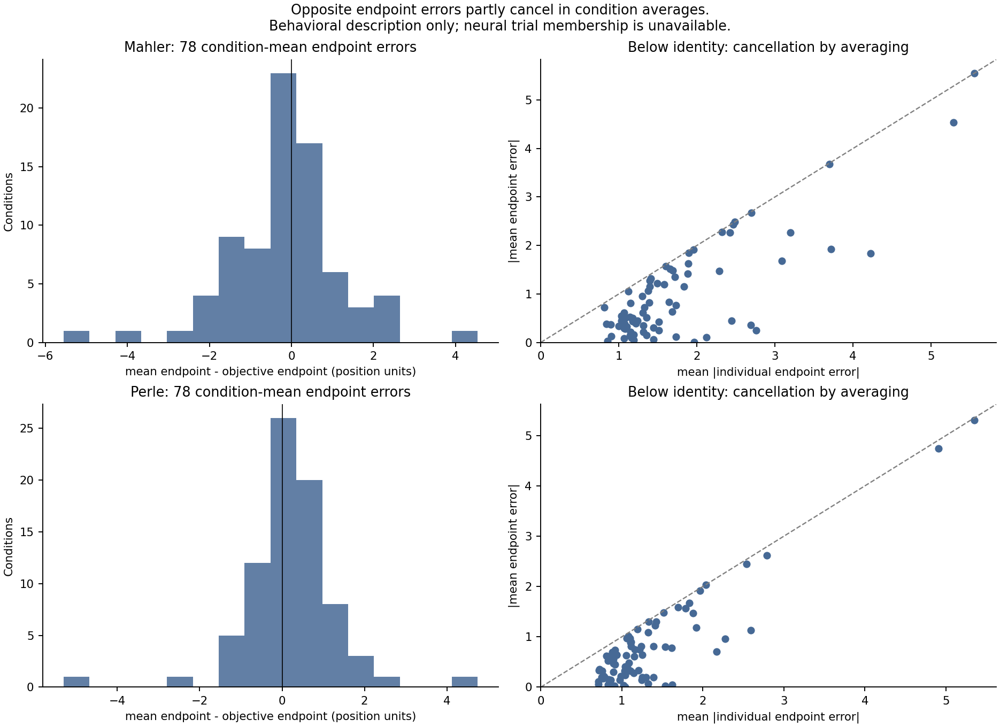
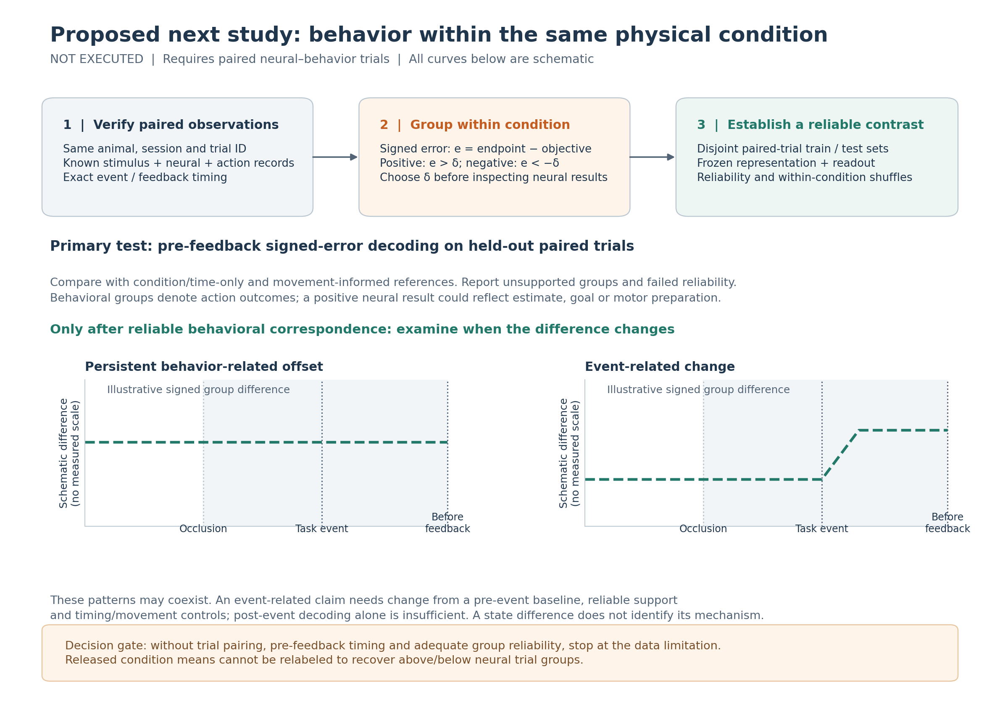

# Next Steps: What the Mental-Pong Result Changes

**Status:** Research interpretation and proposed next study. The current Mental-Pong analysis is complete (`CLOSED_EXPLORATORY_WITH_LIMITATIONS`). **None of the proposed neural–behavior grouping or temporal tests below has been performed.**

## 1. The question, expectation, and actual outcome

The completed study asked whether condition-mean activity in macaque dorsomedial frontal cortex (DMFC) reconstructs a **behavior-constrained estimate of a moving ball** better than its **objective physical path**. The motivation was that an animal's eventual paddle position might reflect an estimate that differs from the physical path. If that estimate were represented in neural activity, a suitable behavioral candidate could be a more informative reconstruction target.

The tested candidate was deliberately simple. For each physical condition, it used the *mean terminal paddle position* as its endpoint and connected that endpoint to the known physical geometry with fixed interpolation. The objective and candidate targets were reconstructed from the **same 50-dimensional FA or GPFA features** using separately trained linear readouts. The analysis included own-target and 2×2 cross-scoring (A), fixed-head condition mismatch (B), randomized endpoint assignments with refitted readouts (C), and a task-geometry baseline. See the [behavior-relation setup](02_behavior_relation/SETUP.md) for the exact definitions.

The principal observations are:

| Completed observation | Result | What it establishes or limits |
|---|---|---|
| Objective position reconstruction | Full-interval vertical-position `r = 0.4928–0.7204` across the two animals and FA50/GPFA50 | Task-related position information is linearly recoverable in the tested representations. |
| Objective versus candidate, each using its own head and target | Full `Δr = −0.0248` to `−0.0108`; `ΔRMSE = −0.0322` to `−0.0220`, with positive differences defined to favor the candidate | **The proposed candidate has no full-path own-target advantage.** The hidden-period comparisons also favor the objective target. |
| Fixed-head condition mismatch (B) | Correct condition correspondence performs better on matched support | Neural predictions retain condition-related structure, although the mismatch also disrupts physical geometry and timing relationships. |
| Randomized endpoints with readout refitting (C) | Actual candidates outperform the specified random assignments on full, hidden, and endpoint-influence support | The real endpoint assignment contains structure relative to that null. It does **not** mean the candidate beats the objective path. |
| C after collision | Random-at-least-as-good RMSE fractions are `0.643`, `0.406`, `0.534`, `0.489` across the four animal/representation cases | Candidate superiority over randomized endpoints is **not uniform across phases and metrics**. |
| Task-informed geometry baseline | All four full-interval candidate neural skills are negative (`−2.2594` to `−1.1445`) | The tested neural readouts do not reduce whole-path squared error beyond this **unmatched-input**, geometry-rich baseline. |

These are completed comparisons, not tests of a unique neural simulation algorithm. The 100 condition splits reuse the same observations and do not represent 100 independent animals or experiments. The complete values and split dispersions are in [task-motion results](01_task_motion/RESULTS.md) and [behavior-relation results](02_behavior_relation/RESULTS.md).

**Current conclusion:** The released condition-mean DMFC representation supports physical task-position reconstruction and condition-related endpoint structure. Objective trajectories are reconstructed more accurately than the *specified mean-endpoint candidate* over the full path. This weakens the candidate-advantage hypothesis and directs the next study toward evidence that can resolve behavior-related neural states; internal simulation remains an open mechanistic question.

## 2. Why might the expected candidate advantage have been absent?

The next study needs to distinguish the explanations below. Their evidential status ranges from measured target properties to untested neural hypotheses.

| Possible explanation | What the completed study actually shows | Status and decisive missing evidence |
|---|---|---|
| **The average behavioral candidate is too similar to the objective path** | Opposite signed behavioral endpoint deviations often cancel; the current candidate uses the mean endpoint and inherits the physical path's geometry and timing | Measured target similarity and behavioral cancellation; whether this reduced statistical sensitivity enough to change the model comparison is **not established**. |
| **Behavior-related neural differences were also canceled by averaging** | The neural release contains means per physical condition, with no recoverable assignment of neural samples to the corresponding behavioral trials | A plausible hypothesis, **not a measured loss of neural information**; requires paired neural and behavioral observations. |
| **The candidate's imposed trajectory is not the animal's actual internal estimate** | Its vertical path is an affine function of the terminal paddle endpoint and fixed physical anchors; no internal path was directly recorded | A construct-validity limitation; requires time-resolved behavioral or neural constraints capable of discriminating alternative internal paths. |
| **The task structure explains much of the decodable position** | Objective reconstruction and condition correspondence are present, yet the geometry-only comparator has lower full-path squared error | Strong alternative explanation for a high position `r`; the geometry baseline has additional task information and is not a capacity-matched neural predictor. |
| **The selected representation or linear readout omits useful information** | FA50/GPFA50 plus fixed OLS recovers only a restricted task projection; prediction amplitudes are compressed relative to targets | Possible analytic limitation, but the analysis does not quantify information absent from full neural activity. |
| **Neural and behavioral source observations do not correspond trial by trial** | Behavioral membership is recorded, while the trials contributing to each released neural pseudopopulation mean are unknown | Pairing is unverified; the rate or effect of mismatch cannot be quantified from available arrays. |
| **Upstream filling or terminal-feedback timing affected the test** | Released missing neural responses were filled with global condition/time information; strictly pre-feedback timing of the terminal paddle scalar is unresolved | `raw_preprocessing=fail` is a documented provenance limit; its impact and any feedback contamination have not been isolated. |
| **There is no substantial behavioral dependence in the measured neural population under this task** | The present condition-average result supplies no affirmative evidence for within-condition behavioral specificity | Still possible. It cannot be distinguished from the data/measurement limitations without a reliable paired test. |

The own-target result shifts the priority from expanding the decoder or redefining the candidate to resolving the observation limit. We need evidence that separates *absence of a behavior-related neural effect* from *inability of the current data to measure that effect*. Choosing a new analysis to recover a positive outcome would leave that distinction unresolved.

## 3. How condition averaging could weaken this comparison

### 3.1 What is observed in behavior

Let `c` index a fixed physical ball trajectory and let `b_{c,i}` be the terminal paddle position on behavioral trial `i`. Define the signed endpoint deviation relative to the physical interception point as

\[
e_{c,i}=b_{c,i}-y_{\mathrm{obj},c}(t_{\mathrm{arrival}}).
\]

The current candidate uses `\bar b_c`, the mean endpoint of its retained behavioral records. With the fixed physical anchor and interpolation coefficient, its post-anchor vertical coordinate is

\[
y_{\mathrm{cand},c}(t)=[1-\alpha_c(t)]\,y_{\mathrm{anchor},c}
                         +\alpha_c(t)\,\bar b_c.
\]

Because this mapping is affine in `b`, averaging trial-constructed candidates is equivalent to constructing the candidate from the mean endpoint. It **does not preserve which trials erred above or below the physical interception point**. As the signed deviations cancel, their mean can approach the objective endpoint; where the physical branches coincide, the candidate and objective trajectories can become harder to distinguish.

*Each point in the right panels is one valid physical condition. Below the identity line, the absolute mean error is smaller than the mean absolute individual error. This is a behavioral observation; the corresponding neural trial membership is unavailable.*

The quantities below distinguish behavioral cancellation from separation of the constructed targets:

| Quantity | Mahler | Perle |
|---|---:|---:|
| Valid physical conditions containing both signs of endpoint error | 77/78 | 78/78 |
| Condition-equal mean absolute trial error | 1.7272 | 1.3388 |
| Mean absolute condition-mean error | 0.9784 | 0.7908 |
| Median within-condition cancellation fraction | 0.5398 | 0.4804 |
| Full-path candidate–objective RMS separation | 0.6760 | 0.5612 |

The first four rows quantify averaging of **behavioral** deviations. The last measures separation of the **constructed, averaged target paths** on their retained support. These are behavioral and target-level measurements; neural effects require paired observations.

### 3.2 Why these facts could matter for neural reconstruction

The figure establishes opposing **behavioral** errors and their reduction by averaging. Fixed geometry then determines the separation of the two averaged target paths. A decoder with one neural mean per condition/time has no access to opposite behavioral groups, which creates an **identifiability limitation**. Whether neural deviations also cancel, or target similarity sufficiently reduces sensitivity to change the conclusion, remains untested.

Target-path separation and decoder RMSE have different pooling rules; their ratio is **not a power calculation**. The earlier repeated-neural-mean analysis changed both labels and condition weights. It neither restored paired trials nor isolated neural information loss.

A direct test of the averaging hypothesis requires **neural activity from known trials partitioned by the behavior of those same trials**, allowing a comparison such as

\[
\mathbb{E}[R(t)\mid c,\,e>\delta]\quad\text{versus}\quad
\mathbb{E}[R(t)\mid c,\,e<-\delta].
\]

Here `\delta` is a preselected tolerance for meaningful signed behavioral deviation, **not an already chosen threshold**. The coordinate convention must first be checked so that positive/negative error corresponds correctly to above/below target in the display. No operation on the released condition means can recover these group-conditioned neural responses.

## 4. The minimum data needed for a meaningful next test

The immediate follow-up requires linked **neural and behavioral records from the same trials**. Each usable observation should identify the animal, recording session, stable trial ID, physical condition, stimulus/ball trajectory, neural units and time bins, terminal paddle movement, and the exact times of visibility, occlusion, collision, interception, motor response and feedback. The endpoint used to define a prospective estimate must be verified as available **before feedback**. Movement or joystick measurements, where available, should be retained as potential explanatory covariates.

The recordings must include enough trials of **both error signs within the same physical condition and recording context** to form reliable group estimates. Any condition with inadequate paired observations should be reported as unsupported rather than filled or forced into a group. Group membership must refer to actual linked trials, not to a single published pseudopopulation mean replicated under multiple labels. If units are assembled across sessions, group-conditioned pseudopopulation means may still be useful, but they must be identified as such; they cannot be described as simultaneously observed single-trial population trajectories.

Data processing must preserve trial identity and distinguish observed data from imputed values. Neuron eligibility, normalization, latent fitting and any behavioral readout should use training data alone; held-out measurements must not determine these choices. If a Gaussian-process latent is used for a statement about *when* a signal emerges, its inference must be restricted to the observation prefix available at that time and the provenance of the input must also be checked. Frozen parameters do not make full-window smoothing causal, nor do they reverse upstream future-informed filling.

**Decision gate:** Proceed to the behavior-specific neural test only with paired, time-resolved inputs. Without them, preserve the completed condition-mean study as a closed exploratory result and report the outstanding data requirement.

## 5. Proposed study: compare above-target and below-target behavior within the same physical condition

This **proposed protocol** specifies the next study; it has not been applied to the current released data.

*No neural group difference is measured here. Dashed curves illustrate two possible, compatible patterns without numerical scales or uncertainty estimates. Positive/negative endpoint error must be mapped to above/below only after checking the display-coordinate convention.*

### Step 1 — Define the behavioral groups before examining neural results

Predefine **above-target**, **below-target** and, where supported, **near-target** groups using measurement precision and task criteria. Keep continuous signed error as a complementary target. Do not optimize thresholds using neural results. Match or account for error magnitude, trial counts, session, neuron availability and timing; report unsupported conditions. These groups describe **action outcomes**, which can reflect estimate, goal, motor control or feedback rather than a directly observed perceptual belief.

### Step 2 — Establish a measurable neural contrast

Partition **paired trials** within condition and session; train preprocessing, a common representation and readouts using training observations only. Held-out-trial and leave-whole-condition-out tests address different generalization questions and must be reported separately. Establish reproducible group means on disjoint trial halves, then separation beyond within-condition label shuffles; retain coverage and failures.

The primary readout uses **pre-feedback neural activity to predict the signed behavioral residual relative to the objective endpoint** on held-out paired trials. Compare with condition/time-only and movement-informed references, and retain physical-position decoding as a task reference. Held-out endpoints must never inform training. **Reliable group separation precedes interpretation of trajectory shape.**

### Step 3 — Ask whether the neural difference is persistent or changes at a task event

Within the same condition, construct group trajectories in one **training-defined, fixed neural coordinate system**. Let `z_up(c,t)` and `z_down(c,t)` denote group-averaged latent states. Their separation can be described by

\[
\Delta z_c(t)=z_{\mathrm{up},c}(t)-z_{\mathrm{down},c}(t).
\]

A nonzero `||Δz||` measures latent separation, not a signed ball-position difference. A fixed readout trained on independent trials must test the expected direction of the above-minus-below projection. The schematic distinguishes **persistent offsets** from **event-related changes**, which may coexist. Persistence does not demonstrate updating or exclude motor preparation; event-related changes remain compatible with attention, cues, timing or motor adjustment.

Test change **relative to a pre-event baseline**, with aligned support and null controls. High post-event decoding alone is insufficient. GPFA smoothing, unreliable differences and uncertain collision/feedback timing can mimic or obscure transitions; affected bins cannot establish temporal ordering.

### Step 4 — Use targeted controls rather than a new broad model search

Shuffle **behavioral-group labels within the same physical condition**, preserving session and group sizes where possible. This retains the objective path, unlike current across-condition B. Repeat with count-balanced groups and report residual movement/session imbalance. Geometry/time, movement, reliability and a predeclared temporal disruption address separate alternatives.

Select any representation dimension or temporal settings inside training/validation data. Use no final group result for selection or refitting. Alternative candidate curves or more flexible readouts should follow reliable behavioral correspondence and use fresh held-out data; greater decoder capacity cannot repair missing trial pairing or input provenance.

## 6. Predictions, possible results, and decision rules

The following **predictions for future paired data** define how each possible outcome would guide the research decision. These comparisons remain unperformed.

| Future observation | Interpretation and next decision |
|---|---|
| **Reliable group separation and a correctly signed pre-feedback neural readout**, beyond within-condition shuffle and geometry-only references | Supports a behavior-related population representation at the tested observation level. It still does not identify an internal physical simulation or prove that the code predicts the animal's future belief. |
| **Group differences are persistent through occlusion without a clear event-linked change** | Supports a maintained behavior-associated state. Do not infer selective updating from its persistence alone; compare with motor preparation and other persistent covariates. |
| **A reproducible event-linked change occurs before feedback**, with the expected signed behavioral correspondence and suitable timing/movement controls | Consistent with state updating and motivates a more discriminating test of competing computations. It does not by itself establish the update algorithm or neural causality. |
| **Reliable neural group estimates but no held-out behavioral direction relationship**, under a sensitive predefined test | Weakens the specific behavior-linked representation hypothesis for this population, task and metric. Do not automatically attribute the null to averaging or decoder choice. |
| **Apparent effects arise only after feedback or disappear after movement/session adjustment** | Favors feedback-related or motor/contextual explanations over a pre-feedback estimate, within the measured controls. |
| **Groups are too small, trial identity is uncertain, or group neural reliability is inadequate** | The comparison is not interpretable. It does not overturn the existing objective-position decoding, and it cannot be counted as support for either behavioral hypothesis. |

A positive signed residual or group difference is a **representation-level observation**: neural activity covaries with behavior beyond the fixed physical condition. A computation-level claim would then require mechanisms that predict **different responses to a controlled manipulation**. Changing an expectation while holding sensory history as constant as possible is one possible later design. It could distinguish computations that remain compatible with another reconstruction of the same mean path. This manipulation is **not a test specified as completed here**.

## 7. Research decision and priority

The final FA50/GPFA50–OLS analysis recovers task-position structure, with **objective reconstruction more accurate than the specified behavior-constrained candidate over the full path**. Fixed-head mismatches and endpoint randomization locate condition and assignment structure within that result. The stronger geometry comparator leaves the contribution of an internal behavioral estimate unresolved. The next priority is therefore a paired observation that holds physical condition fixed.

The next work should proceed in this order:

1. **Data feasibility:** acquire or identify genuinely paired neural–behavior trials, raw-input provenance, precise event times and adequate within-condition behavioral variability.
2. **Measurement validity:** establish reliable above/below group neural differences on independent trial partitions, with within-condition nulls and support checks.
3. **Behavioral correspondence:** test held-out signed-error decoding relative to physical geometry and motor covariates.
4. **Temporal signatures:** distinguish sustained offsets from event-related changes, while respecting pre-feedback timing and latent-inference limits.
5. **Mechanistic discrimination, only if warranted:** design an independent manipulation under which persistent-state, updating and motor-related explanations make different predictions.

If step 1 cannot be satisfied, preserve the final negative result and state the data requirement; neither relabeling published means nor restarting an unrestricted model search supplies the missing trials. If steps 1–3 succeed but step 4 remains inconclusive, the supported claim is behavior-associated neural representation, with state updating unresolved.

## 8. Summary for the project overview

> The completed Mental-Pong analysis used condition-mean DMFC activity to reconstruct objective ball position more accurately than the mean-endpoint behavior-constrained path over the full interval. Actual behavioral endpoints outperformed specified randomized assignments in several phases, and a task-informed geometry baseline remained stronger over the full interval. Opposing endpoint errors partly canceled in condition averages; testing corresponding neural information loss requires the unavailable trial-level neural–behavior membership. The proposed next step compares reliable neural states from above-target and below-target trials *within the same physical condition*, first testing behavioral correspondence and then examining whether the difference persists or changes around task events.

## 9. Supporting records and boundaries

- [Goal 1 — Task-motion setup](01_task_motion/SETUP.md) and [results](01_task_motion/RESULTS.md): objective-position recovery, condition mismatch and physical-geometry reference.
- [Goal 2 — Behavior-relation setup](02_behavior_relation/SETUP.md) and [results](02_behavior_relation/RESULTS.md): own-target/cross-scoring, randomized endpoint controls, phase exceptions, geometry skill and behavioral cancellation.
- [Models and Data](MODELS_AND_DATA.md): original condition means, behavioral membership, representation/OLS identities and unresolved upstream input filling.
- [Research Questions](QUESTIONS.md): reconstruction versus prediction, trial generalization, causal prefix inference and the limit of internal-simulation claims.
- Original evidence records: `evidence/closeout_v1/A/self_reconstruction_main_table.csv`, `evidence/closeout_v1/A/cross_2x2_summary.csv`, `evidence/closeout_v1/C/random_endpoint_summary.csv`, `evidence/closeout_v1/descriptive/mean_cancellation_summary.json`, and `evidence/closeout_v1/A/previous_trial_version_comparison.csv`. Their exact filters and interpretations are listed in the goal Results documents.

**Data and execution boundary:** The current observations are published processed condition means with unresolved global condition/time filling (`raw_preprocessing=fail`) and no original neural–behavior trial pairing. The proposed grouping, signed-error decoding, event-locked tests and mechanistic manipulation were **not** executed. No numerical outcome is projected for them.
