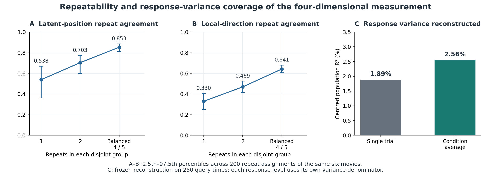
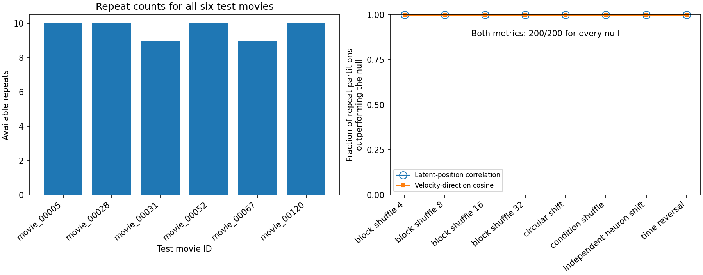

# Shared Trajectory Measurement: Results

**The frozen four-dimensional GPFA provides repeatable position and local-direction measurements for this comparison, especially after averaging repeated presentations. Its response reconstruction measures how much population variance this component covers.** These findings describe different properties of the measurement: agreement between repeat halves, sensitivity to prescribed nulls, and coverage of response variance.

All results use the current `retrained_v1` GPFA, one pilot session, 512 fixed neurons and test frames 50–299. Single- and two-repeat diagnostics and response reconstruction reuse this same fitted object. The representation remains fixed throughout these checks. The main measurement is complete; cross-setting robustness remains unassessed after withdrawal of the auxiliary fits.

[Setup](SETUP.md) defines the data, scales, posterior, metrics and null operations. The resulting Static–reduced Dynamic comparison is reported separately in [Goal 3](../03_model_comparison/RESULTS.md).

## 1. Fitted measurement and initialisation selection

The GPFA used 282 training trials and 66 validation trials. Four latent dimensions were fixed before initialisation selection. The 0.25-second candidate had the lowest recorded mean validation negative log likelihood (NLL):

| Initial timescale (s) | Validation NLL per observation | Standard error | Selected |
| ---: | ---: | ---: | --- |
| 0.125 | 1.448502115 | 0.033603672 | No |
| 0.25 | 1.448115348 | 0.033605337 | Yes |
| 0.5 | 1.448284851 | 0.033603564 | No |
| 1.0 | 1.448909758 | 0.033605255 | No |

These scores select among candidate initialisations at the fixed latent dimension; they describe analysis parameters rather than biological time constants. The additional `stage=dimension` record documents a bookkeeping fit at four dimensions with a 0.5-second initialisation.

The selected initialisation was fitted on the 282 training trials only. The final model converged in **19 of at most 20 EM iterations**, under the recorded relative tolerance of `1e-6`. The final log likelihood was `-12799279.532411832`, with last improvement `12.67228139191866`. The four learned timescales range from approximately 0.2540 to 0.2586 seconds; their individual values and the fixed artifact identities are in [Setup](SETUP.md#3-gpfa-model-and-fixed-identity).

The [selection table](../evidence/04_model_comparison/retrained_v1/gpfa_selection.csv), filtered to `stage=initialization`, supplies the scores above. The [frozen identity](../evidence/04_model_comparison/retrained_v1/frozen_gpfa_identity.json) records trial counts, dimension and final iterations; the [main diagnostic fit identity](../evidence/04_model_comparison/retrained_v1_diagnostics/gpfa/main/fit_identity.json) records convergence, final likelihood and last improvement.

*Repeat reliability and reconstruction measure different properties of the same frozen GPFA. Error bars show the 2.5th–97.5th percentile range across 200 repeat assignments within the same six movies. Reconstruction bars use population centred R² on the 250-point grid; their response-level denominators differ.*

## 2. Repeat averaging increases trajectory agreement

Disjoint same-movie comparisons use one, two, or balanced four/five repeats per side. Averaging improves both primary metrics; the full table also retains the secondary measures.

| Repeats per side | Metric | Observed mean | SD | 2.5% quantile | 97.5% quantile |
| ---: | --- | ---: | ---: | ---: | ---: |
| 1 | Position correlation (primary) | 0.5385 | 0.0783 | 0.3608 | 0.6684 |
| 1 | Velocity-direction cosine (primary) | 0.3296 | 0.0406 | 0.2493 | 0.4039 |
| 1 | Normalised position RMSE | 0.9849 | 0.1173 | 0.8149 | 1.2420 |
| 1 | Speed-profile correlation | 0.3614 | 0.1149 | 0.1486 | 0.5618 |
| 1 | Acceleration-direction cosine | 0.2890 | 0.0389 | 0.2058 | 0.3637 |
| 2 | Position correlation (primary) | 0.7034 | 0.0458 | 0.5976 | 0.7732 |
| 2 | Velocity-direction cosine (primary) | 0.4688 | 0.0302 | 0.4141 | 0.5239 |
| 2 | Normalised position RMSE | 0.7812 | 0.0731 | 0.6613 | 0.9405 |
| 2 | Speed-profile correlation | 0.5425 | 0.0819 | 0.3625 | 0.6814 |
| 2 | Acceleration-direction cosine | 0.4181 | 0.0303 | 0.3615 | 0.4724 |
| Balanced 4/5 | Position correlation (primary) | 0.8526 | 0.0193 | 0.8113 | 0.8849 |
| Balanced 4/5 | Velocity-direction cosine (primary) | 0.6414 | 0.0195 | 0.6058 | 0.6786 |
| Balanced 4/5 | Normalised position RMSE | 0.5518 | 0.0432 | 0.4712 | 0.6496 |
| Balanced 4/5 | Speed-profile correlation | 0.7457 | 0.0313 | 0.6828 | 0.8031 |
| Balanced 4/5 | Acceleration-direction cosine | 0.5810 | 0.0213 | 0.5420 | 0.6229 |

All rows summarise 200 partitions of the same six movies. Values are rounded to four decimal places. SD is the standard deviation across partitions; the quantiles describe repeat-assignment variability. The 200 partitions describe resampling of the observed repeats, with uncertainty confined to this movie set.

The observed distributions are identical across the eight null entries within each repeat level and metric. The table therefore uses the `null=condition_shuffle` rows from [repeat_averaging_summary.csv](../evidence/04_model_comparison/retrained_v1_diagnostics/gpfa/repeat_averaging_summary.csv) once, rather than duplicating them for every null. The balanced scores are the unchanged main results; the one- and two-repeat settings replay the saved repeat-assignment plan.

Single repeats show repeatable structure; averaging repeats substantially increases their agreement. The higher balanced scores support repeat-averaged trajectories for the present comparison; the single-repeat rows describe individual-trial measurement reliability.

## 3. Correspondence exceeds the prescribed nulls

### Main balanced-repeat result

The balanced analysis retains 1,500 condition/time state bins, 1,494 within-condition velocity bins and 1,488 acceleration bins per comparison. The observed means for the two primary metrics are **0.8526 for position correlation** and **0.6414 for velocity-direction cosine**.

Both metrics exceed their matched null in every one of the 200 partitions for each null configuration:

| Null | Position null mean | Direction null mean | Superior partitions, each metric | Failures; undefined, each metric |
| --- | ---: | ---: | ---: | ---: |
| Condition shuffle | -0.0632 | 0.0246 | 200/200 | 0; 0 |
| Circular shift | 0.1729 | -0.0056 | 200/200 | 0; 0 |
| Time reversal | 0.2682 | 0.1281 | 200/200 | 0; 0 |
| Independent-neuron shift | 0.3993 | 0.0028 | 200/200 | 0; 0 |
| Block shuffle: 4 frames | 0.3379 | 0.0032 | 200/200 | 0; 0 |
| Block shuffle: 8 frames | 0.2972 | 0.0045 | 200/200 | 0; 0 |
| Block shuffle: 16 frames | 0.2709 | 0.0084 | 200/200 | 0; 0 |
| Block shuffle: 32 frames | 0.2936 | 0.0918 | 200/200 | 0; 0 |

The last two columns apply separately to each primary metric. Null means are rounded to four decimal places. Across the full main battery—**five metrics × eight nulls**—the records contain zero failures and zero undefined partitions. For normalised RMSE, superiority means a lower observed value rather than a higher one.

Condition mismatch changes movie correspondence. Shifts, reversal and block permutations alter timing or order, while independent-neuron shifts alter population coordination. Every operation occurs after conversion to the GPFA input scale and before frozen inference. These results show that agreement depends on the movie and temporal relationships targeted by the prescribed changes. Smoothing and averaging remain possible contributors to the observed repeatability.

The [main reliability summary](../evidence/04_model_comparison/retrained_v1/pilot/reliability_summary.csv) and [repeat-membership records](../evidence/04_model_comparison/retrained_v1/pilot/reliability_split_identities.csv) preserve the scores and assignments. Reversal is deterministic on each right-half mean. Across partitions, the same reversal is applied to different right-half means. Superiority counts summarize the specified perturbation comparisons within the observed dataset.

Repeat availability and all prescribed primary-null comparisons

*Coverage here means repeat availability, not response-variance reconstruction. Both primary measures exceed each null in all 200 balanced partitions of the same six movies.*

### Performance with fewer repeats

At one and two repeats per side, both primary metrics also have zero failures for every prescribed null. All two-repeat metric/null comparisons are defined and superior in the required direction. **One-repeat secondary metrics have the following failures to outperform their matched nulls**:

| Metric | Null | Observed mean | Null mean | Failures / 200 | Undefined |
| --- | --- | ---: | ---: | ---: | ---: |
| Normalised position RMSE | Independent-neuron shift | 0.9849 | 1.0745 | 17 | 0 |
| Speed-profile correlation | Condition shuffle | 0.3614 | -0.0239 | 3 | 0 |
| Speed-profile correlation | Circular shift | 0.3614 | 0.0880 | 1 | 0 |
| Speed-profile correlation | Independent-neuron shift | 0.3614 | 0.1126 | 1 | 0 |
| Speed-profile correlation | Block shuffle: 4 frames | 0.3614 | 0.1386 | 3 | 0 |
| Speed-profile correlation | Block shuffle: 8 frames | 0.3614 | 0.1366 | 5 | 0 |
| Speed-profile correlation | Block shuffle: 16 frames | 0.3614 | 0.1369 | 4 | 0 |

Every row above uses one repeat per side. These are all the nonzero repeat/null failure counts in the retained results; no undefined outcomes occur. Normalised position RMSE fails to improve on the independent-neuron-shift null in 17 of 200 partitions. Speed-profile correlation has between one and five failures for six null configurations.

The [complete repeat table](../evidence/04_model_comparison/retrained_v1_diagnostics/gpfa/repeat_averaging_summary.csv) retains these failures alongside the stronger primary results. Averaging improves measured agreement. The retained failures identify which trajectory properties need repeat averaging for consistent null separation.

Path-length similarity is not part of this five-metric battery. As a historical descriptive quantity, total distance measures path extent; timing and direction are evaluated by the current trajectory metrics.

## 4. Response variance covered by the frozen reconstruction

The frozen observation model reconstructs GPFA-scaled responses as `z @ C.T + d`. It is applied separately to individual trials and condition means. This measures response coverage from the inferred states using the existing observation model. It evaluates reconstruction conditional on the responses supplied to the posterior; independent stimulus-to-response prediction is evaluated separately.

Two reference denominators are retained. **Centred R²** uses each evaluated neuron's mean for the relevant response level and grid. **Train-intercept R²** uses the frozen observation offset `d`. The evaluation means define scoring baselines while the fitted model remains fixed.

| Response level | Grid | Population centred R² | Train-intercept R² | Mean neuron R² | Median neuron R² | Positive neuron fraction |
| --- | --- | ---: | ---: | ---: | ---: | ---: |
| Single trial | 250 query points | 0.018900 | 0.027121 | 0.002845 | 0.012062 | 0.671875 |
| Single trial | 63 observation points | 0.019034 | 0.027259 | 0.002816 | 0.011956 | 0.669922 |
| Condition average | 250 query points | 0.025580 | 0.051815 | -0.052640 | 0.015400 | 0.593750 |
| Condition average | 63 observation points | 0.025707 | 0.051945 | -0.052679 | 0.015132 | 0.593750 |

All 512 neuron denominators are defined at both response levels and on both grids. The positive-neuron fraction refers to centred per-neuron R². Scores are rounded to six decimal places; full values are retained in [reconstruction.csv](../evidence/04_model_comparison/retrained_v1_diagnostics/gpfa/main/reconstruction.csv) and [reconstruction_neurons.csv](../evidence/04_model_comparison/retrained_v1_diagnostics/gpfa/main/reconstruction_neurons.csv).

The reconstruction panel shows limited centred variance coverage. Observation-grid values are similar. The two grids evaluate the same fitted model, with alternative GPFA fits left for a separate robustness analysis.

### Population and per-neuron summaries answer different questions

For condition averages, the full-grid mean per-neuron centred R² is **−0.052640**, despite a positive population R² and positive scores for 59.375% of neurons. These values are compatible. Population R² pools the sums of squared error and centred variation, whereas the per-neuron mean gives each neuron's score equal weight. The reported mean includes negative per-neuron values.

Full-grid RMSE is 1.1201 for trials and 0.6095 for condition means, in GPFA training-standard-deviation units. Each response level retains its own R² denominator, reflecting its different variability.

Recorded sums of squares, error scale and array support

Each row uses its own response-level/grid denominator. The values below are retained at the precision supplied in the result record.

| Response level | Grid | SSE | Centred SST | Train-intercept SST | RMSE | Arrays × frames × neurons |
| --- | --- | ---: | ---: | ---: | ---: | --- |
| Single trial | 250 query points | 9314132.821709178 | 9493563.251398128 | 9573782.287261184 | 1.1200882252012712 | 58 × 250 × 512 |
| Single trial | 63 observation points | 2339860.852225389 | 2385261.2696367186 | 2405431.1733092447 | 1.1183449054683214 | 58 × 63 × 512 |
| Condition average | 250 query points | 285292.58409452066 | 292782.03155033325 | 300882.9730746208 | 0.6094872589915836 | 6 × 250 × 512 |
| Condition average | 63 observation points | 71706.15873241037 | 73598.15757669203 | 75635.05770766753 | 0.6086916563183135 | 6 × 63 × 512 |

The formulas are given in [Setup](SETUP.md#6-metrics-and-response-reconstruction). The two full-grid scores use arrays of different sizes and different variability: `[58, 250, 512]` for single trials and `[6, 250, 512]` for condition means. Each array is scored against its corresponding response-variance denominator.

**High repeat agreement and low response reconstruction can coexist.** Here, a small four-dimensional measurement captures repeatable trajectory structure while accounting for only a limited part of the measured response variance. Interpreting that component biologically or characterizing information outside the projection requires additional analyses.

## 5. What this measurement supports

The primary position and local-direction measures are repeatable across disjoint presentations and sensitive to the specified identity and timing perturbations. Their agreement improves substantially with repeat averaging, supporting the fixed four-dimensional measurement for the current condition-level encoder comparison with reliability reported alongside model scores.

Limited response coverage and heterogeneous per-neuron reconstruction make response prediction a necessary, separate criterion alongside trajectory agreement. The weaker one-repeat results also limit claims about single-trial trajectories. The null counts and balanced-repeat values provide measurement-specific references; scores remain in their original units rather than reliability-normalised units.

Temporal interpretation remains limited by the measurement. GPFA uses later observations within the evaluation window, and derivatives are calculated from its smoothed posterior. The resulting derivatives describe offline estimates on the 30 Hz query grid; causal latency requires time-restricted measurements. The evidence covers six movies in one session; extending the measurement to other sessions or unseen source films requires further validation.

Four dimensions define the retained measurement for this completed analysis; optimality and biological interpretation remain separate questions. Cross-dimension and observation-grid robustness remain unassessed after withdrawal of the auxiliary sensitivity fits. Earlier GPFA fits and their reconstruction results remain separate historical evidence: the exact historical reconstruction denominator is not available for an executable equivalence check.

The next analysis asks how closely Static and reduced Dynamic reproduce the measured neural trajectories, using the same frozen representation. Its [settings](../03_model_comparison/SETUP.md) and [results](../03_model_comparison/RESULTS.md) are distinct from the neural–neural measurement checks reported here. Method attribution, configuration paths and implementation references are collected in [Setup](SETUP.md#7-evidence-attribution-and-scope).
