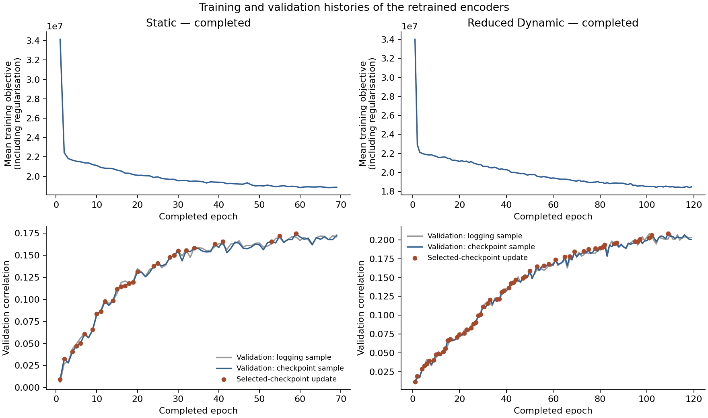
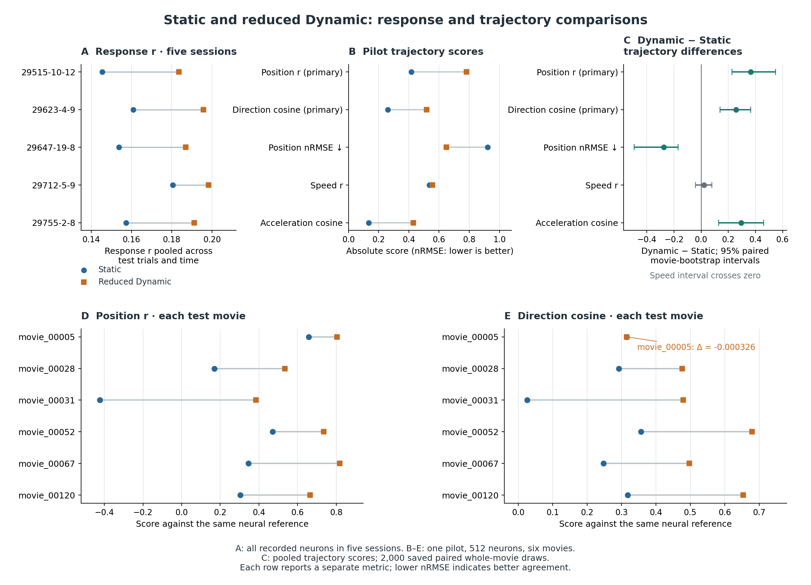

# Static and Reduced Dynamic Comparison: Results

**Reduced Dynamic has higher response correlation and lower response error in all five sessions. In the pilot, it also agrees more closely with the neural trajectories on the two primary measures: latent position correlation and velocity-direction cosine. Speed-profile differences remain unresolved; movie-level and secondary-metric results show where the advantage varies.**

These are the completed `retrained_v1` results from newly trained, frozen encoders and the current GPFA. They provide held-out evaluation after retraining. The test movies retain their history of earlier exploration; the historical full Dynamic reproduction has its own analysis and model identity. [Setup](SETUP.md) defines the models, data roles, metrics and uncertainty; [Models and Data](../MODELS_AND_DATA.md) provides the project-wide context.

## 1. Completed training and comparison scope

Both encoders started from scratch at seed 42 under the same train, validation and test roles. The selected checkpoints remain fixed. Each training-status record states `test_read_by_trainer=false`.

| Model | Selected epoch | Selection validation r | Last epoch | Stop reason |
| --- | ---: | ---: | ---: | --- |
| Static | 59 | 0.174307 | 69 | Patience cycles exhausted |
| Reduced Dynamic | 109 | 0.208147 | 119 | Patience cycles exhausted |

Checkpoint selection uses random-snippet validation correlations; full-sequence test scores are reported separately. The [Static](../evidence/04_model_comparison/retrained_v1/static_training_status.json) and [Dynamic](../evidence/04_model_comparison/retrained_v1/dynamic_training_status.json) status records retain checkpoint and stopping identities.

*Training objectives, validation correlations and checkpoint updates for the current retrained encoders. Historical full Dynamic has a separate training history.*

Static has 2,814,015 trainable parameters and reduced Dynamic has 2,862,063, a difference of 48,048 or approximately 1.707%. Readout and shifter counts match; core counts differ. The [actual-instance record](../evidence/04_model_comparison/retrained_v1_diagnostics/encoder/parameter_counts.json) meets the 2% total-count check; architecture and computation remain distinct.

The five-session response analysis includes 293 test trials and 40,034 recorded neurons. Detailed conventional and GPFA results use pilot session `29515-10-12`: 58 trials, six movies, 512 fixed neurons and original frames 50–299. The current four-dimensional GPFA is fitted on training neural responses, with its initialisation chosen by validation neural likelihood, then frozen. Its [reliability and reconstruction results](../02_trajectory_measurement/RESULTS.md) define the measurement's scope; trajectory validation concerns the single pilot session.

Scores below are rounded to four decimal places unless otherwise stated. Differences are calculated from full-precision stored values or taken from the saved contrast fields before display rounding. All differences are **Dynamic minus Static**. Positive differences favour Dynamic for correlation, CKA and cosine; negative differences favour Dynamic for error metrics.

*A: pooled response scores across five sessions. B–C: all five pilot trajectory scores and paired intervals for the same pooled estimand; the speed contrast crosses zero, and lower nRMSE indicates better agreement. D–E: scores for all six movies, including the small movie_00005 direction exception. The intervals describe resampling of the six whole movies.*

## 2. Response prediction across five sessions

### Pooled trial/time scores

For each neuron, response correlation pools the aligned test trial/time samples, then the score averages eligible neurons within the session. Dynamic has higher correlation in every session:

| Session | Static | Dynamic | Dynamic − Static |
| --- | ---: | ---: | ---: |
| 29515-10-12 | 0.1455 | 0.1836 | +0.0381 |
| 29623-4-9 | 0.1608 | 0.1956 | +0.0348 |
| 29647-19-8 | 0.1538 | 0.1869 | +0.0331 |
| 29712-5-9 | 0.1805 | 0.1983 | +0.0178 |
| 29755-2-8 | 0.1573 | 0.1911 | +0.0338 |
| **Unweighted session mean** | **0.1596** | **0.1911** | **+0.0315** |

The unweighted five-session correlation gain is **+0.031528**; sessionwise pooled differences range from +0.0178 to +0.0381.

Response NMSE uses the pooled scalar neural-response variance as its denominator. Dynamic also has lower normalised error in every session:

| Session | Static | Dynamic | Dynamic − Static |
| --- | ---: | ---: | ---: |
| 29515-10-12 | 0.9781 | 0.9621 | -0.0160 |
| 29623-4-9 | 0.9659 | 0.9520 | -0.0139 |
| 29647-19-8 | 0.9782 | 0.9661 | -0.0121 |
| 29712-5-9 | 0.9625 | 0.9549 | -0.0076 |
| 29755-2-8 | 0.9702 | 0.9575 | -0.0127 |
| **Unweighted session mean** | **0.9710** | **0.9585** | **-0.0125** |

The last row of each table gives equal weight to the five session scores. This summary gives sessions equal weight; an animal-population interval is not available. The [session paired table](../evidence/04_model_comparison/retrained_v1/response/response_session_paired_bootstrap.csv) supplies the pooled scores and differences; the [session summary](../evidence/04_model_comparison/retrained_v1/response/response_session_summary.csv) supplies the two unweighted means. The mean NMSE difference is the subtraction of those full stored means.

### Movie-level differences within each session

The following points and intervals answer a different question. Correlation is calculated separately for each movie, then the six movie scores receive equal weight. Bootstrap intervals describe the mean paired movie-score difference within that session, not the pooled correlations above.

| Session | Mean-movie Static r | Mean-movie Dynamic r | Mean paired difference | 95% paired interval |
| --- | ---: | ---: | ---: | --- |
| 29515-10-12 | 0.1074 | 0.1322 | +0.0248 | [+0.0150, +0.0329] |
| 29623-4-9 | 0.1083 | 0.1343 | +0.0260 | [+0.0209, +0.0311] |
| 29647-19-8 | 0.1165 | 0.1446 | +0.0281 | [+0.0215, +0.0349] |
| 29712-5-9 | 0.1179 | 0.1293 | +0.0114 | [+0.0079, +0.0149] |
| 29755-2-8 | 0.1064 | 0.1291 | +0.0227 | [+0.0181, +0.0287] |

Each session has six defined paired movie scores, 2,000 valid whole-condition bootstrap draws and zero undefined draws. All five response-correlation intervals are above zero. This supports the direction of the response difference within each observed movie set, with uncertainty defined by within-session movie resampling.

Pooled response correlation includes cross-movie variation when trials are combined. Averaging correlations already calculated within movies is a different operation, which explains why the two sets of point estimates need not agree. The [complete session paired table](../evidence/04_model_comparison/retrained_v1/response/response_session_paired_bootstrap.csv) also retains the NMSE intervals; their endpoints are not reproduced here. [All session-condition scores](../evidence/04_model_comparison/retrained_v1/response/response_condition_metrics.csv) preserve the individual movie results.

## 3. Pilot trajectory comparison

Recorded and predicted responses are averaged within each of the six pilot movies, converted to the same training-defined scale, and passed separately through the same frozen GPFA. The scores describe correspondence in that latent space. Position refers to state in the GPFA latent coordinates.

| Metric | Role | Static | Dynamic | Dynamic − Static | 95% paired interval |
| --- | --- | ---: | ---: | ---: | --- |
| Position correlation | Primary | 0.4165 | 0.7816 | +0.3650 | [+0.2279, +0.5473] |
| Velocity-direction cosine | Primary | 0.2594 | 0.5170 | +0.2576 | [+0.1403, +0.3651] |
| Normalised position RMSE | Secondary; lower is better | 0.9222 | 0.6479 | -0.2743 | [-0.4931, -0.1697] |
| Speed-profile correlation | Secondary | 0.5346 | 0.5557 | +0.0211 | [-0.0403, +0.0795] |
| Acceleration-direction cosine | Secondary | 0.1331 | 0.4289 | +0.2958 | [+0.1294, +0.4599] |

The paired trajectory panel and table agree: both primary intervals favour Dynamic; secondary error and acceleration results also favour it. Acceleration direction reflects the second-difference vector, which includes more than geometric curvature alone.

The speed interval includes zero, leaving its advantage unresolved; equivalence would require a separate test.

Each point and its interval concern the same pooled condition-average trajectory score. In every bootstrap draw, six whole movie conditions are sampled with replacement, paired between the models, and the pooled scores are recomputed. All 2,000 draws are defined. The [paired record](../evidence/04_model_comparison/retrained_v1/pilot/paired_bootstrap.csv) retains the unrounded values, intervals and `interval_estimand` labels. These intervals describe movie resampling; Goal 2 reports repeat-partition variability separately. Model scores remain in their original metric units.

## 4. Time-aware conventional metrics also distinguish the models

The pilot conventional analysis uses the same 512 neurons and time interval as the trajectory comparison. It directly compares the aligned recorded and predicted response arrays. These comparisons characterize population-response outputs; internal feature layers would require a separate analysis.

### Pooled point estimates

| Metric | Pooled Static | Pooled Dynamic | Pooled difference |
| --- | ---: | ---: | ---: |
| Response r | 0.1451 | 0.1860 | +0.0408 |
| Response NMSE | 0.9782 | 0.9625 | -0.0157 |
| Condition/time CKA | 0.4561 | 0.5108 | +0.0548 |
| Temporal-difference CKA | 0.0281 | 0.0932 | +0.0651 |
| Condition/time-state RSA | 0.4248 | 0.5449 | +0.1201 |

The pilot response values differ slightly from the all-neuron values for session `29515-10-12` in Section 2 because this analysis uses the fixed 512-neuron subset rather than all 7,863 neurons. Each score retains its stated neuron scope.

The pooled points are reported separately from the equal-weight movie intervals below. Response r and NMSE pool trial/time data; the pooled CKA and RSA summaries use within-movie repeat means and combine their condition/time states as defined in [Setup](SETUP.md#5-metrics).

### Equal-weight movie means and matching intervals

| Metric | Mean-movie Static | Mean-movie Dynamic | Mean paired difference | 95% paired interval |
| --- | ---: | ---: | ---: | --- |
| Response r | 0.1041 | 0.1320 | +0.0278 | [+0.0174, +0.0373] |
| Response NMSE | 0.9841 | 0.9643 | -0.0198 | [-0.0322, -0.0124] |
| Condition/time CKA | 0.5271 | 0.5938 | +0.0667 | [+0.0083, +0.1565] |
| Temporal-difference CKA | 0.0948 | 0.2005 | +0.1057 | [+0.0773, +0.1315] |
| Condition/time-state RSA | 0.5206 | 0.6296 | +0.1090 | [+0.0238, +0.2303] |

All five rows use 2,000 defined paired movie-score draws. Their intervals favour Dynamic in the required direction: higher correlations and CKA, and lower NMSE. The means and intervals here are on the same equal-weight movie-score target. Their interval target is the equal-weight movie mean.

**Time-aware CKA and RSA already detect the model difference.** Trajectory metrics describe it through latent position and local-direction correspondence, complementing these other measures of temporal structure. Dynamic's concurrent improvement in response prediction leaves open how much the trajectory comparison adds beyond response correlation. [Temporal metric tests](../04_temporal_metric_tests/RESULTS.md) and [response matching](../05_response_matching/RESULTS.md) address those more specific questions separately.

The common pilot support contains 1,500 condition/time states, 1,494 first-difference bins, 1,488 second-difference bins, 512 response neurons and 11,175 sampled RSA edges. All movies are retained. Full conventional values and interval definitions are in the [pilot paired table](../evidence/04_model_comparison/retrained_v1/pilot/paired_bootstrap.csv).

## 5. The advantage varies across movies

The pooled advantage coexists with movie-specific exceptions. The following tables retain each movie's repeat count and both primary scores. Values are displayed to six decimal places so that the small direction exception remains visible.

### Position correlation

| Movie | Repeats | Static | Dynamic | Dynamic − Static |
| --- | ---: | ---: | ---: | ---: |
| `movie_00005` | 10 | 0.656774 | 0.804052 | +0.147277 |
| `movie_00028` | 10 | 0.168635 | 0.533487 | +0.364851 |
| `movie_00031` | 9 | -0.423821 | 0.384971 | +0.808793 |
| `movie_00052` | 10 | 0.470425 | 0.735198 | +0.264773 |
| `movie_00067` | 9 | 0.345977 | 0.818417 | +0.472440 |
| `movie_00120` | 10 | 0.303768 | 0.664691 | +0.360923 |

### Velocity-direction cosine

| Movie | Repeats | Static | Dynamic | Dynamic − Static |
| --- | ---: | ---: | ---: | ---: |
| `movie_00005` | 10 | 0.315487 | 0.315160 | -0.000326 |
| `movie_00028` | 10 | 0.292266 | 0.476364 | +0.184098 |
| `movie_00031` | 9 | 0.026261 | 0.479826 | +0.453566 |
| `movie_00052` | 10 | 0.356810 | 0.679759 | +0.322949 |
| `movie_00067` | 9 | 0.247435 | 0.496844 | +0.249409 |
| `movie_00120` | 10 | 0.318247 | 0.654018 | +0.335770 |

Position improves in all six movies; direction improves in five. **movie_00005 has direction difference −0.000326**, retained in the figure and table. movie_00031 contributes the largest position gain.

Among the secondary metrics, normalised position error is lower in all six movies, acceleration-direction correspondence is higher in five, and speed-profile correlation is higher in three. Speed is lower for `movie_00005`, `movie_00052` and `movie_00067`; acceleration is lower for `movie_00005`. These counts describe the direction of the movie-level point differences; significance was assessed for the pooled contrasts.

All secondary movie-level scores

Normalised position RMSE is lower-is-better; speed and acceleration correspondence are higher-is-better. Differences use the full stored per-condition values before display rounding.

| Movie | Repeats | Metric | Static | Dynamic | Dynamic − Static |
| --- | ---: | --- | ---: | ---: | ---: |
| `movie_00005` | 10 | Normalised position RMSE | 0.803309 | 0.604877 | -0.198432 |
| `movie_00005` | 10 | Speed-profile correlation | 0.649832 | 0.572449 | -0.077383 |
| `movie_00005` | 10 | Acceleration-direction cosine | 0.219549 | 0.160302 | -0.059247 |
| `movie_00028` | 10 | Normalised position RMSE | 1.047076 | 0.891459 | -0.155617 |
| `movie_00028` | 10 | Speed-profile correlation | 0.218732 | 0.281514 | +0.062782 |
| `movie_00028` | 10 | Acceleration-direction cosine | 0.260087 | 0.386852 | +0.126765 |
| `movie_00031` | 9 | Normalised position RMSE | 1.766209 | 1.061553 | -0.704655 |
| `movie_00031` | 9 | Speed-profile correlation | 0.046585 | 0.261070 | +0.214484 |
| `movie_00031` | 9 | Acceleration-direction cosine | -0.131498 | 0.470352 | +0.601850 |
| `movie_00052` | 10 | Normalised position RMSE | 0.931937 | 0.680164 | -0.251773 |
| `movie_00052` | 10 | Speed-profile correlation | 0.655116 | 0.572545 | -0.082570 |
| `movie_00052` | 10 | Acceleration-direction cosine | 0.172332 | 0.596183 | +0.423850 |
| `movie_00067` | 9 | Normalised position RMSE | 1.040410 | 0.582655 | -0.457755 |
| `movie_00067` | 9 | Speed-profile correlation | 0.606507 | 0.593965 | -0.012542 |
| `movie_00067` | 9 | Acceleration-direction cosine | 0.022702 | 0.426025 | +0.403323 |
| `movie_00120` | 10 | Normalised position RMSE | 0.974672 | 0.753336 | -0.221336 |
| `movie_00120` | 10 | Speed-profile correlation | 0.609679 | 0.637511 | +0.027832 |
| `movie_00120` | 10 | Acceleration-direction cosine | 0.255419 | 0.533562 | +0.278143 |

The [condition table](../evidence/04_model_comparison/retrained_v1/pilot/condition_metrics.csv) retains model, metric, movie, repeat count and support. Both nine-repeat and ten-repeat movies remain in the comparison, preserving the full observed heterogeneity.

## 6. Both models retain correspondence relative to prediction nulls

The saved prediction-null results contain 50 model × null × metric groups: two models, five null types and five trajectory measures. Each random null uses 200 draws; time reversal is one deterministic transformation per model. The summary records **zero non-superior outcomes** across these groups.

The nulls alter movie correspondence, timing, direction or coordinated population changes in the GPFA-scaled condition-average predictions, while leaving the neural reference fixed. Higher unperturbed scores are superior for correlation and cosine; lower unperturbed normalised RMSE is superior for error. Both Static and Dynamic retain correspondence that the specified output perturbations reduce. Static's lower main-comparison score therefore coexists with relevant structure in its predictions.

These nulls answer whether an original prediction retains more of the tested correspondence than its altered versions. The controls assess output correspondence in this dataset; isolating the contribution of temporal convolution requires additional comparisons. The [full null record](../evidence/04_model_comparison/retrained_v1/pilot/model_nulls.csv) preserves `observed`, `value`, `null`, `permutation` and support. This perturbation analysis is distinct from Goal 2's neural repeat-half reliability and its eight null configurations.

## 7. Interpretation and scope

The completed comparison supports three conclusions within this fixed run. Reduced Dynamic predicts responses better across the five evaluated sessions. In the one trajectory pilot, its pooled position and local-direction correspondence are higher, with supporting secondary differences in position error and acceleration. The movie-level pattern is uneven, and speed remains unresolved.

Current encoder fitting and GPFA fitting use training data, and model selection and calibration use validation data; the designated test data are reserved for evaluation. These roles separate fitting and selection from current test scoring. Historical exploration of the movies remains, and the approximate content check does not establish upstream source-film independence. The result supports held-out evaluation after retraining within this history of test-movie exposure.

Both encoders use the same neural space, scaling rule and evaluation support. Total parameter matching controls overall size while preserving differences in cores, regularisation, initialisation and optimisation. Those differences remain possible contributors to the observed advantage. Stronger response prediction can also contribute to stronger trajectory agreement. The separate [response-matching analysis](../05_response_matching/RESULTS.md) examines matching of one specified scalar response summary; statistical and computational equivalence are separate questions.

The advantage varies across movies and metrics, and its consistency across training seeds remains untested. Only one encoder seed and one trajectory session are available; the five response sessions provide broader response evaluation, with trajectory evaluation confined to the pilot session. Condition-average trajectories characterize repeat-averaged activity; single-trial correspondence requires a separate assessment. The GPFA's limited response coverage, documented in [Goal 2](../02_trajectory_measurement/RESULTS.md#4-response-reconstruction-is-limited), defines the fraction of neural-response variation covered by this four-dimensional comparison.

The offline posterior supports descriptive temporal comparisons; causal latency requires time-restricted inference. Robustness across dimensions or observation grids remains unassessed after withdrawal of auxiliary GPFA fits. These findings characterise two frozen models under the specified measurement. Identifying a biological algorithm or isolating temporal computation would require discriminating manipulations beyond this model comparison.

## 8. Result records

| Record | Content used here |
|---|---|
| [Static training status](../evidence/04_model_comparison/retrained_v1/static_training_status.json) and [Dynamic training status](../evidence/04_model_comparison/retrained_v1/dynamic_training_status.json) | `best_epoch`, `validation_score`, `last_epoch`, `stop_reason`, `test_read_by_trainer` |
| [Actual parameter counts](../evidence/04_model_comparison/retrained_v1_diagnostics/encoder/parameter_counts.json) | Current model totals and component counts |
| [Session paired scores](../evidence/04_model_comparison/retrained_v1/response/response_session_paired_bootstrap.csv) | `pooled_*` fields for pooled points; `static`, `dynamic`, `dynamic_minus_static` and `ci_*` for equal-weight condition intervals |
| [Session summary](../evidence/04_model_comparison/retrained_v1/response/response_session_summary.csv) | Both models and both response metrics, averaged equally over sessions |
| [Session-condition scores](../evidence/04_model_comparison/retrained_v1/response/response_condition_metrics.csv) | Individual movie response results and retained support |
| [Pilot paired scores](../evidence/04_model_comparison/retrained_v1/pilot/paired_bootstrap.csv) | Metric-specific points, stored differences, percentile intervals and `interval_estimand` |
| [Pilot condition scores](../evidence/04_model_comparison/retrained_v1/pilot/condition_metrics.csv) | All model/metric/movie scores, repeat counts and support |
| [Model nulls](../evidence/04_model_comparison/retrained_v1/pilot/model_nulls.csv) | Observed and altered-prediction scores, null identities, draws and support |
| [Evaluation summary](../evidence/04_model_comparison/retrained_v1/evaluation_summary.json), [status](../evidence/04_model_comparison/retrained_v1/status.json) and [generated manifest](../evidence/04_model_comparison/retrained_v1/generated_manifest.json) | Completed run and output identities |

[Setup](SETUP.md#7-evidence-and-interpretation-scope) supplies the corresponding configuration, formula and source-function references. Historical model/data records retain their separate identities; these tables describe the current comparison.
