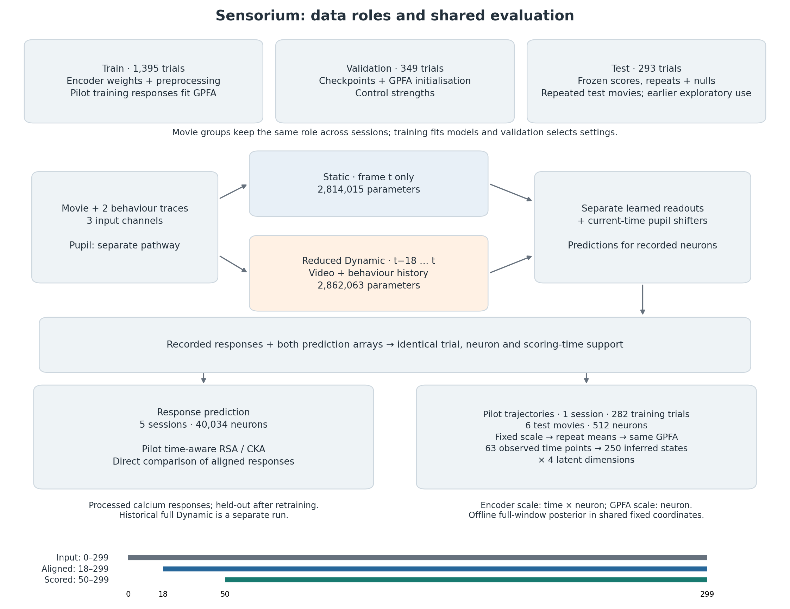

# Static and Reduced Dynamic Comparison: Setup

## 1. Research question

**With similar total parameter counts, how do Static and reduced Dynamic differ in neural-response prediction, time-aware population summaries and neural trajectories? Do these differences remain on data excluded from this run's fitting and model selection?**

These questions are addressed by one comparison of two frozen encoders from `retrained_v1`. Response evaluation covers five sessions. The detailed population-summary and Gaussian-process factor analysis (GPFA) comparison covers one pilot session. In this document, **Dynamic** means the current reduced Dynamic model; the historical full-width baseline is a separate model.

Both encoders start from scratch under the same data roles and train-only normalisation. The diagram shows their shared response support and frozen neural-defined GPFA. Similar parameter totals control overall model size while retaining the distinct cores and training settings.

[Goal 1](../01_model_validation/RESULTS.md) establishes implementation checks and the scope of historical reproduction. [Goal 2](../02_trajectory_measurement/RESULTS.md) establishes the measurement's reliability and response coverage. The model comparison itself is reported in [Results](RESULTS.md). [Response matching](../05_response_matching/SETUP.md) and [temporal-weight controls](../06_temporal_weight_controls/SETUP.md) are separate analyses; this main comparison uses the original frozen predictions.



*Current Static and reduced Dynamic share recorded-neuron targets, trial identities, timestamps and one neural-defined GPFA. Total parameter counts are similar; the cores retain different computations and access to video and behaviour history. Test movies were explored historically.*

## 2. Data and evaluation support

### Sessions and data roles

The inputs are released processed calcium responses to natural movies. Each session has its own neuron identities. Full session keys have the form `dynamic<identifier>-Video-9b4f6a1a067fe51e15306b9628efea20`.

| Session identifier | Train trials | Validation trials | Test trials | Neurons | Repeats per test movie |
| --- | ---: | ---: | ---: | ---: | --- |
| 29515-10-12 | 282 | 66 | 58 | 7,863 | 9, 9, 10, 10, 10, 10 |
| 29623-4-9 | 252 | 77 | 56 | 7,908 | 8, 9, 9, 10, 10, 10 |
| 29647-19-8 | 281 | 73 | 60 | 8,202 | 10, 10, 10, 10, 10, 10 |
| 29712-5-9 | 287 | 72 | 60 | 7,939 | 10, 10, 10, 10, 10, 10 |
| 29755-2-8 | 293 | 61 | 59 | 8,122 | 9, 10, 10, 10, 10, 10 |
| **Total** | **1,395** | **349** | **293** | **40,034** | Six movies per session |

Repeat counts are sorted by count, not by movie identity. Six movie conditions are evaluated within each session; source-film identities are needed to determine whether these correspond to 30 distinct films. Session counts describe recording units; animal replication and trajectory replication are assessed separately.

The original training tier is divided into new train and validation roles using seed 42 and whole identifiable stimulus groups, with a target validation fraction of 0.20. Group roles are coordinated across sessions. The upstream labelled repeated-movie tier, called `oracle`, supplies this run's test data. The evaluation excludes all 1,518 hidden-tier trials with placeholder response arrays and scores observed responses.

The [split manifest](../evidence/04_model_comparison/retrained_v1/split_manifest.json) retains source indices, unit IDs, original tiers, assigned roles and checksums. An approximate shifted-content check examined 7,725 proposed development/test pairs without finding verified overlap. Source-film identities remain unavailable, and the test movies were explored in earlier work. The evaluation therefore describes **held-out evaluation after retraining** within the documented history of test-movie exposure; unseen-source-film generalisation remains unverified.

### Inputs, timestamps and pilot subset

Source videos are 36 × 64 grayscale arrays. Two supplied behavioural traces are broadcast over the image and appended as input channels; two pupil-centre coordinates enter a separate shifter. The current loader takes the first 300 source frames on the released 30 Hz grid and requires complete, finite modalities. All final scores use original frames 50–299.

The pilot is session `29515-10-12`. Its 512 neurons are fixed by sorting stable unit IDs by the SHA-256 digest of `42:<unit_id>` and retaining the first 512. The hash-based rule selects neurons independently of test reliability and model accuracy. The five-session response analysis instead uses all recorded neurons in each session.

| Pilot stage | Axes | Shape |
|---|---|---|
| Aligned neural responses or model predictions | Trial × time × neuron | `[58, 250, 512]` |
| Means within each movie | Condition × time × neuron | `[6, 250, 512]` |
| Shared-space trajectories | Condition × time × latent dimension | `[6, 250, 4]` |

[Models and Data](../MODELS_AND_DATA.md#2-observations-array-shapes-and-time-alignment) defines the fields; the [split summary](../evidence/04_model_comparison/retrained_v1/split_summary.csv) retains session counts and repeats.

## 3. Models and fitting

### Architectures and parameter matching

Static applies a shared four-layer 2D core separately to each frame. Reduced Dynamic uses three Factorized3D stages, each combining spatial and temporal convolution. Both have session-specific Gaussian readouts, cortical-coordinate grid predictors, pupil-shifter families and ELU + 1 outputs. Their learned weights are separate.

| Component | Static | Reduced Dynamic |
|---|---|---|
| Core widths | 64 throughout four layers | 16 → 32 → 64 |
| Spatial operations | Initial valid 9 × 9 convolution; three pointwise/depthwise 7 × 7/pointwise blocks | Spatial kernels 11 × 11, 5 × 5 and 5 × 5; valid padding |
| Temporal operations | No frame mixing; parameter-free crop of the first 18 outputs | Temporal kernels of 11, 5 and 5 frames; valid padding; 19-frame receptive field |
| Readout and shifter | Gaussian readout, anatomical grid predictor and pupil shifter | Same families, with separately learned parameters |

| Parameter group | Static | Reduced Dynamic |
| --- | ---: | ---: |
| Core | 50,624 | 98,672 |
| Readout | 2,763,106 | 2,763,106 |
| Pupil shifter | 285 | 285 |
| **Total** | **2,814,015** | **2,862,063** |

The total difference is 48,048 parameters; the relative-count calculation is:

$$
\frac{|P_{\mathrm{Dynamic}}-P_{\mathrm{Static}}|}{P_{\mathrm{Static}}}
=0.01707453585002212\approx1.707\%.
$$

The actual-instance check uses a 2% acceptance bound. The reduced model preserves the original 1:2:4 channel progression with a uniform half-width rule and a final width of 64. The fixed half-width rule determines model width independently of trajectory scores. Older design notes used different preferred and maximum count tolerances; those are historical design thresholds, not this run's acceptance bound or a different parameter count.

**Total-count matching controls overall size; core parameters, receptive fields, computation and optimisation behaviour remain distinct.** The matched readout and shifter totals therefore coexist with distinct cores. The [actual parameter record](../evidence/04_model_comparison/retrained_v1_diagnostics/encoder/parameter_counts.json) and [model overview](../MODELS_AND_DATA.md#4-models-and-training) retain the construction details.

### Train-only preprocessing

For each session, preprocessing moments are estimated from the new training trials over source frames 0–299, preserving the original pixel/channel/neuron and time axes. Standard deviations use `ddof=0`; the moments retain time dependence.

| Field | Fixed transformation |
|---|---|
| Video and pupil centre | `(value − mean) / std` |
| Behaviour | `value / std` |
| Neural response | `value / max(std, 0.01 × mean(std))` |

Non-response standard deviations below float32 machine epsilon are replaced by one. Response scaling preserves the mean and retains small negative values from the released arrays. Readout activity initialisation uses new training batches only. These transforms use the new training moments in place of the historical all-data statistics. Validation and test apply the fixed arrays without estimating new moments. Exact array shapes and formulas are retained in [normalisation provenance](../evidence/04_model_comparison/retrained_v1/normalization_provenance.json).

### Encoder training and checkpoint selection

Both encoders start at seed 42 with new weights, optimiser state and BatchNorm state. A local resumable implementation follows the pinned upstream objective, cycling and scheduling behaviour; the historical full Dynamic run used the original trainer directly.

| Setting | Current comparison protocol |
|---|---|
| Training input | Random 80-frame snippets |
| Physical batch | Eight snippets per session |
| Gradient accumulation | Five sessions; 40 snippets per update cycle |
| Data objective | Summed Poisson loss, scaled by the square root of dataset length / batch size, plus architecture-specific regularisation |
| Optimiser | AdamW; learning rate 0.005; betas (0.9, 0.999); epsilon `1e-8`; weight decay 0.01 |
| Scheduler | Learning-rate multiplier 0.3; patience 5; tolerance `1e-6`; minimum learning rate `1e-4` |
| Training limits | Up to four learning-rate cycles and 200 epochs |
| Checkpoint and stopping input | New validation trials, evaluated with the retained random-snippet rule |

The dataset-length multiplier is retained metadata, not estimated from test responses. Loader key `oracle` contains **new validation trials only**. Separate random-snippet validation calls supply checkpoint and scheduler events, with test data reserved for scoring.

The comparison retains the models’ existing architecture-specific settings:

| Setting | Static | Reduced Dynamic |
|---|---:|---:|
| Input/spatial regularisation coefficient | 6.3831 | 10 |
| Temporal regularisation coefficient | Not applicable | 0.01 |
| Readout regularisation coefficient | 0.0076 | 0 |
| BatchNorm momentum | 0.9 | 0.7 |
| Readout `init_mu_range` | 0.3 | 0.2 |
| Readout `init_sigma` | 0.1 | 1 |

These differences remain part of the model comparison. The retained checkpoints and stopping records are reported in [Results](RESULTS.md#1-completed-training-and-comparison-scope). The source configurations and resumable training functions are linked in [Section 7](#7-evidence-and-interpretation-scope).

## 4. Frozen predictions and shared GPFA inference

### Complete-trial prediction

Complete-trial inference and the two scoring branches are shown above. Dynamic produces frames 18–299; Static crops its first 18 framewise outputs. Both use complete-trial evaluation-mode predictions to score original frames 50–299.

Neural targets and predictions share identities, neuron order and timestamps. Direct response/population metrics compare the encoder-scale arrays.

### Condition means in one fixed neural space

For trajectories, predictions and recorded responses are averaged across all available repeats **within each movie**. Each condition mean is converted into the same GPFA input scale:

```text
GPFA_input[t, n] = encoder_scaled[t, n]
                   / encoder_train_precision[t, n]
                   * GPFA_train_precision[n]
```

`precision` denotes a multiplicative scale: encoder precision varies by time and neuron, GPFA precision by neuron. Division undoes the first scale; multiplication applies the neural-training scale. Both use fixed training-derived scales shared across recorded and predicted responses.

The main four-dimensional GPFA is fitted on the pilot's 282 training trials. Validation neural likelihood selects its 0.25-second timescale initialisation; the final fit uses train alone. It observes every fourth scored frame, indices `0, 4, …, 248`, and queries all 250 timestamps. The same loadings, offsets, observation noise and temporal priors are applied separately to neural, Static and Dynamic condition means. The predictions are evaluated in those original, fixed GPFA axes.

Offline posterior inference uses the full observation window, including later observations when estimating earlier states. Scores retain their original units, with repeat-half agreement reported separately as a measurement-specific reference. [Goal 2](../02_trajectory_measurement/SETUP.md#4-shared-scaling-and-posterior-inference) defines measurement fitting and reliability.

The [frozen-analysis record](../evidence/04_model_comparison/retrained_v1/frozen_analysis.json) binds the selected models and transforms to this comparison.

<details>
<summary>Checkpoint, GPFA and data identities</summary>

| Artifact or identity | Recorded SHA-256 / semantic digest |
| --- | --- |
| Static best.pt | `3ded37a0fac494f47a8553a432e04e8be7e95a0a99ed9444b07ae61f31ff7052` |
| Reduced Dynamic best.pt | `c6eff392ec412494ef69d6e599193711f4b5428862fe57633899280144531954` |
| Main GPFA pickle | `98de0cef99973c8a57b5b44d330763a5cd0fc5ad0cab36654c058591ae6eb52c` |
| Main GPFA array export | `e1d5f87d29eab8f9406fc2a2ee1b9c72a509707c6583df839a888199e47a09f5` |
| Split semantic identity | `52d021ee699ddd5d026a4deba3375838548b352f7d46ec3b878d5460b261e926` |
| Preprocessing semantic identity | `52a9b81d45ffd23fdee5b2502a025d4234946f24568dee95b8eb2a8a9e88ac73` |

The original ignored run stores the encoders at `encoders/static/best.pt` and `encoders/dynamic/best.pt`, with the GPFA under `gpfa/`. These are run-relative locations. The [model manifest](../../../models/manifest.json) and [artifact guide](../../../models/README.md) identify current copies and access requirements. Execution requires the fitted payloads identified by the public records. Historical full Dynamic scores and weights retain their separate run identity.

</details>

## 5. Metrics

### Response and population-pattern measures

**Response correlation** is Pearson correlation for each neuron over flattened aligned trial × time samples, followed by averaging over neurons finite for both compared predictions. For an individual movie score, only that movie's repeats and timestamps are pooled. The averaging unit is the neuron after its trial/time correlation has been calculated.

**Response normalised mean squared error (NMSE)** is mean squared prediction error divided by the pooled scalar variance of the corresponding neural-response tensor. If `Y` is the neural tensor and `P` its aligned prediction,

$$
\mathrm{NMSE}(Y,P)=\frac{\operatorname{mean}[(Y-P)^2]}{\operatorname{Var}_{\mathrm{pooled}}(Y)}.
$$

Lower is better. This denominator differs from the trajectory normalisation below and from Goal 2's observation-model reconstruction denominators.

**Condition/time linear centred kernel alignment (CKA)** first averages repeats, flattens condition × time into the sample axis, and centres each neuron column. For the resulting centred matrices `X` and `Y`,

$$
\mathrm{CKA}(X,Y)=
\frac{\|X^\mathsf{T}Y\|_F^2}
{\sqrt{\|X^\mathsf{T}X\|_F^2\,\|Y^\mathsf{T}Y\|_F^2}}.
$$

**Temporal-difference CKA** applies the same calculation to first differences within each movie, excluding differences across movie boundaries.

**Condition/time-state representational similarity analysis (RSA)** samples every tenth time point, constructs correlation-distance matrices between neural population patterns, and computes Spearman correlation between jointly finite upper triangles. The pooled pilot contains 150 sampled states and 11,175 such pairwise entries. When scoring movies separately, the same procedure is restricted to each movie before averaging its scalar score.

These measures compare predicted and recorded neural responses in output space. Time-aware CKA and RSA serve as conventional comparators that retain temporal information. The recorded implementation specifies their project-specific aggregation.

### Trajectory measures

Let `Z[c, t, q]` be the neural trajectory and `P[c, t, q]` the trajectory inferred from one model's predictions. Here, `c` indexes movie, `t` time and `q` one of four GPFA dimensions. For each neural–model pair, define the pooled per-axis centre:

$$
m_q=\frac{1}{2CT}\sum_{c=1}^{C}\sum_{t=1}^{T}
\left(Z_{ctq}+P_{ctq}\right),
\qquad C=6,\ T=250.
$$

This scoring operation uses the original fixed GPFA coordinates. The same rule is applied separately to the neural–Static and neural–Dynamic pairs.

| Metric | Definition and interpretation | Role |
|---|---|---|
| Position correlation | Pearson correlation between flattened `Z − m` and `P − m` | Primary; higher is better |
| Normalised position RMSE | `sqrt(mean((Z − P)^2)) / sqrt(mean((Z − m)^2))` | Secondary; lower is better |
| Velocity-direction cosine | Mean cosine of corresponding within-movie first-difference vectors, divided by `dt = 1/30` seconds before direction comparison | Primary; higher is better |
| Speed-profile correlation | Pearson correlation between flattened norms of within-movie first-difference vectors; the common `dt` factor cancels | Secondary; higher is better |
| Acceleration-direction cosine | Mean cosine of corresponding within-movie second-difference vectors divided by `dt^2` | Secondary; higher is better; not pure curvature |

“Position” denotes a state in the fixed latent space. The normalised position-RMSE denominator depends on the compared pair through `m`, giving each pair its own normaliser. Scoring retains this implemented normalisation and pooled centring.

Direction comparisons use common nonzero-norm support across the neural reference and every compared output. The current `_trajectory_scores` wrapper uses `EPS=1e-12`, records retained support, and reports undefined scores as `NA`; legacy helpers with zero fallbacks do not define the current reporting behaviour.

All reported correlations, cosines, CKA, NMSE and normalised RMSE are dimensionless. Before normalisation, derivatives have latent units per second or per second squared. They describe the smoothed GPFA posterior on the 30 Hz query grid; interpreting exact neural latency requires a time-restricted measurement.

| Shared pilot support | Count |
|---|---:|
| Condition/time states | 1,500 |
| Within-condition first differences | 1,494 |
| Within-condition second differences | 1,488 |
| Response neurons | 512 |
| Sampled RSA states / edges | 150 / 11,175 |

Every movie is retained. Detailed measurement definitions are also in [Goal 2](../02_trajectory_measurement/SETUP.md#6-metrics-and-response-reconstruction).

## 6. Paired uncertainty and prediction nulls

### Keep the score and its interval on the same target

A **pooled score** is calculated after combining the relevant data. An **equal-weight mean movie score** is calculated by scoring each movie first and averaging the six resulting numbers. The order of pooling and scoring determines the resulting value. In particular, averaging already calculated correlations is not equivalent to correlating pooled data.

The bootstrap uses a seed-42 generator and 2,000 draws of six whole movie conditions with replacement. The same condition indices are drawn for Static and Dynamic. Repeatedly drawn conditions remain whole blocks; time differences are not introduced across their boundaries.

| Result family | Reported point | Bootstrap calculation |
|---|---|---|
| Pilot trajectory metrics | Dynamic minus Static on pooled condition-average trajectories | Recompute both pooled trajectory scores on each resampled set of whole conditions, then subtract |
| Pilot conventional metrics | Equal-weight mean of six paired movie-score differences | Calculate each movie's score first; resample the six paired scores and average |
| Per-session response intervals | Equal-weight mean of paired movie-score differences within that session | Resample that session's six conditions, using the same rule |
| Pooled conventional scores | Direct pooled trial/time or condition/time score | Separate point estimate; the mean-movie interval is not attached to it |
| Five-session summary | Unweighted mean of the five pooled session scores | No animal-population or five-session population interval is supplied |

For the interval-bearing conventional results, the displayed Static and Dynamic points are also equal-weight movie means. Each point estimate is therefore paired with an interval for the same quantity. Whole movies are the resampling units; each movie retains its frames, neurons and repeats together. Percentile endpoints are the 2.5th and 97.5th percentiles of the paired draws. The [pilot paired table](../evidence/04_model_comparison/retrained_v1/pilot/paired_bootstrap.csv) labels the target in `interval_estimand`; the [session paired table](../evidence/04_model_comparison/retrained_v1/response/response_session_paired_bootstrap.csv) retains pooled and condition-mean fields separately.

### Model-prediction nulls

Prediction nulls ask whether an encoder's unperturbed trajectory correspondence exceeds correspondence after prescribed changes to its output. The neural reference remains fixed. The operations act on **GPFA-scaled condition-average predictions, before the same frozen posterior**; input videos and encoder weights remain fixed.

| Null | Changed correspondence |
|---|---|
| Condition derangement | Assign complete prediction sequences to other movies |
| Joint circular shift | Shift a condition's whole population sequence in time |
| Time reversal | Reverse the prediction sequence deterministically |
| Independent-neuron shifts | Change each neuron's timing independently |
| 16-frame block permutation | Reorder temporal blocks while preserving order within each block |

The four random nulls each use 200 draws per model. Reversal is one transformation per model. Operator details are given in [Goal 2 Setup](../02_trajectory_measurement/SETUP.md#5-repeat-reliability-and-matched-nulls); this model comparison uses five null types, while repeat-half reliability uses eight configurations.

The random-number stream follows the existing score/reliability/bootstrap execution order seeded at 42. Outcomes and finite support are retained in [model_nulls.csv](../evidence/04_model_comparison/retrained_v1/pilot/model_nulls.csv). Superiority means a higher original score for correlation or cosine, or a lower original normalised RMSE. These descriptive comparisons measure sensitivity to the specified output perturbations within the observed dataset.

## 7. Evidence and interpretation scope

The comparison identifies how these two frozen models perform under one split, one encoder seed and one shared GPFA measurement. Common inputs, scales and fixed coordinate axes give both encoders the same neural-defined measurement. Temporal history remains coupled to differences in architecture, regularisation and optimisation. The present evidence covers one encoder seed and one trajectory session; further seeds, sessions and source-film identities would extend its generalisation scope.

Earlier full Dynamic reproduction and oracle-selected models have separate identities. The present tables retain the identities and scores of the current models. Cross-dimension and sampling-grid robustness remain unassessed following withdrawal of the auxiliary GPFA fits. These limits define the interpretation of the frozen comparison.

| Evidence | Record and relevant content |
|---|---|
| Current protocol | [retrained_v1.json](../../../code/sensorium/configs/retrained_v1.json): `data`, `preprocessing`, `models`, `training`, `traditional`, `reporting` |
| Data roles and transforms | [Split summary](../evidence/04_model_comparison/retrained_v1/split_summary.csv), [split manifest](../evidence/04_model_comparison/retrained_v1/split_manifest.json), [normalisation provenance](../evidence/04_model_comparison/retrained_v1/normalization_provenance.json) |
| Architecture-specific settings | [Static configuration](../../../code/sensorium/records/baselines/static/training_config.yaml), [reduced Dynamic configuration](../../../code/sensorium/configs/dynamic_parameter_matched.yaml) |
| Encoder fitting | [retrained_training.py](../../../code/sensorium/src/trajectory_model_eval/retrained_training.py): `sensorium_objective`, `_long_cycle`, checkpoint and random-state restoration |
| Prediction export | [retrained_predictions.py](../../../code/sensorium/src/trajectory_model_eval/retrained_predictions.py): `verify_test_lock`, `export_predictions`, `combine_pilot`, `select_neurons` |
| Current scoring | [unified_analysis.py](../../../code/sensorium/src/trajectory_model_eval/unified_analysis.py): `_conventional`, `_trajectory_scores`, `score_frozen` |
| Session aggregation | [retrained_analysis.py](../../../code/sensorium/src/trajectory_model_eval/retrained_analysis.py): `score_session_response`, `summarize_session_responses` |
| Conventional primitives | [traditional.py](../../../code/sensorium/src/trajectory_model_eval/traditional.py): `column_correlation`, `linear_cka`, `condition_means`, `correlation_rdm` |

RSA is attributed to Kriegeskorte, Mur and Bandettini (2008), *Representational similarity analysis—connecting the branches of systems neuroscience*, [doi:10.3389/neuro.06.004.2008](https://doi.org/10.3389/neuro.06.004.2008). CKA is attributed to Kornblith et al. (2019), *Similarity of neural network representations revisited*, [PMLR 97](https://proceedings.mlr.press/v97/kornblith19a.html). These references identify the methods; the time aggregation and equations used here are those recorded for this project. GPFA attribution and fitting details are in [Goal 2](../02_trajectory_measurement/SETUP.md#7-evidence-attribution-and-scope).

[Results](RESULTS.md) reports the corresponding scores, intervals, movie-level differences and their scope. The [code contract](../../../code/sensorium/README.md) describes inputs, artifacts and the actual reproduction entry point.
