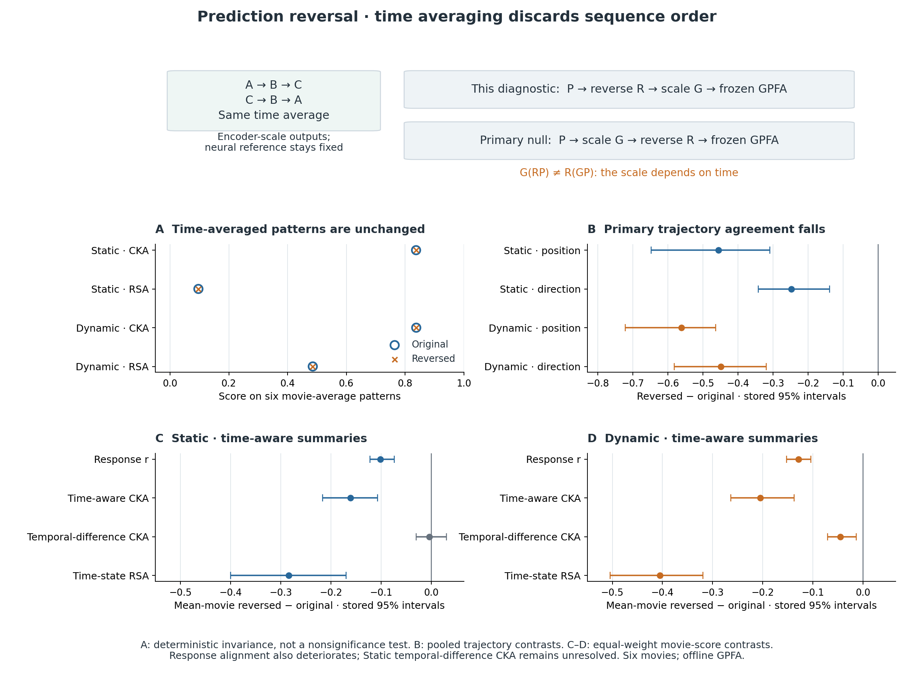

# Temporal Metric Tests: Setup

## 1. Research question

**Can reversing a model's prediction sequence leave a specified representation summary unchanged while changing its agreement with the recorded neural trajectory?**

This analysis tests what a particular summary discards. Each current encoder is compared with its own time-reversed output while the recorded responses remain unchanged. The same operation is evaluated with response metrics, time-averaged and time-aware forms of representational similarity analysis (RSA) and centred kernel alignment (CKA), and five trajectory metrics. The analysis identifies what time averaging removes and tests which other summaries register the resulting change.

The [main model comparison](../03_model_comparison/RESULTS.md) asks how Static and reduced Dynamic differ. Here, the contrast is **reversed minus original within each model**. Reversal does not match response accuracy; the separate [response-matching analysis](../05_response_matching/SETUP.md) addresses that question. The [measurement analysis](../02_trajectory_measurement/RESULTS.md) supplies the reliability and response-coverage context for the shared Gaussian-process factor analysis (GPFA).

This is a completed supplementary diagnostic configured after the main results were known. Its operation and checks are specified in the [supplementary configuration](../../../code/sensorium/configs/supplementary_reversal_v1.json). The encoder and GPFA remain fixed throughout this supplementary analysis. Its timing makes it exploratory rather than preregistered.

## 2. Data and evaluation support

The diagnostic uses pilot session `dynamic29515-10-12-Video-9b4f6a1a067fe51e15306b9628efea20`. Its current data roles are 282 training trials, 66 validation trials and 58 repeated test trials from six movie conditions. The sorted repeat counts are 9, 9, 10, 10, 10 and 10. The 512 neurons are fixed by seed-42 hashing of stable neuron IDs; they were not selected using response quality, reliability or model scores.

| Array or stage | Axes | Shape or support |
|---|---|---|
| Recorded responses and each encoder's test predictions | Trial × time × neuron | `[58, 250, 512]` |
| Within-movie repeat means | Movie × time × neuron | `[6, 250, 512]` |
| Time-averaged condition patterns | Movie × neuron | `[6, 512]` |
| GPFA posterior trajectories | Movie × time × latent dimension | `[6, 250, 4]` |
| GPFA observation indices | Scoring-window index | 63 indices: `0, 4, …, 248` |
| GPFA query indices | Scoring-window index | All 250 indices: `0, 1, …, 249` |

The inputs are released preprocessed mouse visual-cortex calcium responses and aligned video, behavioural and pupil fields, not raw electrical recordings. Full encoder inference uses 300 frames. The 18-frame output reduction is aligned to original timestamps before retaining frames 50–299. Reversal acts on these **250 scored predictions**, not on the full input video.

The array grid is 30 Hz. Earlier project documentation describes approximately 8 Hz calcium acquisition before resampling; that acquisition rate is documented in narrative sources rather than independently checked acquisition metadata here. Neither the 250-bin array nor the GPFA query grid represents 250 independent neural observations.

The cached bundle contains `neural`, `static`, `dynamic`, `conditions`, `dataset_indices`, `neuron_ids`, `frame_indices` and `encoder_precision`. The diagnostic uses the existing trial arrays directly, preserving their original trial support. The upstream labelled repeated-movie tier, called `oracle`, is test data for this retrained run. Hidden-tier zero-response placeholders are excluded. These movies were explored in historical work, so this diagnostic is not an untouched external validation.

Dataset fields and the wider data dependencies are described in [Models and Data](../MODELS_AND_DATA.md#2-observations-array-shapes-and-time-alignment).

## 3. Fixed encoders and common GPFA

In this document, **Dynamic** means the newly trained reduced Dynamic model in `retrained_v1`; the historical full-width baseline is a separate model.

| Model | Core | Selected epoch | Trainable parameters |
|---|---|---:|---:|
| Static | Framewise 2D core | 59 | 2,814,015 |
| Reduced Dynamic | Three factorised spatiotemporal stages, widths 16/32/64 | 109 | 2,862,063 |

Both models started from seed 42. They share readout and pupil-shifter families, with distinct core computations and separately learned weights. Reversal changes an existing prediction array; the encoders themselves remain fixed.

The main GPFA has four latent dimensions, a linear observation model, diagonal neuron noise and a learned radial basis function (RBF) timescale for each latent dimension. Only training neural responses fit its parameters. Validation neural likelihood selected the 0.25-second initial timescale. The final fit used 19 expectation-maximisation (EM) iterations on the 282 training trials, without adding validation trials. The diagnostic reuses this existing fit.

The posterior observes every fourth scored frame and is queried at all 250 times. It conditions on the full window, so later observations can influence an earlier inferred state. Neural, original-prediction and reversed-prediction trajectories use the same loadings, offsets, noise, temporal priors, scaling and neuron order. There is no model-specific refit, rotation or latent-axis selection. No withdrawn auxiliary GPFA sensitivity result supports this goal.

<details>
<summary>Frozen artifact identities</summary>

| Artifact | SHA-256 |
|---|---|
| Static checkpoint | `3ded37a0fac494f47a8553a432e04e8be7e95a0a99ed9444b07ae61f31ff7052` |
| Reduced Dynamic checkpoint | `c6eff392ec412494ef69d6e599193711f4b5428862fe57633899280144531954` |
| Main GPFA pickle | `98de0cef99973c8a57b5b44d330763a5cd0fc5ad0cab36654c058591ae6eb52c` |
| Original analysis freeze referenced by the supplementary configuration | `139162d5a7309f90e26990d627124ff442935ea4ce370166ede7fdc82030da90` |

The [freeze record](../evidence/04_model_comparison/retrained_v1/frozen_analysis.json) and [GPFA identity](../evidence/04_model_comparison/retrained_v1/frozen_gpfa_identity.json) identify the fixed objects. The reversal records index original and reversed caches and their source checksums. Identity JSON files identify the artifacts; they contain no weight payloads, and the [model access guide](../../../models/README.md) describes artifact availability.

</details>



*Prediction reversal changes encoder-scale output order before GPFA-scale conversion; the neural reference stays fixed. The schematic separates this operation from the after-conversion null. Panels show retained results: deterministic pattern invariance, pooled trajectory intervals, and separate equal-weight movie-score intervals for time-aware metrics. Static temporal-difference CKA remains unresolved.*

## 4. Reversal and the order of scale conversion

### One output transformation, with the reference held fixed

Let $P_{r,u,n}$ be an existing encoder prediction, where $r$ is a test trial, $u\in\{0,\ldots,249\}$ is an index within the scoring window, and $n$ is a selected neuron. Define the reversal operator $\mathcal R$ by

$$
(\mathcal R P)_{r,u,n}=P_{r,249-u,n}.
$$

The implemented operation is:

```python
P_rev = P[:, ::-1, :].copy()
```

Source frames 299 and 50 exchange predicted values; trial/movie identities, neuron order, timestamps and neural responses stay fixed. **Neither input videos nor inferred latent coordinates are reversed.**

Original and reversed outputs enter the same metric families. Response metrics use trial arrays; representation metrics use their prescribed aggregation; GPFA compares converted repeat means with the unchanged neural trajectory.

### The fixed conversion depends on time

For a condition-average prediction $\bar P$, the conversion is

$$
G(\bar P)_{c,u,n}
=\frac{\bar P_{c,u,n}}{e_{u,n}}\,g_n.
$$

Here, $e_{u,n}$ is the frozen encoder training precision and $g_n$ is the GPFA training precision. In this implementation, **precision denotes a multiplicative scale factor**. Encoder response scaling uses training-only moments at each time/neuron location, with `ddof=0` and no mean subtraction. Its precision therefore varies with both time and neuron. Dividing by $e_{u,n}$ undoes that response scaling.

GPFA precision is fixed per neuron:

$$
g_n=
\frac{1}{\max\left(s_n,\;0.01\,\operatorname{mean}_{j}(s_j)\right)},
$$

where $s_n$ is the standard deviation of raw-scale training responses pooled over training trials and scoring-window times, with `ddof=1`. Multiplication by $g_n$ applies the common neural-training scale. Recorded and predicted arrays use the same conversion. The [measurement setup](../02_trajectory_measurement/SETUP.md#4-shared-scaling-and-posterior-inference) gives its fitting and inference details.

### Why this is not the primary model-null reversal

This counterexample reverses encoder-scale predictions **before** conversion. At a fixed scoring-window index $u$, its converted value is

$$
G(\mathcal R\bar P)_{c,u,n}
=\frac{\bar P_{c,249-u,n}}{e_{u,n}}\,g_n.
$$

The primary model-null instead reverses the **already converted** condition-average response:

$$
\bigl(\mathcal R G(\bar P)\bigr)_{c,u,n}
=\frac{\bar P_{c,249-u,n}}{e_{249-u,n}}\,g_n.
$$

The time-dependent scale stays at its original timestamps, giving the two different denominators shown above. Thus **reversal and scaling do not commute**, defining two distinct controls.

## 5. Metrics and what time averaging preserves

### Time-averaged condition-pattern summaries

For movie $c$, first average its repeated predictions and then average all $T=250$ scored times. With $I_c$ denoting that movie's trial indices,

$$
A_{c,n}(P)=
\frac{1}{|I_c|T}
\sum_{r\in I_c}\sum_{u=0}^{T-1}P_{r,u,n}.
$$

Reversal permutes the terms in the time sum, so in exact arithmetic:

$$
A_{c,n}(\mathcal R P)=A_{c,n}(P)
$$

These patterns are formed **in encoder-target scale, before GPFA conversion**, using float64 accumulation. The invariance statement concerns these patterns; it does not assert preservation of the time average after a time-dependent scale conversion.

Time-averaged condition-pattern CKA compares the six neural patterns with the six predicted patterns using centred linear CKA. Time-averaged condition-pattern RSA compares their correlation-distance matrices using Spearman correlation over the 15 unique movie-pair distances. The neural patterns remain fixed. Identical prediction patterns therefore give identical values for these two summaries, up to the checked numerical tolerance.

The 15 RSA edges here describe movie-pattern distances; the 11,175 edges of the time-state RSA below describe state distances. Each measure retains its own support label.

### Response and time-aware representation measures

| Measure | Input and calculation | Direction |
|---|---|---|
| Response r | Flatten trial and time within each neuron; compute Pearson r against recorded responses; average neurons defined for both compared outputs. | Higher is better |
| Response normalised mean squared error (NMSE) | Mean squared prediction error divided by the recorded tensor's pooled scalar variance. | Lower is better |
| Condition/time CKA | Average repeats within movies, flatten movie × time, centre each neuron column and apply linear CKA. | Higher is better |
| Temporal-difference CKA | Apply the same CKA to within-movie first differences of the repeat means. | Higher is better |
| Condition/time-state RSA | Sample every tenth time point; compute correlation distances between population states and Spearman correlation over shared finite upper-triangle distances. | Higher is better |

For column-centred matrices $X$ and $Y$, linear CKA is

$$
\operatorname{CKA}(X,Y)=
\frac{\|X^{\mathsf T}Y\|_F^2}
{\sqrt{\|X^{\mathsf T}X\|_F^2\,
             \|Y^{\mathsf T}Y\|_F^2}}.
$$

The response and time-aware measures preserve temporal correspondence in their inputs, allowing their values to change when one prediction sequence is reversed against a fixed neural reference. All representation comparisons use predicted and recorded population responses in output space.

### Trajectory measures

Let $Z$ be the neural trajectory and $\widehat Z$ the original or reversed prediction's trajectory, each with shape `[6, 250, 4]`. Position correlation and velocity-direction cosine are primary. The other three measures are secondary.

| Measure | Calculation | Role and direction |
|---|---|---|
| Position correlation | Subtract the same per-axis centre pooled across $Z$ and $\widehat Z$; flatten both centred arrays and compute Pearson r. | Primary; higher is better |
| Velocity-direction cosine | Compute within-movie first differences divided by $\Delta t=1/30$ s; average corresponding direction cosines on jointly nonzero-norm support. | Primary; higher is better |
| Normalised position root mean squared error (RMSE) | Divide $\operatorname{RMS}(Z-\widehat Z)$ by $\operatorname{RMS}(Z-m)$, where $m$ is the same pair-pooled per-axis centre. | Secondary; lower is better |
| Speed-profile correlation | Pearson r between the flattened norms of the within-movie velocity vectors. | Secondary; higher is better |
| Acceleration-direction cosine | Use within-movie second differences divided by $\Delta t^2$; average corresponding direction cosines. | Secondary; higher is better |

The normalised RMSE denominator is specific to each neural/prediction pair. Position denotes latent state, and derivatives describe changes in the offline GPFA posterior. Physical object positions, independently observed neural velocities and causal latencies remain outside these definitions. All reported correlations, cosines, CKA scores and normalised errors are dimensionless.

The recorded full support is 1,500 condition/time states, 1,494 first differences, 1,488 second differences and 512 response neurons. Time-state RSA uses 150 sampled states and 11,175 pairwise edges. Undefined scores remain `NA`; they are not replaced by zero. Full metric definitions are also recorded in the [main comparison setup](../03_model_comparison/SETUP.md#5-metrics).

## 6. Numerical checks, paired intervals and related nulls

### Deterministic invariance and baseline replay

The operation is performed once per model. Two types of checks are kept separate:

| Check | Absolute tolerance | Purpose |
|---|---:|---|
| Original versus reversed time-averaged condition patterns | `1e-10` | Check preservation of the actual summary inputs |
| Original versus reversed time-averaged pattern RSA/CKA | `1e-10` | Check preservation of the corresponding metric values |
| Original scores replayed here versus the main score table | `3e-6` | Check consistency with the frozen baseline within the declared tolerance |

Pattern invariance is a deterministic property checked numerically; it is separate from nonsignificance or randomisation p-values. Baseline replay checks agreement within tolerance rather than bitwise identity.

### Keep points and intervals on the same statistical target

For each model, define the contrast as

$$
\Delta=S_{\mathrm{reversed}}-S_{\mathrm{original}}.
$$

Negative differences indicate reduced similarity for correlations, CKA and direction cosines. Positive differences indicate greater error for response NMSE and normalised position RMSE.

The paired bootstrap uses seed 42 and 2,000 draws of six whole movie conditions with replacement. Original and reversed outputs are paired within each draw. The score targets differ by metric family:

| Family | Point estimate and interval target |
|---|---|
| Trajectory metrics | Recompute the pooled condition-average trajectory score for the sampled movies. Both points and the interval concern this pooled score and its reversal contrast. |
| Response and time-aware conventional metrics | Score each movie separately, then average the six movie scores equally. The paired interval concerns the mean within-movie reversal contrast. |
| Time-averaged condition-pattern RSA/CKA | Evaluate the deterministic preservation check on the six patterns. No random-sampling interval or p-value is assigned to invariance. |

Pooled conventional scores are also reported as separate point estimates. The condition-mean intervals belong to their corresponding movie-mean points. Saved `a`, `b` and `b_minus_a` fields retain each matched point and difference; displayed rounded values are not used to reconstruct the differences.

Movie resampling describes variation within this six-movie pilot. Frames, repeats, RSA edges and bootstrap draws are not independent animals. These intervals are also distinct from the repeat-partition ranges used for neural reliability in Goal 2.

### Related primary model-prediction nulls

The primary comparison already includes condition derangement, a joint per-movie circular shift, independent-neuron shifts, 16-frame block permutation and time reversal. They alter converted condition-average predictions before the frozen posterior. Their respective targets are movie identity, absolute temporal alignment, population timing, inter-block order and temporal order.

Each random null uses 200 draws; reversal is one deterministic operation per model. Paired transformations are shared across Static and Dynamic. In `score_frozen`, transformation seeds come from the seed-42 generator after the 2,000 main bootstrap draws. These records provide related measurement controls, not additional independent reversal experiments. The current counterexample supplies its own before-conversion operation and cross-metric comparison.

## 7. Source records and interpretation scope

| Source | Relevant settings or functions |
|---|---|
| [Supplementary reversal configuration](../../../code/sensorium/configs/supplementary_reversal_v1.json) | `operation`, `source_freeze_sha256`, invariance tolerances, `baseline_replay_absolute_tolerance`, bootstrap settings and estimands |
| [Reversal implementation](../../../code/sensorium/src/trajectory_model_eval/supplementary_reversal.py) | `run`, `condition_pattern_scores`; array reversal, float64 pattern construction and separate interval targets |
| [Shared scoring implementation](../../../code/sensorium/src/trajectory_model_eval/unified_analysis.py) | `FrozenAnalysis.gpfa_input`, `latent_gpfa`, `_conventional`, `_trajectory_scores`, `score_frozen`; scale conversion and the primary after-conversion null |
| [Traditional metric kernels](../../../code/sensorium/src/trajectory_model_eval/traditional.py) | `column_correlation`, `condition_means`, `linear_cka`, `correlation_rdm` |
| [Null operators](../../../code/sensorium/src/trajectory_reliability/reliability.py) | `_null_response`, `_block_shuffle`, `_derangement` |
| [Main configuration](../evidence/04_model_comparison/retrained_v1/configuration.json) | `data`, `gpfa`, `model_nulls`, `traditional` |
| [Frozen analysis](../evidence/04_model_comparison/retrained_v1/frozen_analysis.json) and [GPFA identity](../evidence/04_model_comparison/retrained_v1/frozen_gpfa_identity.json) | Checkpoint, preprocessing, GPFA and analysis identities; fitting and selection roles |

[Results](RESULTS.md#7-result-records) links the operation scores, paired intervals and numerical checks. The inference concerns the within-movie order information removed by time averaging: the unchanged pattern is insensitive to that alteration. Score reductions in other measures leave independence from response information, universal superiority over conventional metrics and a neural algorithm unresolved. Exact biological meanings of the latent axes are not identified. Historical regression residuals and withdrawn GPFA sensitivity results are not evidence for this goal.
