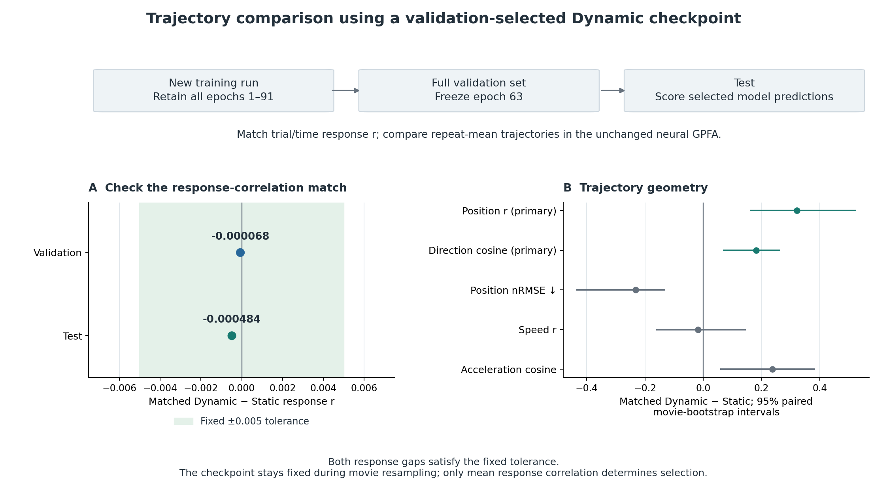

# Response Matching by Dynamic Checkpoint: Results

**Dynamic epoch 63 retains higher trajectory position and local-direction agreement at nearly the same mean response correlation as Static.** The test response-r gap is **0.000483949**, within the fixed 0.005 tolerance. Position correlation is **0.737842 versus 0.416545**, and velocity-direction cosine is **0.441458 versus 0.259418**. Both primary paired intervals exclude zero. Speed-profile agreement remains unresolved.

These are the selected checkpoint's direct predictions. The comparison matches the named mean response-correlation summary; the trajectory measures describe the latent paths and their local changes in the shared neural GPFA space.

## 1. Completed checkpoint selection

The new Dynamic training run reached native early stopping at **epoch 91** under the unchanged training policy. Every completed checkpoint from epochs **1–91** was scored on the complete 66-trial pilot validation set. **Epoch 63** had the smallest absolute response-r gap from the frozen Static epoch-59 model and was frozen before test evaluation.

The candidate rule was clarified before full-pilot matching scores and new test outputs: retain every completed epoch through the earlier of epoch 119 and verified native early stopping. The [protocol revision](../evidence/04_model_comparison/checkpoint_matching_v1/protocol_revision.json) and [completion proof](../evidence/04_model_comparison/checkpoint_matching_v1/cohort_completion.json) record this rule and its execution. Initial parameters matched the original run, while subsequent training states differed; the [run-difference record](../evidence/04_model_comparison/checkpoint_matching_v1/replay_difference_note.json) preserves that distinction.

The original main comparison remains Static epoch 59 versus Dynamic epoch 109. The new matched checkpoint has SHA-256 `f8730fc47796c7d6cf7d383f1b0e8ccb9255d5613dba9bd8acd9c3c2b38b310f`. Its [frozen selection](../evidence/04_model_comparison/checkpoint_matching_v1/checkpoint_selection.json) binds the checkpoint, all candidate scores, the source identities and the selection settings.

## 2. The response match transfers to test

| Data role | Static response r | Matched Dynamic response r | Stored absolute gap | Within 0.005 |
|---|---:|---:|---:|---|
| Validation — 66 trials | 0.146299203 | 0.146231522 | 0.000067682 | Yes |
| Test — 58 trials | 0.145128707 | 0.144644757 | 0.000483949 | Yes |

All **512 neurons** have finite correlations across the validation candidate cohort and on test. The same neuron set is used for both stages. Within each neuron, trial and time samples are pooled before Pearson correlation; the neuron correlations are then averaged. The [summary](../evidence/04_model_comparison/checkpoint_matching_v1/summary.json) records `test_matching_evaluable=true`, `test_matching_retained=true` and `test_retuned=false`.

The [candidate table](../evidence/04_model_comparison/checkpoint_matching_v1/checkpoint_candidates.csv) contains all 91 candidates. The tolerance establishes closeness of this scalar score; it is not an equivalence test or a requirement that individual-neuron scores be equal.

*Both response gaps are inside the fixed tolerance. The trajectory panel shows matched Dynamic minus Static on the five geometric measures, with paired whole-movie bootstrap intervals. Speed remains unresolved. Checkpoint selection and model weights stay fixed during resampling.*

## 3. Trajectory geometry

The test comparison uses six repeated movies, 512 neurons and 250 time bins. Responses and predictions are averaged within each movie and passed through the same fixed four-dimensional GPFA. This gives 1,500 latent states, 1,494 within-movie velocity comparisons and 1,488 acceleration comparisons.

| Trajectory measure | Role | Static | Matched Dynamic, epoch 63 | Matched Dynamic − Static | 95% paired interval |
|---|---|---:|---:|---:|---|
| Position correlation | Primary | 0.416545 | 0.737842 | +0.321297 | [+0.162470, +0.521944] |
| Velocity-direction cosine | Primary | 0.259418 | 0.441458 | +0.182040 | [+0.070690, +0.261959] |
| Normalised position RMSE ↓ | Secondary | 0.922172 | 0.689921 | -0.232250 | [-0.432846, -0.132657] |
| Speed-profile correlation | Secondary | 0.534564 | 0.517173 | -0.017391 | [-0.158366, +0.144102] |
| Acceleration-direction cosine | Secondary | 0.133099 | 0.369716 | +0.236618 | [+0.060662, +0.380622] |

The selected Dynamic checkpoint follows the neural latent positions and local movement directions more closely. Its normalised position error is lower and acceleration-direction agreement is higher. **The speed contrast is slightly negative and its interval crosses zero**, so the results do not support improvement in every geometric property.

Point scores come from [response_matching_metrics.csv](../evidence/04_model_comparison/checkpoint_matching_v1/response_matching_metrics.csv). Contrasts and intervals are the stored full-precision results from [response_matching_bootstrap.csv](../evidence/04_model_comparison/checkpoint_matching_v1/response_matching_bootstrap.csv); displayed values are rounded. Each of the five intervals uses 2,000 valid, seed-42 paired draws of six whole movies. It recomputes both pooled trajectory scores on the same sampled movies, holding the checkpoint fixed.

### Differences across movies

Position agreement is higher for all six movies. Local-direction agreement is higher for five, with the exception retained below:

| Movie | Position-r difference | Direction-cosine difference |
|---|---:|---:|
| `movie_00005` | +0.012136 | -0.087742 |
| `movie_00028` | +0.395396 | +0.154184 |
| `movie_00031` | +0.778998 | +0.294869 |
| `movie_00052` | +0.193799 | +0.241536 |
| `movie_00067` | +0.408436 | +0.251084 |
| `movie_00120` | +0.264996 | +0.238311 |

These are within-movie point contrasts from [condition metrics](../evidence/04_model_comparison/checkpoint_matching_v1/response_matching_condition_metrics.csv). The pooled trajectory contrast above is recomputed over all movie/time states and need not equal the mean of these movie scores.

## 4. Other response and representation measures

| Measure | Static | Matched Dynamic, epoch 63 |
|---|---:|---:|
| Mean per-neuron response r — matching target | 0.145129 | 0.144645 |
| Response NMSE ↓ | 0.978172 | 0.978119 |
| Condition/time CKA | 0.456054 | 0.431186 |
| Temporal-difference CKA | 0.028074 | 0.071593 |
| Condition/time-state RSA | 0.424808 | 0.470534 |

Response NMSE is also numerically very close, although it was not a selection criterion. The representation measures show mixed directions: condition/time CKA is lower for the matched Dynamic checkpoint, while temporal-difference CKA and time-state RSA are higher. Their point scores remain separate outcomes; the five trajectory intervals do not provide intervals for these conventional measures.

## 5. Interpretation and provenance

Similar mean response correlation coexists here with different agreement in latent position and local direction. The geometric measures expose those differences in the same response arrays. This control does not establish that trajectory representations contain information absent from the responses or from all other representation measures.

The result concerns one selected checkpoint, one training seed, one pilot session and six test movies. The GPFA remains the original offline neural measurement; its reliability and response coverage are described in [Goal 02](../02_trajectory_measurement/RESULTS.md). Repeat averaging and posterior inference remain part of the common measurement applied to all three response arrays.

The [setup](SETUP.md) defines the candidate policy, finite neuron support, scaling and metrics. The [new evidence directory](../evidence/04_model_comparison/checkpoint_matching_v1/) contains the selection, model and prediction checks, source audit and saved results. The superseded [output-noise method](HISTORICAL_OUTPUT_NOISE_SETUP.md) and [results](HISTORICAL_OUTPUT_NOISE_RESULTS.md) retain their original values as historical records. The earlier [epoch-65 comparison](../evidence/04_model_comparison/extended_prediction_summary.json) also belongs to a separate training run.
