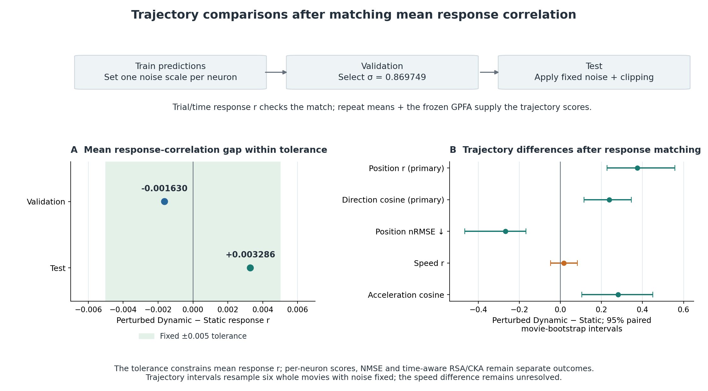

# Response Matching: Setup

## 1. Research question

**When one response-correlation summary is brought within a fixed tolerance, do Static and perturbed Dynamic outputs still differ in their agreement with the recorded neural trajectory?**

The [main model comparison](../03_model_comparison/RESULTS.md) reports better response prediction and stronger primary trajectory agreement for reduced Dynamic. This control tests whether the trajectory differences persist when the specified scalar response scores are brought close together. Static predictions are unchanged. Additive noise and a fixed lower clipping bound modify reduced Dynamic predictions, with the noise amplitude selected using validation data alone.

The selected operation is then applied unchanged to test predictions. Its response-score gap is checked before interpreting the trajectory comparison. The diagnostic modifies the saved outputs while the trained encoders remain fixed. Matching targets **mean per-neuron response correlation**. Individual-neuron accuracy and other output properties may still differ; statistical equivalence is a separate question.

The [trajectory measurement analysis](../02_trajectory_measurement/RESULTS.md) supplies the reliability and response-coverage context. The separate [temporal metric tests](../04_temporal_metric_tests/SETUP.md) ask what a fixed reversal changes or preserves. Their distinct operation addresses a complementary question.

## 2. Data roles and evaluation support

The control uses pilot session `dynamic29515-10-12-Video-9b4f6a1a067fe51e15306b9628efea20`. Its current split contains 282 training trials, 66 validation trials and 58 repeated test trials from six movie conditions. The sorted test repeat counts are 9, 9, 10, 10, 10 and 10. Seed-42 hashing of stable neuron IDs fixes the 512-neuron subset independently of response accuracy and reliability.

| Data role | Trials | Use in this control |
|---|---:|---|
| Train | 282 | Estimate one noise scale per neuron from the frozen Dynamic model's training predictions. |
| Validation | 66 | Compare candidate perturbation amplitudes against Static using the specified response-correlation summary. Select and freeze one amplitude. |
| Test | 58 | Apply the frozen perturbation, check whether the response gap remains within tolerance, and score trajectories and other response summaries. |

All roles use the same pilot neurons and original scoring frames 50–299. Amplitude selection pools trial and time samples within each neuron, allowing validation movies without repeats. Trajectory and representation metrics use within-movie test repeat means; the response-correlation matching target uses individual trial/time samples.

| Array or stage | Axes | Shape or support |
|---|---|---|
| Training Dynamic predictions used for noise scaling | Trial × time × neuron | `[282, 250, 512]` |
| Validation targets and predictions | Trial × time × neuron | `[66, 250, 512]` |
| Test targets and predictions | Trial × time × neuron | `[58, 250, 512]` |
| Test repeat means | Movie × time × neuron | `[6, 250, 512]` |
| GPFA posterior trajectories | Movie × time × latent dimension | `[6, 250, 4]` |

Inputs are released preprocessed mouse visual-cortex responses with aligned video, behavioural and pupil fields. Full encoder inference consumes 300 frames. Both models' 18-frame output reduction is aligned to original timestamps, after which frames 50–299 are retained. The 30 Hz array grid contains resampled neural responses. Earlier project notes describe approximately 8 Hz calcium acquisition before resampling; that rate is documented in narrative sources rather than independently checked acquisition metadata here.

The bundles contain `neural`, `static`, `dynamic`, `conditions`, `dataset_indices`, `neuron_ids`, `frame_indices` and `encoder_precision`. The control uses the existing trial arrays directly, preserving their original trial support. Hidden-tier zero-response placeholders are excluded. The upstream labelled repeated-movie tier, called `oracle`, is test data for this retrained run. Historical exploration of these movies limits external-validation claims; the current result provides held-out evaluation after retraining. The wider data dependencies are in [Models and Data](../MODELS_AND_DATA.md#3-training-validation-and-test-data).

## 3. Frozen models and control identity

Here, **Dynamic** means the reduced Dynamic encoder from `retrained_v1`; the historical full-width model is a separate model.

| Model | Core | Selected epoch | Trainable parameters |
|---|---|---:|---:|
| Static | Framewise 2D core | 59 | 2,814,015 |
| Reduced Dynamic | Three factorised spatiotemporal stages, widths 16/32/64 | 109 | 2,862,063 |

Both models started from seed 42. They share readout and pupil-shifter families, but their cores and learned weights differ. This control changes Dynamic outputs with both selected encoders held fixed. The training design and parameter comparison remain in the [main comparison setup](../03_model_comparison/SETUP.md#3-models-and-fitting).

The shared four-dimensional Gaussian-process factor analysis (GPFA) has a linear observation model, diagonal neuron noise and a learned radial basis function (RBF) timescale per latent dimension. Training neural responses alone fit its parameters. Validation neural likelihood selected the 0.25-second initial timescale. The final fit used 19 expectation-maximisation (EM) iterations on the 282 training trials alone.

The posterior observes 63 scoring-window indices, `0, 4, …, 248`, and is queried at all 250 timestamps. It conditions on the full window, so later observations can influence an earlier inferred state. Neural responses, Static predictions and perturbed Dynamic predictions use the same fixed GPFA and preprocessing. The objective uses the retained main GPFA, with auxiliary sensitivity analyses withdrawn.

The selected output-noise amplitude is `sigma=0.8697490026177834`. The saved `frozen_control.npz` contains the training-derived `noise_scale`. The [frozen analysis record](../evidence/04_model_comparison/retrained_v1/frozen_analysis.json) binds that control to the amplitude, noise seed, clipping floor, selected checkpoints and GPFA. These choices are unchanged by test scoring.

<details>
<summary>Frozen artifact identities</summary>

| Artifact | SHA-256 |
|---|---|
| Static checkpoint | `3ded37a0fac494f47a8553a432e04e8be7e95a0a99ed9444b07ae61f31ff7052` |
| Reduced Dynamic checkpoint | `c6eff392ec412494ef69d6e599193711f4b5428862fe57633899280144531954` |
| Main GPFA pickle | `98de0cef99973c8a57b5b44d330763a5cd0fc5ad0cab36654c058591ae6eb52c` |

These values identify local artifacts whose parameters reside in separate model payloads. The [model access guide](../../../models/README.md) describes their availability.

</details>



*Training predictions set the noise scale; validation selects one amplitude, then test applies it unchanged. The response tolerance band shows the fixed acceptance rule; statistical equivalence was not tested. The trajectory panel uses stored pooled-score intervals with fixed noise; speed remains unresolved.*

## 4. Output perturbation and amplitude selection

### Training predictions determine the noise scale

Let $P^D_{i,u,n}$ denote an encoder-target-scaled Dynamic prediction for trial $i$, scoring-window index $u$ and neuron $n$. Calculate

$$
s_n=\operatorname{std}_{i\in\mathrm{train},\,u}
       \left(P^D_{i,u,n};\ \mathrm{ddof}=0\right).
$$

This per-neuron standard deviation measures variation across training Dynamic predictions. This prediction-derived scale is distinct from neural trial variability, residual noise and the neural-derived GPFA scale.

For a candidate amplitude $\sigma$, the perturbed prediction is

$$
\widetilde P^{D,\sigma}_{i,u,n}
=
\max\left(
P^D_{i,u,n}+\sigma s_n\epsilon_{i,u,n},\;10^{-5}
\right).
$$

Noise and the lower clip act only on Dynamic outputs in encoder-target units. Neural preprocessing and Static predictions remain unchanged; the full addition-and-clipping operation defines the control.

### Noise is fixed by trial identity

Each trial receives a fixed array of independent standard-normal draws. The recorded `_noise` procedure uses the project digest helper as follows:

```python
identity = _digest(session, str(dataset_index), 123)
rng = np.random.default_rng(int(identity[:16], 16))
epsilon = rng.normal(size=(250, 512))
```

The saved trial identity and seed 123 fix one noise realisation per trial. Each validation amplitude reuses the trial-specific realisation generated independently of test targets. Seed 123 differs from model/bootstrap seed 42.

### Only one response summary determines selection

For a recorded response tensor $Y$ and a prediction tensor $P$, the matching score is

$$
r_{\mathrm{resp}}(Y,P)
=
\frac{1}{|\mathcal N|}\sum_{n\in\mathcal N}
\operatorname{corr}\left(
\operatorname{vec}_{i,u}Y_{i,u,n},
\operatorname{vec}_{i,u}P_{i,u,n}
\right).
$$

Trial and time are flattened within each neuron before calculating Pearson correlation. $\mathcal N$ contains neurons for which both Static and the candidate output have defined correlations against the same reference. Their mean correlations are compared on shared finite support, with undefined scores retained as undefined.

The candidate grid is zero followed by 100 geometrically spaced values:

```python
sigma_grid = np.concatenate(([0.0], np.geomspace(0.01, 10.0, 100)))
```

There are 101 candidates. For each candidate, compute the validation absolute gap

$$
a_{\mathrm{val}}(\sigma)
=
\left|
 r_{\mathrm{resp}}(Y_{\mathrm{val}},\widetilde P^{D,\sigma}_{\mathrm{val}})
 -r_{\mathrm{resp}}(Y_{\mathrm{val}},P^S_{\mathrm{val}})
\right|.
$$

Evaluate the full grid and choose the smallest validation gap, breaking ties by first grid occurrence. The [selection table](../evidence/04_model_comparison/retrained_v1/response_matching_selection.csv) retains all 101 rows.

The selected amplitude is then frozen. On test, calculate the same absolute gap and record whether

$$
a_{\mathrm{test}}(\sigma^*)\leq0.005.
$$

The absolute-gap rule permits the perturbed score to fall on either side of Static, including opposite sides in validation and test. The amplitude, noise seed and matching threshold stay fixed for test. [Results](RESULTS.md#2-the-fixed-response-match-transfers-to-test) reports both gaps and the retained support.

## 5. From perturbed responses to the shared trajectory

Noise and clipping are applied to each trial before repeat averaging. For movie $c$ with trial set $\mathcal T_c$, form

$$
\overline{\widetilde P}^{D}_{c,u,n}
=
\frac{1}{|\mathcal T_c|}
\sum_{i\in\mathcal T_c}\widetilde P^{D,\sigma^*}_{i,u,n}.
$$

Use the same within-movie averaging for recorded responses and Static predictions. All available test repeats of each movie enter these means; this is distinct from splitting repeats into halves for reliability.

The frozen conversion to GPFA input scale is

$$
G(\bar P)_{c,u,n}
=
\frac{\bar P_{c,u,n}}{e_{u,n}}\,g_n.
$$

Here, $e_{u,n}$ is the encoder training precision and $g_n$ is the GPFA training precision. In this implementation, precision denotes a multiplicative scale factor. Encoder response scaling uses training-only time/neuron moments with `ddof=0` and no mean subtraction, so $e$ depends on both time and neuron. Dividing by it undoes that response scaling.

For the GPFA, let $s_n^{\mathrm{neural}}$ be the raw-response standard deviation over training trial/time samples, computed with `ddof=1`. Then

$$
g_n=
\frac{1}{\max\left(
 s_n^{\mathrm{neural}},
 0.01\,\operatorname{mean}_{j}s_j^{\mathrm{neural}}
\right)}.
$$

The prediction-derived noise scale $s_n$ and neural-derived GPFA scale $g_n$ serve different purposes. Both stay frozen after training.

Static predictions and recorded responses use the same conversion and posterior without the output perturbation. All comparisons retain the original scales, GPFA parameters and latent axes. The common measurement is described in the [trajectory measurement setup](../02_trajectory_measurement/SETUP.md#4-shared-scaling-and-posterior-inference).

## 6. Metrics and paired uncertainty

### Matching target and other response summaries

Only the mean per-neuron response r defined in Section 4 is calibrated. The following measures provide additional comparisons after amplitude selection:

| Measure | Input and calculation | Direction |
|---|---|---|
| Response normalised mean squared error (NMSE) | Mean squared prediction error divided by the observed trial tensor's pooled scalar variance. | Lower is better |
| Condition/time centred kernel alignment (CKA) | Average repeats, flatten movie × time and centre each neuron column; apply linear CKA. | Higher is better |
| Temporal-difference CKA | Apply the same CKA to within-movie first differences of the repeat means. | Higher is better |
| Condition/time-state representational similarity analysis (RSA) | Sample every tenth frame, form population-pattern correlation distances and calculate Spearman correlation over shared finite upper-triangle distances. | Higher is better |

For column-centred matrices $X$ and $Y$,

$$
\operatorname{CKA}(X,Y)=
\frac{\|X^{\mathsf T}Y\|_F^2}
{\sqrt{\|X^{\mathsf T}X\|_F^2\,
             \|Y^{\mathsf T}Y\|_F^2}}.
$$

These CKA and RSA versions retain temporal correspondence in recorded and predicted population responses. They operate in output space and may differ even when mean per-neuron response r is close.

### Trajectory measures

Let $Z$ be the neural trajectory and $\widehat Z$ the Static or perturbed Dynamic trajectory, both with shape `[6, 250, 4]`. Position correlation and velocity-direction cosine remain primary. The other three measures are secondary.

| Measure | Calculation | Role and direction |
|---|---|---|
| Position correlation | Subtract the same per-axis centre pooled across $Z$ and $\widehat Z$; flatten both centred arrays and compute Pearson r. | Primary; higher is better |
| Velocity-direction cosine | Compute within-movie first differences divided by $\Delta t=1/30$ s; average corresponding direction cosines on jointly nonzero-norm support. | Primary; higher is better |
| Normalised position root mean squared error (RMSE) | Divide $\operatorname{RMS}(Z-\widehat Z)$ by $\operatorname{RMS}(Z-m)$, where $m$ is the same pair-pooled per-axis centre. | Secondary; lower is better |
| Speed-profile correlation | Pearson r between the flattened norms of the within-movie velocity vectors. | Secondary; higher is better |
| Acceleration-direction cosine | Use within-movie second differences divided by $\Delta t^2$; average corresponding direction cosines. | Secondary; higher is better |

The normalised RMSE centre and denominator depend on the compared pair. Position denotes latent state. Derivatives describe changes in the smoothed offline posterior; relating them to physical motion or causal neural timing requires corresponding measurements. All reported correlations, cosines, CKA scores and normalised errors are dimensionless. The [main comparison definitions](../03_model_comparison/SETUP.md#5-metrics) use the same conventions.

Full common support comprises 1,500 condition/time states, 1,494 first differences, 1,488 second differences and 512 response neurons. Time-state RSA uses 150 sampled states and 11,175 edges. Undefined values retain the `NA` designation.

### Paired intervals concern the fixed control

For each of the five trajectory metrics, the saved contrast is

$$
\Delta_S=S(Z,\widehat Z^{D,\mathrm{perturbed}})
          -S(Z,\widehat Z^S).
$$

Positive differences favour perturbed Dynamic for correlations and direction cosines; negative differences favour it for normalised position RMSE.

The paired bootstrap uses seed 42 and 2,000 draws of six whole movie conditions with replacement. Each draw retains the neural reference and both outputs for the same sampled movies. The pooled condition-average trajectory score is recomputed for each output; their difference is then recorded. Point estimates and reported 95% intervals concern the same pooled-trajectory target.

The amplitude and trial-keyed noise stay fixed during resampling. The intervals describe movie resampling conditional on the fixed noise and calibration; further repetitions would be needed to quantify noise-, calibration- or training-seed variability. Movies are the resampling units; frames, repeats and RSA comparisons remain grouped within them.

Only five trajectory contrasts have control-specific intervals. Response and representation scores are reported as point estimates; control-specific intervals would require their own paired analysis. The response-r tolerance defines scalar closeness; statistical equivalence remains untested.

## 7. Source records and interpretation scope

| Source | Relevant fields or functions |
|---|---|
| [Active calibration implementation](../../../code/sensorium/src/trajectory_model_eval/retrained_analysis.py) | `freeze_analysis`; training-prediction standard deviations, amplitude grid, shared finite support, selection and control persistence |
| [Noise and frozen scoring](../../../code/sensorium/src/trajectory_model_eval/unified_analysis.py) | `_noise`, `_response_r`, `score_frozen`, `_trajectory_scores`; trial-keyed draws, clipping, test matching and pooled-trajectory bootstrap |
| [Recorded configuration](../evidence/04_model_comparison/retrained_v1/configuration.json) | `response_matching.noise_seed`, `tolerance`, `sigma_grid_rule`, clipping floor and failed-test interpretation; `traditional.paired_bootstrap_samples`, `project.seed` |
| [Validation selection](../evidence/04_model_comparison/retrained_v1/response_matching_selection.csv) | All 101 candidates; `selected=True`, amplitude, validation scores and `absolute_gap` |
| [Frozen analysis](../evidence/04_model_comparison/retrained_v1/frozen_analysis.json) | `response_matching`, `control_sha256`, `checkpoint_identities` and `gpfa_identity` |
| [Evaluation summary](../evidence/04_model_comparison/retrained_v1/evaluation_summary.json) | `pilot.response_matching`, including `test_absolute_gap`, `test_matching_retained` and `test_retuned` |
| [Traditional kernels](../../../code/sensorium/src/trajectory_model_eval/traditional.py) and [trajectory definitions](../../../code/sensorium/src/trajectory_reliability/metrics.py) | Implemented response, representation and trajectory metric definitions |

[Results](RESULTS.md#6-result-records-and-available-presentation) links the control scores and paired intervals. The comparison tests whether similar values of the named scalar response summary coexist with different trajectory agreement under this fixed output operation. The conclusion concerns the matched scalar; neuron-level accuracy, other response statistics and statistical equivalence would require additional matching criteria or tests.

Response r uses individual trial/time samples, whereas trajectory scoring uses repeat means and the smoothed posterior. Added noise can affect these two levels differently. Averaging and smoothing therefore remain possible contributors to a surviving trajectory contrast. The evidence covers one noise setting, one encoder training seed and one pilot session; broader robustness requires additional perturbations and recordings.

<details>
<summary>Historical response-matching controls: provenance only</summary>

The earlier [epoch-65 control](../evidence/04_model_comparison/extended_prediction_summary.json), under `validation_matched_checkpoint`, records Dynamic validation r `0.16388525068759918` and Static r `0.16395580768585205`. It belongs to a different checkpoint from the current epoch-109 Dynamic model that supplies the present perturbed outputs.

The earlier [Q4 record](../evidence/04_model_comparison/q1_q6_answers.json), field `Q4`, uses `sigma=0.7054802310718645`, with 28 pooled oracle trials for amplitude selection and 28 for scoring. That oracle tier also informed historical encoder selection. The historical coverage description reports that individual half-membership indices were not saved; the retained Q4 JSON provides pooled counts. These limitations belong to that earlier run. Its historical scores and splits retain their own provenance, separately from the current 282/66/58 data roles, amplitude and paired intervals.

</details>
