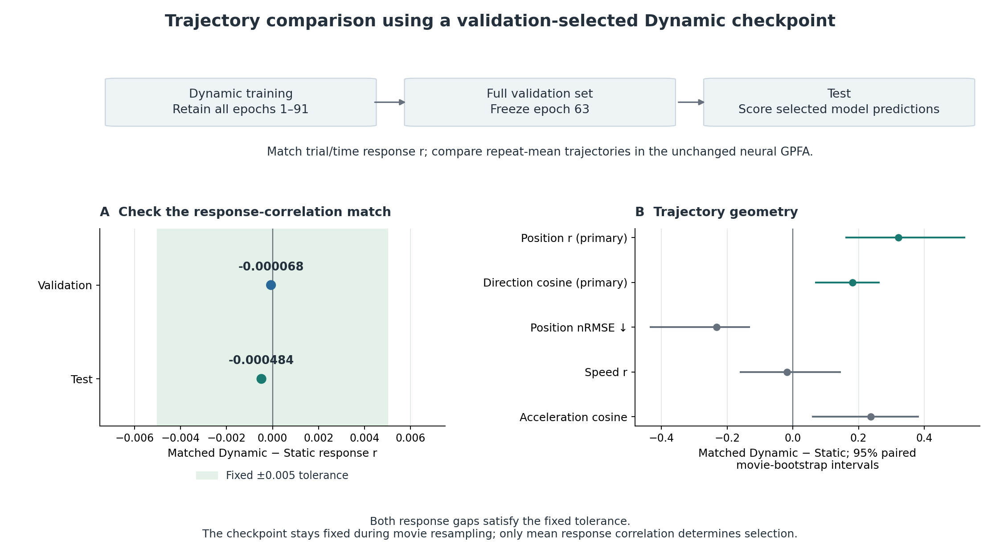

# Response Matching by Dynamic Checkpoint: Setup

## 1. Research question

**When a Dynamic training checkpoint predicts responses about as accurately as the frozen Static model, do its neural trajectories still differ in position and local movement direction?**

The control selects an actual reduced Dynamic checkpoint using validation response correlation. It then evaluates the checkpoint's own predictions on test data. The Static epoch-59 model, the main epoch-109 Dynamic comparison and the neural-data-defined GPFA remain fixed.

The selection rule is recorded in [checkpoint_matching_v1.json](../../../code/sensorium/configs/checkpoint_matching_v1.json). It supersedes the earlier output-noise control. That completed analysis remains in a clearly labelled [historical setup](HISTORICAL_OUTPUT_NOISE_SETUP.md) and [historical results](HISTORICAL_OUTPUT_NOISE_RESULTS.md).

## 2. Candidate checkpoints and data roles

Candidate checkpoints are retained during reduced Dynamic training, using the architecture, seed 42, training split, training-derived preprocessing, optimizer, learning-rate schedule and native stopping policy specified for the main comparison.

The candidate rule retains **every completed epoch from 1 through the earlier of epoch 119 and verified native early stopping**. The original training settings remain `max_iter=200`, `patience=5` and four learning-rate decay cycles. A completed training summary with stop reason `patience_cycles_exhausted` is required to accept fewer than 119 epochs. A pause, interruption or incomplete epoch does not complete the candidate set.

This rule was clarified before any full-pilot checkpoint-matching scores or new test outputs were produced, and its timestamp and provenance are recorded in `protocol_revision.json`. The candidate boundary follows the declared cap and native stopping policy; it is not chosen from pilot matching or test results. Selection waits for the complete contiguous candidate set. The main comparison still uses its original Static epoch 59 and Dynamic epoch 109.

| Data role | Pilot trials | Use |
|---|---:|---|
| Training | 282 | Pilot contribution to the original five-session training protocol; estimate the existing training-only transforms. |
| Validation | 66 | Run every candidate on the full pilot validation set, compare its response score with Static and freeze one checkpoint. |
| Test | 58 | Evaluate the selected checkpoint, check transfer of the response match and compare trajectories on six repeated movies. |

The fixed pilot is `dynamic29515-10-12-Video-9b4f6a1a067fe51e15306b9628efea20`. Stable neuron-ID hashing selects the same 512 neurons as the main analysis. All models use the same original frames 50–299, giving 250 time bins per trial. The validation arrays have shape `[66, 250, 512]`; test arrays have shape `[58, 250, 512]`. Test repeat counts are 9, 9, 10, 10, 10 and 10. The unchanged data definitions are in [Models and Data](../MODELS_AND_DATA.md#3-training-validation-and-test-data).

The checkpoint search uses validation data only. Test responses, trajectory scores and GPFA agreement do not enter checkpoint ranking. The original test movies were explored in earlier project work; the data roles describe the present training and selection procedure.

*The completed run contributes epochs 1–91; validation selects epoch 63. The figure shows the stored validation/test response gaps and all five paired trajectory contrasts.*

## 3. Validation selection

Let $Y_{i,t,n}$ be the recorded response, $P^S_{i,t,n}$ the frozen Static prediction and $P^{D,e}_{i,t,n}$ the prediction from Dynamic epoch $e$. The matching score is

$$
r(Y,P;\mathcal N)=\frac{1}{|\mathcal N|}\sum_{n\in\mathcal N}
\operatorname{corr}\!\left(\operatorname{vec}_{i,t}Y_{i,t,n},
\operatorname{vec}_{i,t}P_{i,t,n}\right).
$$

For each neuron, trial and time samples form the statistical axis of the Pearson correlation. Then the correlations are averaged across neurons. Validation movies need no repeated presentations for this score.

$\mathcal N$ is fixed across the entire candidate comparison: it contains the selected pilot neurons with defined validation correlations for the neural reference, Static and every Dynamic candidate. Undefined correlations remain undefined; they are not replaced by zero. The retained neuron identities and counts are saved. This finite-support rule does not change the 512 neurons used by the GPFA.

For every candidate, calculate

$$
a_{\mathrm{val}}(e)=\left|
 r(Y_{\mathrm{val}},P^{D,e}_{\mathrm{val}};\mathcal N)
-r(Y_{\mathrm{val}},P^S_{\mathrm{val}};\mathcal N)\right|.
$$

Select the smallest absolute gap. Exact ties choose the earlier epoch, then the lexicographically earlier checkpoint SHA-256. Save all candidate scores in `checkpoint_candidates.csv` and the selected identity in `checkpoint_selection.json`. This freeze records the candidate set, model bytes, data support, preprocessing and selection settings before the selected checkpoint is scored on test.

The tolerance is **0.005**. Selection always identifies the closest available candidate; the tolerance separately determines whether its validation gap qualifies as a match. Test uses the same response summary and tolerance:

$$
a_{\mathrm{test}}(e^*)=
\left|r(Y_{\mathrm{test}},P^{D,e^*}_{\mathrm{test}})
-r(Y_{\mathrm{test}},P^S_{\mathrm{test}})\right|\leq0.005.
$$

Test matching retains the validation-selected neuron cohort $\mathcal N$: its response means use the jointly finite test correlations within that cohort and report the retained count; if any cohort neuron has an undefined test correlation, `test_matching_evaluable=false` and no response match is claimed. The GPFA and other metrics retain all 512 neurons.

A failed validation or test match is reported as such. No checkpoint is replaced after inspecting test. Similar mean response correlations do not require equal neuron-by-neuron scores, NMSE or RSA/CKA.

## 4. Shared trajectory measurement

For each test movie $c$, average its trial set $\mathcal T_c$:

$$
\bar P_{c,t,n}=\frac{1}{|\mathcal T_c|}\sum_{i\in\mathcal T_c}P_{i,t,n}.
$$

Apply this operation to recorded responses, Static predictions and the selected Dynamic predictions. Convert each repeat mean from encoder-target units to the existing GPFA input scale:

$$
G(\bar P)_{c,t,n}=\frac{\bar P_{c,t,n}}{e_{t,n}}g_n,
\qquad
 g_n=\frac{1}{\max(s_n^{\mathrm{neural}},\;0.01\operatorname{mean}_j s_j^{\mathrm{neural}})}.
$$

$e_{t,n}$ is the frozen encoder training precision. $s_n^{\mathrm{neural}}$ is the raw neural-response standard deviation over training trials and time, with `ddof=1`; $g_n$ is the frozen GPFA precision. These multiplicative scales come from training data. No response-matching-specific rescaling is fitted.

The same four-dimensional GPFA infers each trajectory using its fixed loadings, offsets, observation covariance and temporal priors. It observes window indices `0, 4, …, 248` and queries all 250 timestamps. The resulting array is `[6 movies, 250 times, 4 latent dimensions]`. The posterior conditions on the full observation window. Details remain in the [trajectory measurement setup](../02_trajectory_measurement/SETUP.md#4-shared-scaling-and-posterior-inference).

| Fixed reference | Identity |
|---|---|
| Static epoch 59 | `3ded37a0fac494f47a8553a432e04e8be7e95a0a99ed9444b07ae61f31ff7052` |
| Main Dynamic epoch 109, for context | `c6eff392ec412494ef69d6e599193711f4b5428862fe57633899280144531954` |
| Main GPFA pickle | `98de0cef99973c8a57b5b44d330763a5cd0fc5ad0cab36654c058591ae6eb52c` |

The separately [frozen matching selection](../evidence/04_model_comparison/checkpoint_matching_v1/checkpoint_selection.json) identifies Dynamic epoch 63, SHA-256 `f8730fc47796c7d6cf7d383f1b0e8ccb9255d5613dba9bd8acd9c3c2b38b310f`. [Model access](../../../models/README.md) describes the local numerical payloads.

## 5. Geometry and other measures

The main geometric comparisons are **position correlation** and **local velocity-direction cosine**. Both compare the selected checkpoint with the same neural trajectory and fixed latent axes used for Static.

| Measure | Calculation | Direction |
|---|---|---|
| Position correlation | Subtract a common per-axis centre pooled across neural and predicted trajectories; flatten the centred arrays and calculate Pearson r. | Higher is better |
| Velocity-direction cosine | Form within-movie first differences divided by $\Delta t=1/30$ s; average corresponding cosines on jointly nonzero support. | Higher is better |
| Normalised position RMSE | Divide $\operatorname{RMS}(Z-\widehat Z)$ by $\operatorname{RMS}(Z-m)$ using the same pair-pooled centre $m$. | Lower is better |
| Speed-profile correlation | Correlate the flattened norms of within-movie velocity vectors. | Higher is better |
| Acceleration-direction cosine | Compare within-movie second differences divided by $\Delta t^2$. | Higher is better |

The last three measures are secondary. Point scores and per-movie results describe the geometry; uncertainty accompanies these comparisons. Response NMSE, condition/time CKA, temporal-difference CKA and time-state RSA remain additional outcomes. Their definitions follow the [main comparison](../03_model_comparison/SETUP.md#5-metrics).

For each trajectory measure $S$, report the paired difference

$$
\Delta_S=S(Z,\widehat Z^{D,e^*})-S(Z,\widehat Z^S).
$$

The 95% interval uses 2,000 seed-42 paired bootstrap draws of six whole movie conditions. Each draw recomputes both pooled trajectory scores on the same sampled movies. The checkpoint and all preprocessing stay fixed. This interval concerns variability across the evaluated movies conditional on the selected model; checkpoint selection and training are not rerun within the bootstrap.

## 6. Records and interpretation

The active control has its own `checkpoint_matching_v1` configuration and result identity. The original `retrained_v1.json` remains the immutable source-run record; its superseded matching fields are not the active selection settings.

The completed [result bundle](../evidence/04_model_comparison/checkpoint_matching_v1/) contains the 91-candidate table, frozen epoch-63 identity, validation/test response gaps, prediction-cache checksums, geometric and conventional metrics, paired trajectory intervals and source checksums. Numerical prediction arrays remain in the separate local bundle. [Results](RESULTS.md) reports the measured outcomes.

If the validation-selected checkpoint also stays within the test response tolerance, the comparison asks whether models with similar mean response correlation produce different latent paths and local directions. The trajectories summarize structure in the same responses. Their value here is the geometric description, with matching limited to the named scalar response score.
