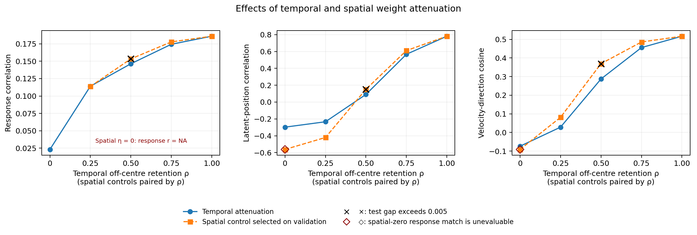

# Temporal-Weight and Spatial-Damage Controls: Results

**Attenuating the selected temporal weights lowers both primary trajectory scores; response-matched spatial controls reveal differences that depend on the metric and intervention strength.** Two nontrivial spatial/temporal pairs retain the response tolerance on test. At temporal retention 0.75, spatial damage has higher position and direction agreement. At temporal retention 0.25, position favours temporal attenuation while direction favours spatial damage. The zero-spatial endpoint is marked numerically degenerate, with response-correlation matching unevaluable.

These findings describe the current reduced Dynamic network under specified weight changes. The results measure within-model weight dependence; explaining the full Static–Dynamic difference requires separate comparisons. The [setup](SETUP.md) defines the interventions, frozen measurement and paired comparisons.

## 1. Completed diagnostic and unchanged baseline

This exploratory diagnostic uses the epoch-109 reduced Dynamic checkpoint and unchanged main four-dimensional GPFA from `retrained_v1`. Calibration uses the existing 66 pilot validation trials; test uses 58 trials from six movies, 512 fixed neurons and original frames 50–299. Settings were fixed after the main outcomes were known and before the diagnostic's own scoring. Encoder parameters, main GPFA parameters and the original output-noise matching amplitude remained fixed. The analysis retains the main GPFA measurement after withdrawal of the auxiliary sensitivity fits.

Temporal retention one reproduces the original Dynamic prediction cache with **maximum absolute error 0.000000**, within the required `rtol=atol=3e-6`. The prediction-identity check establishes the unattenuated point as the current Dynamic baseline. The [manifest](../evidence/04_model_comparison/retrained_v1_diagnostics/encoder/manifest.json) records that check and the unchanged source identities.

All score tables below use the supplementary diagnostic records. Conventional curves are pooled scores; conventional paired intervals have a different, equal-weight movie-mean target. Reported contrasts retain the stored difference fields at their original precision.

*Temporal retention is the horizontal coordinate. Blue circles show temporal attenuation; orange squares place each selected spatial control at its corresponding temporal target. Black crosses mark failed test matching. Zero-spatial response r is NA; red outlines identify descriptive trajectory values at that unevaluable matching endpoint. The figure shows pooled point estimates; the tables report paired intervals for the corresponding statistical targets.*

## 2. Temporal attenuation reduces primary trajectory agreement

Temporal retention scales every off-centre slice of the three temporal convolutions. Centre slices and unspecified parameters remain fixed. Lower retention means stronger attenuation.

| Temporal retention $\rho$ | Response r | Position r | Velocity-direction cosine | Normalised position RMSE ↓ | Speed r | Acceleration-direction cosine |
| --- | --- | --- | --- | --- | --- | --- |
| 1.00 | 0.185953 | 0.781569 | 0.516995 | 0.647897 | 0.555709 | 0.428879 |
| 0.75 | 0.174370 | 0.566947 | 0.455918 | 0.837851 | 0.516519 | 0.382467 |
| 0.50 | 0.146333 | 0.090223 | 0.287251 | 1.026567 | 0.286824 | 0.251264 |
| 0.25 | 0.114054 | -0.233935 | 0.028543 | 1.120636 | -0.025197 | 0.040545 |
| 0.00 | 0.023153 | -0.297912 | -0.073768 | 1.137800 | -0.016551 | -0.046115 |

Both primary scores and response r decline at every stronger temporal attenuation level. Temporal zero is still a modified Dynamic network, distinct from the separately trained Static model.

The stored primary contrasts compare each attenuated level with retention one:

| Temporal retention $\rho$ | Primary metric | Stored attenuated − baseline | 95% paired interval |
| --- | --- | --- | --- |
| 0.75 | Position correlation | -0.214622 | [-0.312915, -0.158106] |
| 0.75 | Velocity-direction cosine | -0.061077 | [-0.090714, -0.033147] |
| 0.50 | Position correlation | -0.691346 | [-0.837157, -0.601864] |
| 0.50 | Velocity-direction cosine | -0.229745 | [-0.295252, -0.172581] |
| 0.25 | Position correlation | -1.015504 | [-1.125888, -0.970161] |
| 0.25 | Velocity-direction cosine | -0.488452 | [-0.595233, -0.385670] |
| 0.00 | Position correlation | -1.079481 | [-1.186350, -1.023397] |
| 0.00 | Velocity-direction cosine | -0.590763 | [-0.711812, -0.466458] |

All eight primary baseline contrasts have intervals below zero. The intervals assess each level against baseline; the ordering of adjacent levels is descriptive.

Normalised position RMSE rises as attenuation increases. Acceleration-direction correspondence declines. **Speed shows an endpoint increase:** its correlation rises from −0.025197 at retention 0.25 to −0.016551 at zero. This increase interrupts the otherwise decreasing speed curve.

The other pooled response and time-aware representation scores are:

| Temporal retention $\rho$ | Response NMSE ↓ | Condition/time CKA | Temporal-difference CKA | Condition/time-state RSA |
| --- | --- | --- | --- | --- |
| 1.00 | 0.962457 | 0.510811 | 0.093155 | 0.544941 |
| 0.75 | 0.980549 | 0.476297 | 0.079487 | 0.399562 |
| 0.50 | 0.997295 | 0.379713 | 0.061086 | 0.222346 |
| 0.25 | 1.004360 | 0.290534 | 0.040419 | 0.140605 |
| 0.00 | 1.005934 | 0.159345 | 0.016608 | 0.122955 |

Response NMSE increases, while the two CKA scores and time-state RSA decrease at the recorded levels. Temporal attenuation therefore affects general response prediction and time-aware response summaries as well as GPFA trajectories. The trajectory changes occur alongside general predictive degradation, which remains a possible contributor.

Sources: [intervention scores](../evidence/04_model_comparison/retrained_v1_diagnostics/encoder/intervention_scores.csv), `kind=temporal`; [paired intervals](../evidence/04_model_comparison/retrained_v1_diagnostics/encoder/paired_intervals.csv), `comparison=temporal_minus_baseline`, primary metrics. Correlations, cosines and CKA are higher-is-better; normalised errors marked ↓ are lower-is-better.

## 3. Spatial matching transfers at two nontrivial levels

Spatial damage multiplies only the first spatial-convolution weight tensor, including its video and two appended-behaviour channels. For each temporal level, the original calibration chose the nearest pooled validation response r from a 21-point spatial-retention grid, with ties favouring higher spatial retention. The tolerance is **0.005**. Those choices remained fixed through test scoring and the subsequent identification of numerical degeneration at spatial zero.

### Validation selection and corrected display status

| Temporal retention $\rho$ | Selected spatial retention $\eta$ | Validation temporal r | Validation spatial r | Current validation status |
| --- | --- | --- | --- | --- |
| 1.00 | 1.00 | 0.184211 | 0.184211 | `matched` |
| 0.75 | 0.65 | 0.168335 | 0.169841 | `matched` |
| 0.50 | 0.35 | 0.140189 | 0.142048 | `matched` |
| 0.25 | 0.10 | 0.105852 | 0.108258 | `matched` |
| 0.00 | 0.00 | 0.010321 | NA | `not_evaluable` |

These are the current corrected validation display columns. Original calibration values and choices remain in the source records. The zero-spatial endpoint is now `not_evaluable`, identifying numerical degeneration separately from an ordinary tolerance failure. This correction retains the original calibration.

### Transfer to test without retuning

| Temporal retention $\rho$ | Spatial retention $\eta$ | Test temporal r | Test spatial r | Stored spatial − temporal r | Test status |
| --- | --- | --- | --- | --- | --- |
| 1.00 | 1.00 | 0.185953 | 0.185953 | 0.000000 | `matched` |
| 0.75 | 0.65 | 0.174370 | 0.177786 | 0.003416 | `matched` |
| 0.50 | 0.35 | 0.146333 | 0.153357 | 0.007024 | `outside_tolerance` |
| 0.25 | 0.10 | 0.114054 | 0.113697 | -0.000357 | `matched` |
| 0.00 | 0.00 | 0.023153 | NA | NA | `not_evaluable` |

**Temporal 0.75 / spatial 0.65** and **temporal 0.25 / spatial 0.10** are the two nontrivial test-matched pairs. Retention one is the unchanged baseline.

The 0.50/0.35 pair fails transfer (gap **0.007024**). It remains in the results as a failed match, with the original selection preserved.

Spatial retention zero retains an undefined scientific response r and matching gap. Temporal zero retains its own valid 512-neuron response summary, **0.023153**, rather than the former 436-neuron paired-support calculation. Section 6 separates that endpoint from ordinary low-scoring predictions.

The [matching record](../evidence/04_model_comparison/retrained_v1_diagnostics/encoder/spatial_response_matches.csv) supplies the selected strengths, corrected validation values, stored test gaps and explicit statuses. The last digit of a stored gap can differ from subtraction of the displayed six-decimal scores. The displayed status retains the original full-precision gap and frozen matching rule.

## 4. Valid matched pairs give level-dependent trajectory differences

All contrasts in this section are **spatial damage minus temporal attenuation**. Each intervention is scored against the unchanged neural reference through the same frozen GPFA. Positive differences favour spatial damage for correlations and direction cosines; negative differences favour spatial damage for normalised position RMSE.

Points and intervals concern pooled condition-average trajectories. Each of the ten trajectory rows below has **2,000 valid and zero undefined bootstrap draws**, using seed-42 paired resampling of six whole movie conditions. These draws describe resampling of the observed movies conditional on the fixed interventions.

### Temporal 0.75 versus spatial 0.65

| Trajectory metric | Temporal point | Spatial point | Stored spatial − temporal | 95% paired interval |
| --- | --- | --- | --- | --- |
| Position correlation | 0.566947 | 0.611152 | 0.044205 | [0.015162, 0.094037] |
| Velocity-direction cosine | 0.455918 | 0.485941 | 0.030023 | [0.010406, 0.048774] |
| Normalised position RMSE ↓ | 0.837851 | 0.795946 | -0.041905 | [-0.061941, -0.023397] |
| Speed-profile correlation | 0.516519 | 0.518671 | 0.002152 | [-0.016728, 0.036557] |
| Acceleration-direction cosine | 0.382467 | 0.402484 | 0.020017 | [0.001503, 0.037249] |

At 0.75/0.65, spatial damage retains better primary scores, lower position error and higher acceleration correspondence; speed remains unresolved.

This ordering characterises the two fixed interventions at this matched level; broader temporal specificity requires additional intervention comparisons.

### Temporal 0.25 versus spatial 0.10

| Trajectory metric | Temporal point | Spatial point | Stored spatial − temporal | 95% paired interval |
| --- | --- | --- | --- | --- |
| Position correlation | -0.233935 | -0.420605 | -0.186670 | [-0.224222, -0.148536] |
| Velocity-direction cosine | 0.028543 | 0.081219 | 0.052676 | [0.033825, 0.071527] |
| Normalised position RMSE ↓ | 1.120636 | 1.339892 | 0.219255 | [0.155303, 0.303464] |
| Speed-profile correlation | -0.025197 | 0.053094 | 0.078291 | [-0.034420, 0.215435] |
| Acceleration-direction cosine | 0.040545 | 0.071956 | 0.031411 | [0.008250, 0.051894] |

At 0.25/0.10, **position and position error favour temporal attenuation; direction and acceleration favour spatial damage**. Speed remains unresolved.

Across the valid levels, the ordering depends on the trajectory property being measured.

Position denotes state in the GPFA latent coordinates. Normalised RMSE retains the pair-dependent centre and denominator defined in [Setup](SETUP.md#6-fixed-inference-and-metric-definitions). The metric-specific differences describe separate aspects of the intervention response.

Source: [paired intervals](../evidence/04_model_comparison/retrained_v1_diagnostics/encoder/paired_intervals.csv), `comparison=spatial_minus_temporal`, temporal retention 0.75 or 0.25 and `estimand=pooled trajectory`.

## 5. Response properties beyond the pooled correlation match

The response tolerance in Section 3 applies to a pooled trial/time mean per-neuron correlation. The conventional paired tables below instead score each movie and average the six movie scores equally. They therefore have different point estimates from the pooled curves and matching table. Their intervals quantify the equal-weight movie-mean contrasts.

### Temporal 0.75 versus spatial 0.65: conventional movie means

| Conventional metric | Temporal condition mean | Spatial condition mean | Stored spatial − temporal | 95% paired interval |
| --- | --- | --- | --- | --- |
| Mean per-neuron response r | 0.126015 | 0.127157 | 0.001142 | [0.000349, 0.001803] |
| Response NMSE ↓ | 0.980833 | 0.977970 | -0.002862 | [-0.005758, 0.000921] |
| Condition/time CKA | 0.571252 | 0.579669 | 0.008418 | [0.000598, 0.016239] |
| Temporal-difference CKA | 0.185266 | 0.189828 | 0.004561 | [-0.005235, 0.013919] |
| Condition/time-state RSA | 0.561102 | 0.562553 | 0.001451 | [-0.007925, 0.010471] |

The mean-condition response-r difference and condition/time CKA difference have intervals above zero. NMSE, temporal-difference CKA and time-state RSA intervals include zero. A small but resolved movie-mean response difference is compatible with the pooled response scores meeting an absolute tolerance; the protocol required a fixed absolute tolerance rather than statistical equivalence.

### Temporal 0.25 versus spatial 0.10: conventional movie means

| Conventional metric | Temporal condition mean | Spatial condition mean | Stored spatial − temporal | 95% paired interval |
| --- | --- | --- | --- | --- |
| Mean per-neuron response r | 0.087010 | 0.088015 | 0.001005 | [-0.003742, 0.005751] |
| Response NMSE ↓ | 1.003979 | 1.038701 | 0.034722 | [0.022598, 0.050114] |
| Condition/time CKA | 0.474654 | 0.456529 | -0.018125 | [-0.046401, 0.005767] |
| Temporal-difference CKA | 0.147445 | 0.136272 | -0.011173 | [-0.038400, 0.012377] |
| Condition/time-state RSA | 0.432668 | 0.374522 | -0.058146 | [-0.097600, -0.007681] |

At this level, spatial damage has higher response NMSE and lower time-state RSA, with intervals excluding zero. The response-r and both CKA intervals include zero. The two interventions therefore remain different in response properties beyond the matching target, even when their pooled response-r gap is small.

Each of these ten conventional rows has **2,000 valid and zero undefined draws**. Together with the ten trajectory rows, these are all 20 saved contrasts for the two valid nontrivial pairs. The bootstrap keeps calibration fixed, so the intervals are conditional on the recorded intervention choices.

Source: [paired intervals](../evidence/04_model_comparison/retrained_v1_diagnostics/encoder/paired_intervals.csv), `comparison=spatial_minus_temporal` and `estimand=condition mean`; [paired condition scores](../evidence/04_model_comparison/retrained_v1_diagnostics/encoder/paired_condition_scores.csv) preserve the per-movie conventional values. Every difference uses its stored field rather than rounded-value subtraction.

## 6. Zero spatial weights produce an unevaluable correlation endpoint

At spatial retention zero, the targeted first spatial tensor has zero norm. The cached predictions contain **76 exactly constant neurons and 436 outputs at the floating-point floor** in both validation and test. The maximum recorded range is `9.5367431640625e-7`. The source identifies these fluctuations as numerical residuals at the output precision floor.

The raw mean correlations, `5.0589942800534345e-5` on validation and `0.0002465044812912135` on test, remain diagnostic fields. Their role is numerical diagnosis rather than scientific response scoring. The scientific response correlation and matching gaps are **`NA`**; the endpoint status is **`not_evaluable`**. Response-pair interval records have zero scientifically valid draws, so the matching interval is unevaluable.

This distinction matters: a near-zero correlation from a normally varying prediction would be a low score, whereas this endpoint has no numerically meaningful response variation on which to base the intended correlation comparison. The remaining tiny fluctuations retain the same numerical-floor limitation after exact constants are removed. The correction is specific to this endpoint's saved ranges and exact weight intervention; it imposes no general cutoff on small-amplitude signals.

All recorded zero-spatial endpoint metrics

| Metric | Recorded value | Recorded response-status field |
| --- | --- | --- |
| Position correlation | -0.562472 | `not_applicable` |
| Normalised position RMSE ↓ | 1.415777 | `not_applicable` |
| Velocity-direction cosine | -0.091182 | `not_applicable` |
| Speed-profile correlation | -0.032441 | `not_applicable` |
| Acceleration-direction cosine | -0.066650 | `not_applicable` |
| Mean per-neuron response r | NA | `numerically_degenerate` |
| Response NMSE ↓ | 1.043424 | `not_applicable` |
| Condition/time CKA | 0.000001 | `not_applicable` |
| Temporal-difference CKA | 0.012824 | `not_applicable` |
| Condition/time-state RSA | NA | `not_applicable` |

The last column preserves the source's **response-status field**. `not_applicable` refers to the response-status field on other metrics; response matching remains unevaluable. Finite trajectory, CKA and error values are retained as descriptive endpoint records, separately from response-matching validity. Time-state RSA is also `NA`. Undefined values retain their missing-value status.

Temporal retention zero keeps its standalone 512-neuron response score. Its earlier 436-neuron paired value remains a diagnostic record, separate from the current standalone scientific score. Other strengths and normal-model values are recorded as unchanged. The endpoint correction preserves the original validation calibration and selected strengths.

Sources: [numerical support](../evidence/04_model_comparison/retrained_v1_diagnostics/encoder/response_numeric_support.csv), [intervention scores](../evidence/04_model_comparison/retrained_v1_diagnostics/encoder/intervention_scores.csv), `intervention=spatial_0.00`, and [correction provenance](../evidence/04_model_comparison/retrained_v1_diagnostics/encoder/manifest.json). Raw and original calculation fields are separate from the current scientific values and statuses.

## 7. Interpretation and scope

The baseline identity check and the negative primary contrasts support dependence of this trained network's trajectory agreement on the selected temporal weights. Response r falls at the same time, so general predictive degradation accompanies that effect. Separating temporal-specific dependence from general degradation motivates the matched spatial comparison.

The spatial control compares two test-matched levels while allowing differences in the full outputs, other response summaries and affected pathways. At retention 0.75, spatial damage preserves higher primary scores. At retention 0.25, position and direction favour different interventions. The ordering varies across the measured trajectory properties and intervention levels.

The interventions are structurally different. Temporal attenuation acts on 23,040 eligible off-centre entries across three temporal layers; spatial damage scales 5,808 entries in the first spatial convolution, including weights on appended behaviour. Their distinct locations and weight counts can produce different changes in prediction statistics and internal processing. Temporal zero also retains visual and appended-behaviour information at $t-9$ and current pupil shifting; it therefore remains a delayed-input Dynamic intervention, distinct from the current-frame Static architecture.

The evidence is limited to one reduced Dynamic checkpoint, one fixed neuron selection, six test movies in one session and one spatial-damage design. A temporal algorithm, neural causal mechanism or generalisation across intervention families would require additional targeted tests. The GPFA is a fixed offline measurement; its [repeat reliability and limited response coverage](../02_trajectory_measurement/RESULTS.md) remain part of the interpretation. These supplementary settings were specified after the primary outcomes were known, making this an exploratory model diagnostic.

The two primary scores depend on the temporal weights, and valid response-matched controls reveal metric-dependent differences. One transfer fails, and one endpoint is unevaluable. These distinct outcomes define the evidence from the tested interventions. This diagnostic complements the [main model comparison](../03_model_comparison/RESULTS.md) and the separate [output-noise matching result](../05_response_matching/RESULTS.md).

## 8. Result records

| Record | Content used here |
|---|---|
| [Intervention scores](../evidence/04_model_comparison/retrained_v1_diagnostics/encoder/intervention_scores.csv) | `kind=temporal` for the five-level curves; `intervention=spatial_0.00` for the endpoint; `metric`, `value`, support and status/raw fields |
| [Condition scores](../evidence/04_model_comparison/retrained_v1_diagnostics/encoder/condition_scores.csv) | Per-condition intervention records for all six movie IDs |
| [Paired intervals](../evidence/04_model_comparison/retrained_v1_diagnostics/encoder/paired_intervals.csv) | `comparison=temporal_minus_baseline` for primary losses; `comparison=spatial_minus_temporal` at temporal retention 0.75/0.25 for valid matched contrasts; `a`, `b`, `b_minus_a`, `ci_low`, `ci_high`, `estimand` and valid/undefined counts |
| [Paired condition scores](../evidence/04_model_comparison/retrained_v1_diagnostics/encoder/paired_condition_scores.csv) | Movie-level conventional points underlying the equal-weight paired intervals |
| [Spatial matching records](../evidence/04_model_comparison/retrained_v1_diagnostics/encoder/spatial_response_matches.csv) | Original frozen choices, corrected validation display, test scores and gaps, explicit matching statuses; original/raw fields are provenance |
| [Numerical support](../evidence/04_model_comparison/retrained_v1_diagnostics/encoder/response_numeric_support.csv) | Constant-output counts, float32-floor ranges and scientific endpoint validity |
| [Manifest](../evidence/04_model_comparison/retrained_v1_diagnostics/encoder/manifest.json) | Baseline prediction error zero, source identities and zero-spatial endpoint correction |

[Setup](SETUP.md#8-source-records-and-interpretation-scope) links the fixed configuration, exact weight tensors, time support and implementation functions. The current records cover the specified checkpoint, neuron selection and intervention family; replication across these choices remains a future extension. The retention-0.50 mismatch and zero-spatial endpoint retain their original selection and respective unmatched and unevaluable statuses.
